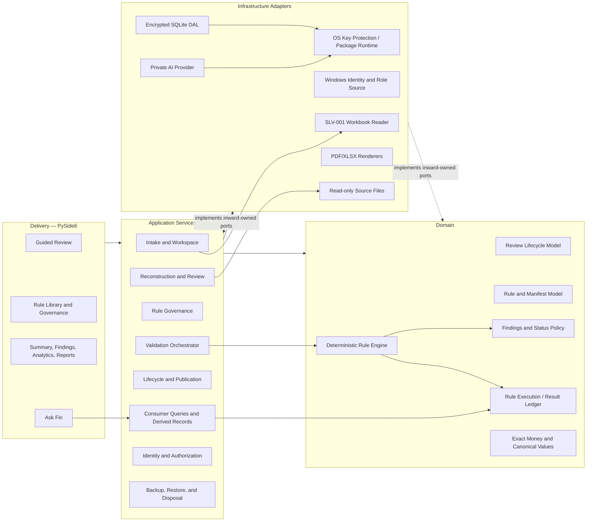
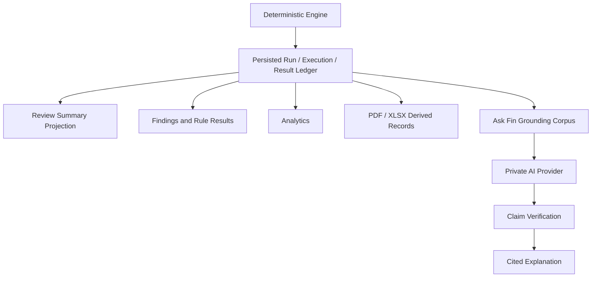

# FinSight Configurable Rule Engine V2 — Draft Application Architecture

- **Status:** Draft — architecture proposal; not approved or baselined
- **Initiative:** `configurable-rule-engine-v2`
- **Product boundary:** One FinSight product, repository, application, and codebase
- **Requirements authority:** FR-123–FR-203 and NFR-081–NFR-110 at the hashes recorded in `../requirements/REQUIREMENTS-PHASE-COMPLETION-2026-07-27.md`
- **Inherited authority:** Root FinSight Constitution, approved root requirements, and accepted ADRs, subject only to the explicit proposed reconciliations in §2
- **Workflow authority:** WF-01–WF-11 in `FINANCIAL-REVIEW-WORKFLOW.md`
- **Implementation authorization:** **None**
- **ADR effect:** Every new or amended architecture decision described here remains **Proposed** until reviewed and approved as part of the complete Architecture package. This document does not silently amend an accepted ADR.

## 1. Purpose, scope, and architecture principles

This document defines the proposed V2 application architecture needed to turn the existing FinSight desktop application into a configurable financial-validation platform. It covers component boundaries, dependencies, application contracts, identity and authorization, deterministic validation, lifecycle and publication, persistence interactions, source reconstruction, reporting and AI boundaries, Windows distribution, operational qualities, and implementation seams.

It does not define the detailed physical persistence schema, the complete rule-definition serialization, final UX layouts, or an implementation plan. Those are separate gated architecture artifacts. It does not authorize source-code, test, migration, packaging, or production-data changes.

### 1.1 Binding outcomes carried from Requirements

The architecture must preserve these outcomes:

1. The configurable deterministic rule engine is the sole source of financial-validation truth.
2. Core Mandatory, Optional Configurable, and Informational/Advisory rules use one engine, versioning model, execution contract, and result ledger.
3. The five Core Mandatory rules are protected baseline controls. Their evolution uses immutable successors and two-person governance.
4. Source Budget and GED files are immutable. FinSight persists source identity and review actions, not workbook bytes or complete reconstructed row stores.
5. The engine accepts only one fingerprint-verified reconstructed `VerifiedDataset` for one sealed Review Version.
6. A Review Version owns zero Validation Runs before validation starts and one stable authoritative Run identity thereafter; only a completion-sealed run owns an authoritative Rule Execution and Rule Result ledger.
7. Review Summary, Findings, Rule Results, Analytics, Reports, Exports, and Ask Fin consume the recorded engine ledger. They do not recalculate validation independently.
8. The product supports any department represented by the approved Budget/GED source contract. Sample department and period values are never product constants.
9. The MVP is machine-local and offline-capable, with sequential use by authenticated actors, versioned roles, and an encrypted shared local store.
10. AI is optional, read-only, private/on-device only, and never controls financial results, data, rules, findings, severity, approvals, or financial actions.
11. PySide6 remains the desktop delivery technology.
12. A qualified signed Windows executable and installer are release requirements.

### 1.2 Proposed top-level decisions

| Decision | Proposed architecture |
|---|---|
| Application style | In-process Python modular monolith with enforced inward dependencies |
| Desktop delivery | Existing PySide6 application retained |
| Deterministic core | Headless domain/application modules using exact `Decimal` arithmetic |
| Persistence | Encrypted SQLite/SQLCipher behind repository ports; authoritative records only |
| User model | Sequential multi-actor use on one machine; one application instance per store |
| Default identity | Authenticated Windows account, keyed by Windows SID |
| Authorization | Versioned role-assignment snapshots plus deny-first separation-of-duties policy |
| Source handling | Read-only `.xlsx` access, source-byte fingerprints, `SLV-001` readers, in-process reconstruction |
| Rule extension | Data-defined rules using allowlisted evaluator families; no user-authored executable code |
| Run persistence | One run identity per Review Version; result ledger committed atomically |
| Trusted result | Explicit published Review Version; working successors cannot silently replace it |
| Derived outputs | Append-only Derived Records linked to one Review Version and Validation Run |
| AI | Read-only grounding adapter over selected ledger evidence; deny by default |
| Packaging | Proposed PyInstaller `onedir` application plus WiX Toolset MSI for Windows |

### 1.3 Non-goals for the V2 MVP

- A second repository, parallel `finsight_v2` package, or separately deployed application.
- A remote application server, browser client, shared network database, or concurrent collaboration.
- Persisting source workbook bytes, normalized workbook rows, complete Working Datasets, or complete `VerifiedDataset` row stores.
- Executing workbook macros, external links, or workbook formulas.
- Arbitrary Python, SQL, scripts, macros, loops, recursion, system commands, or unrestricted expressions in rule definitions.
- Fuzzy duplicate detection, enterprise-wide accounting policy, additional source layouts, or department-specific finance semantics.
- AI-generated validation, severity, findings, approvals, rules, corrections, or financial actions.
- Silent migration of the 57 preserved legacy rules into the V2 active catalog.

## 2. Existing ADR reconciliation and proposed ADR work

### 2.1 Inherited decisions retained

| Existing ADR | V2 treatment |
|---|---|
| ADR-002 — Layering, Ports & Dependency Rules | Retained. Delivery calls application services; domain imports no delivery, infrastructure, storage, or AI provider types; infrastructure implements inward-owned ports. |
| ADR-003 — Exact Decimal Arithmetic & Determinism | Retained. Financial parsing and calculation use exact `Decimal`, explicit formats, stable order, injected time, and canonical serialization. |
| ADR-005 — Audit Event Architecture | Retained and extended by proposal. Audit remains append-only, versioned, distinct from diagnostics, and emitted through an inward-owned port. V2 adds stable identity, authorization-decision, access, governance, disposal, and Derived Record events. |
| ADR-007 — Findings Domain Model | Retained conceptually. Findings remain deterministic projections of failed control results and never replace the complete Rule Result ledger. |
| ADR-008 — Desktop UI Stack: PySide6 | Retained without reopening. V2 extends the existing in-process PySide6 delivery ring. No Tauri/Electron sidecar or local IPC layer is introduced. |
| ADR-011 — Review Lifecycle and Generation Model | Retained with one narrow V2 refinement required by FR-171/FR-172: supersession freezes the generation's financial, verification, run/result, and publication facts, but an authorized later historical report/export may append the one remaining `SUMMARIZED` → `EXPORTED` artifact-state event. ReviewCycle, Working Candidate, ReviewGeneration, one-run ownership, the ordered analytical progression, working/published pointers, reason-specific successors, and atomic promotion otherwise remain authoritative. |
| ADR-012 — Source Binding and Working-Set Reconstruction | Retained. Paths are hints, source fingerprints are identity, and reconstructed datasets are released only after fingerprint verification. |
| ADR-014 — Review Abandonment and Retention | Retained. `Active`/`Abandoned` is orthogonal, explicit, audited, and non-destructive; age causes reminders only. |
| ADR-015 — Immutable Export and Report Identity | Retained and generalized to every Derived Record. Every artifact identifies exactly one Review Version/ReviewGeneration and Validation Run; the first successfully completed report/export advances that generation to `EXPORTED` without changing publication state. |

ADR-001's Python-core direction remains valid, but its Tauri/Electron shell and sidecar sections stay superseded by ADR-008.

### 2.2 Proposed reconciliation of ADR-004 and ADR-006

ADR-004 and ADR-006 contain earlier language that says extracted records and the complete `VerifiedDataset` are persisted. Later ADR-011/ADR-012 and V2 NFR-110 establish the more specific authoritative-only reconstruction contract.

The proposed V2 interpretation is:

- SQLite remains the authoritative local repository technology behind the DAL.
- SQLite persists source bindings and fingerprints; extractor versions; correction, reversion, confirmation, and verification-basis records; ReviewCycle/Working Candidate/ReviewGeneration metadata; rules, configurations, manifests, approvals, runs, executions, results, findings, lifecycle, publication, Derived Records, authorization, audit, backup, and disposal records.
- SQLite does **not** persist source workbook bytes, the complete normalized row population, the complete Working Dataset, or the complete `VerifiedDataset`.
- The V2 realization of ADR-006's `VerifiedDataset` is a frozen in-memory value produced only by successful reconstruction and fingerprint verification from the authoritative basis.
- Reports, exports, and Ask Fin responses may be retained as encrypted Derived Record content; they are not normalized source-row stores.
- SQLCipher encryption becomes required before V2 can process non-synthetic financial data. The earlier deferred at-rest decision is no longer sufficient for the V2 operating model.

Approval of ADR-V2-003 as part of this Architecture package formally records this refinement of ADR-004/ADR-006 before implementation.

### 2.3 ADR-013 is partially superseded

The following ADR-013 decisions remain:

- machine-local desktop deployment;
- one application instance per database/store;
- embedded SQLite rather than a database server;
- no concurrent collaboration or shared database across machines;
- deterministic review remains complete with no AI provider;
- Ask Fin degrades to unavailable without affecting validation.

The following ADR-013 decisions are superseded by the approved V2 requirements and require a formal amendment:

- the fixed actor `local-user`;
- no login/identity boundary;
- no authorization or permissions;
- exactly one reviewer identity per installation;
- synthetic-only operation as a permanent scope.

The proposed replacement is **sequential multi-actor, machine-local use**. Different authenticated Windows users may use the same encrypted FinSight store at different times. Every protected access and action is identity-resolved, authorized, and audited. The store still has one active process/writer and is not a collaboration server.

### 2.4 Proposed V2 ADR set

The following records have been drafted and must be approved with the complete Architecture package. Their status remains **Proposed**:

| Proposed ADR | Decision topics bound |
|---|---|
| [ADR-V2-001](../adr/ADR-V2-001-configurable-deterministic-rule-engine.md) | Rule definitions/manifests, controlled evaluators, deterministic serialization, complete ledger, and replay |
| [ADR-V2-002](../adr/ADR-V2-002-sequential-multi-actor-local-governance.md) | Replaceable identity, signed role-assignment source, authorization, and sequential multi-actor use |
| [ADR-V2-003](../adr/ADR-V2-003-encrypted-authoritative-persistence-and-recovery.md) | Authoritative-only SQLCipher persistence, atomic runs, audit tamper evidence, backup/recovery, and disposal |
| [ADR-V2-004](../adr/ADR-V2-004-windows-packaging-and-support.md) | Windows executable/MSI, signing, support matrix, upgrade, and uninstall |
| [ADR-V2-005](../adr/ADR-V2-005-private-engine-bound-ai.md) | Private Ask Fin provider, egress/context allowlists, and claim verification |
| [ADR-V2-006](../adr/ADR-V2-006-slv001-workbook-safety-profile.md) | Exact `SLV-001` source reader and `WRL-001` workbook-safety/resource profile |
| [ADR-V2-007](../adr/ADR-V2-007-ledger-consumers-and-derived-records.md) | Ledger-only downstream consumers, summary-first behavior, reports/exports, and Derived Records |

ADR-002 and ADR-008 already bind the modular-monolith dependency direction and PySide6 delivery stack, so no duplicate V2 ADR is created for those retained decisions.

## 3. Existing implementation: reuse, gaps, and constraints

The proposal extends the current codebase. It does not assume that the existing behavior already satisfies V2.

| Existing area | Reuse | V2 gap / required seam |
|---|---|---|
| `src/finsight/app.py` | Keep as the single composition root. | Wire identity, authorization, source/reconstruction, rule catalog, engine, ledger, publication, Derived Record, encryption, backup, and disposal adapters only here. |
| `src/finsight/domain/money.py` | Reuse exact-decimal value behavior. | Expand conformance coverage to every rule operand, aggregate, persisted amount, and canonical result serialization. |
| `src/finsight/domain/verified_dataset.py` | Reuse the gate concept and frozen value. | Replace the account-only aggregate shape with the complete V2 Budget/GED row projection and lineage; construction must follow AC-01. |
| `src/finsight/domain/rules.py` and `src/finsight/application/validation.py` | Reuse deterministic rule boundaries where compatible. | Replace the fixed single-threshold path with controlled definitions, scope enumeration, dependencies, all three classifications, one execution per selected rule, and a complete result ledger. |
| `src/finsight/infrastructure/readers.py` | Reuse openpyxl integration patterns only. | Implement exact `SLV-001`: Budget BGT in C, GED header row 7/body row 8, all 15 GED fields, row classification, metadata evidence, formulas plus stored results, and safety preflight. |
| `src/finsight/application/normalization.py` | Reuse explicit normalization style. | Preserve department, journal/date, all GED fields, row type, raw scalar, formula/stored value, and cell lineage; do not quarantine malformed GED transaction rows away from CORE-04. |
| `src/finsight/application/review_working_set.py` and `reconstruction.py` | Reuse cycle-keyed reconstruction/cache concept. | Add Working Candidate correction-basis replay, extractor pinning, complete Current Validation Value projection, verified fingerprint comparison, bounded cache, and recovery receipts. |
| `src/finsight/domain/review_cycle.py`, `src/finsight/application/transition_engine.py`, and lifecycle repositories | Reuse ReviewCycle, generation, publication, supersession, and transition patterns. | Add the seven Review Status values, candidate/version boundary, reason-specific reruns, exact replay events, distinct operational/analytical/publication/disposition projections, and role checks. |
| `src/finsight/infrastructure/persistence.py` and `infrastructure/migrations/` | Reuse repository/DAL and transactional migration patterns. | Add encrypted storage, append-only V2 entities, immutable manifests, authorization, ledger, Derived Records, backup/disposal metadata, constraints, and transaction guards. Do not use `INSERT OR REPLACE` for historical evidence. |
| `src/finsight/infrastructure/audit.py` | Reuse the audit-port boundary. | Add provider-qualified Actor ID, authorization decision/version, correlation ID, schema version, resource scope, event fingerprint, and proposed tamper-evident chaining. Audit data access as well as mutation. |
| `src/finsight/application/reporting.py`, `export.py`, and desktop findings export | Reuse rendering/file-delivery seams. | Make every validation statement consume ledger read models; create append-only Derived Records; retain exact content fingerprint and full identity; generate PDF plus a first-release XLSX evidence workbook. |
| `src/finsight/application/ai/` and `infrastructure/ai/` | Reuse provider abstraction, masking, citations, Null provider, and AI-off behavior. | Ground on one selected persisted ledger and reconstructed minimal evidence, enforce private endpoint allowlisting, atomic claim verification, versioned context allowlist, and no mutable capabilities. |
| `src/finsight/delivery/desktop/` | Reuse PySide6 shell, async worker, models, views, theme, and controller patterns. | Extend to WF-01–WF-11, summary-first navigation, Rule Library/Results/Analytics/Reports, identity/publication labels, three-value review, RBAC, and protected-governance flows. |
| `docs/DISTRIBUTION.md` and current package metadata | Reuse dependency pinning and build-provenance concepts. | Wheel/zipapp and locally generated macOS artifacts are insufficient; add reproducible Windows executable/MSI, signature, checksum, SBOM/dependency manifest, upgrade/uninstall, and clean-machine evidence. |

The current import-linter boundary and domain/application/infrastructure/delivery package structure are architectural assets and remain mandatory. Bytecode-only or ignored local artifacts are not source and are not reusable implementation.

## 4. Proposed modular-monolith architecture



The diagram shows runtime collaboration, not source-code dependency from application/domain to infrastructure. Interfaces are owned inward; concrete adapters are selected only in `src/finsight/app.py`.

### 4.1 Dependency rules

1. `domain` imports Python standard-library/domain modules only. It imports no PySide6, SQLite/SQLCipher, openpyxl, filesystem adapter, Windows API, renderer, or AI provider type.
2. `application` depends on domain types and application-owned ports. It contains use-case orchestration, authorization calls, and transaction boundaries, but no SQL, workbook parsing, UI widgets, or provider HTTP.
3. `infrastructure` implements source, repository, identity, encryption, rendering, filesystem, AI, clock, and ID ports.
4. `delivery` calls application commands and queries. It never executes SQL, creates repositories, parses workbooks, compiles rule logic, or recalculates validation.
5. Only the composition root constructs concrete collaborators.
6. AI delivery/application modules receive query-only grounding contracts. They never receive rule, result, finding, correction, governance, publication, or approval command ports.
7. Report, export, dashboard, analytics, and Ask Fin modules receive ledger-derived read models, not raw rule evaluators.
8. Static import fitness tests and composition-root tests enforce these rules before implementation can be accepted.

### 4.2 Component responsibilities

| Component | Responsibilities | Explicit exclusions |
|---|---|---|
| Desktop Shell | Window lifecycle, navigation, keyboard/accessibility, async operation display, identity/publication context | Business calculations, direct persistence, source parsing |
| Guided Review Presenter | WF-01–WF-11 projection, status gates, three-value field presentation, actionable errors | Lifecycle decisions outside application services |
| Identity Session | Resolve current provider-qualified Actor, clear/lock protected content if identity becomes unavailable | Role decisions, rule execution |
| Authorization Service | Resolve effective assignment snapshot, permission union, resource scope, explicit-denial precedence, decision evidence | Rule logic, financial approval |
| Intake Coordinator | Volatile preflight, two source roles, compatibility, metadata extraction, atomic workspace/source binding creation | Persisting source bytes or partial over-limit intake |
| Source Safety Preflight | File/ZIP/OPC validation, resource ceilings, extension/content checks, timeout/cancellation | Financial row interpretation |
| `SLV-001` Extractor | Exact sheet/header/column/body/row classification, raw and normalized cell lineage, report metadata | Fuzzy aliases, macros, external-link resolution, hidden recalculation |
| Reconstruction Service | Reopen fingerprint-matching sources, pin extractor version, normalize, replay corrections, compute/verify fingerprints, cache bounded datasets | Persisting complete reconstructed row sets |
| Review Data Service | Search/filter/sort reconstructed rows, append corrections/reversions, confirmation request | Source mutation, row insertion/deletion |
| Review Lifecycle Service | Candidate/version creation, seven-status events, append-only generation analytical-state events, reason-specific successor creation, exact replay, abandon/resume | Financial status derivation |
| Rule Library Service | Rule Draft revisions, schema validation, tests, lifecycle, optional/advisory activation and bindings | Arbitrary code, protected activation without approval |
| Protected Governance Service | Change requests, distinct-actor decision, effective activation, Protected Baseline Version, workspace upgrade authorization | Financial approval decisions |
| Protected Activation Coordinator | Execute an already-approved immutable future-dated activation through an in-process timer or signed local due-time helper; recover missed due work before baseline-dependent operations | Approval, candidate selection, network service, or rule evaluation |
| Rule Set Resolver | Produce immutable ordered workspace Rule Set Version from one baseline plus bindings | Ad hoc per-run rule selection |
| Validation Orchestrator | Preflight, one-run reservation, reconstruction, rule compilation, engine invocation, progress, atomic completion | Independent financial calculations |
| Deterministic Engine | Scope enumeration, dependencies, allowlisted evaluators, exact calculations, status, evidence, execution roll-up, Finding projection | I/O, identity, authorization, UI, AI |
| Result Ledger | Complete immutable Rule Executions, Rule Results, Findings, status-policy provenance | Consumer-specific recalculation |
| Publication Service | First-generation auto-publication, successor promotion, supersession, trusted pointer | Rule evaluation |
| Consumer Query Service | Identity-scoped projections for summary/findings/results/analytics and descriptive aggregates | New validation conclusions |
| Derived Record Service | Generate, retain, fingerprint, and audit PDF/XLSX/Ask Fin artifacts for one run | Mutation of sealed reviews or previous artifacts |
| Ask Fin Grounding Service | Finite selected-run corpus, minimization, citations, claim verification, private provider invocation | Cross-run mixing, unsupported claims, write tools |
| Backup/Restore Service | Consistent encrypted backup, manifest, restore/reconciliation, disposal checks | Source-byte backup |
| Disposal Service | Exact-scope impact, second confirmation, managed-copy purge, tombstone, physical cleanup | Selective evidence rewriting |
| Audit Service | Append-only attributable business/security events and timeline queries | Diagnostic logging |
| Diagnostic Service | Privacy-safe operational events and support bundles keyed by correlation ID | Financial values, prompts, source content |

### 4.3 Principal ports

| Port | Owner | Adapter / use |
|---|---|---|
| `IdentityProviderPort` | Application security boundary | Windows SID provider by default; replaceable platform/enterprise provider |
| `RoleAssignmentSourcePort` | Application security boundary | Protected machine-local role-assignment manifest |
| `AuthorizationDecisionPort` | Application security boundary | Versioned deny-first policy evaluator |
| `AuditEventPort` | Domain/application | Encrypted append-only SQLite audit store |
| `ClockPort`, `IdGeneratorPort` | Domain/application | Edge timestamp and stable UUID/ULID adapters |
| `SourceAccessPort` | Application | Read-only file handle, path rebind, source-byte SHA-256 |
| `WorkbookPreflightPort` | Application | ZIP/OPC limits and workbook safety checks |
| `SourceExtractorPort` | Application | Versioned `SLV-001` Budget/GED extractor |
| `DatasetReconstructionPort` | Application/engine boundary | Fingerprint-verified in-memory `VerifiedDataset` |
| `ReviewRepositoryPort` | Application | Cycle, candidate, generation, status, pointers |
| `GenerationAnalyticalStateRepositoryPort` | Application | Append-only `VERIFIED`/`ANALYZED`/`SUMMARIZED`/`EXPORTED` events and compatibility mirror |
| `SourceBindingRepositoryPort` | Application | Path hints, source fingerprints, roles, provenance |
| `CorrectionLedgerRepositoryPort` | Application | Append-only corrections, reversions, confirmations |
| `RuleCatalogRepositoryPort` | Application/domain | Rule definitions, versions, tests, lifecycle |
| `RuleManifestRepositoryPort` | Application/domain | Protected Baseline and workspace Rule Set manifests |
| `ProtectedChangeRepositoryPort` | Application/domain | Requests, decisions, activations, upgrades |
| `ActivationSchedulePort` | Application governance boundary | Durable due jobs plus Windows Task Scheduler/macOS launchd wake adapter |
| `ValidationRunRepositoryPort` | Application/domain | One run identity, attempts, atomic completion |
| `ResultLedgerRepositoryPort` | Domain/application | Executions, scope results, Findings, status policy |
| `PublicationRepositoryPort` | Application | Working/published pointers and supersession |
| `DerivedRecordRepositoryPort` | Application | Immutable content, identity, fingerprint, generation event |
| `ReportRendererPort` | Application | Printable PDF renderer |
| `SpreadsheetExportPort` | Application | XLSX evidence workbook renderer |
| `AIProviderPort` | Application AI boundary | Approved on-device/private provider or Null provider |
| `KeyProtectionPort` | Infrastructure boundary | Windows DPAPI; replaceable macOS Keychain implementation |
| `BackupArchivePort` | Application | Encrypted portable archive creation/restore |
| `DisposalRegistryPort` | Application data-lifecycle boundary | Non-restorable recovery-control journal/head, managed-backup lifecycle, signed continuity capsule, disposal prepare/commit/reconcile, and restore admission |
| `TemporaryArtifactPort` | Application | Protected lifecycle-bound staging and cleanup |

## 5. Machine-local operating model, encryption, and concurrency

### 5.1 Sequential multi-actor model

- One FinSight data store is shared by authorized users of one managed machine.
- Only one FinSight process may open the store at a time. The existing single-instance lock is retained and moved to the shared application-data directory.
- Different Windows accounts may open the application sequentially. The current account is re-resolved at startup, resume, protected-view access, and every command boundary.
- No application session, actor object, or authorization decision is trusted after identity resolution fails or the account changes. Protected views are cleared or locked.
- The model is not concurrent collaboration. It provides attributable handoff across shifts or roles on the same machine.
- SQLite remains single-writer. Application-level optimistic versions protect stale UI commands even inside one process.

### 5.2 Proposed shared storage placement

On Windows, binaries are installed under the standard enterprise application location and mutable data is stored under a machine-wide FinSight directory such as `%ProgramData%\FinSight\`. The exact vendor-qualified path belongs in the Windows packaging ADR.

The machine-wide FinSight root contains:

- opaque store directories containing the encrypted SQLite database and single-instance lock;
- the machine-sealed database-key envelope;
- an ACL-protected role-assignment manifest;
- protected temporary space;
- a separate `Security/DisposalRegistry/` authority containing the content-free registry journal, protected head, registry-key envelope, and managed-recovery continuity projections; and
- privacy-safe diagnostic logs.

The Disposal Registry is outside every replaceable store directory and is never imported from an ordinary database backup. A restore may consult and advance it but cannot overwrite or lower its accepted head.

ACL policy:

- `SYSTEM` and local administrators: full control for installation/recovery;
- an organization-provisioned local FinSight Users group: read/write only where application runtime requires it;
- other local users: no access;
- role-assignment manifest: administrators write, authorized users read;
- signing/private recovery secrets: never stored in this directory.

Application authorization remains mandatory even when the operating-system ACL permits file access. Local administrator compromise is outside the MVP application threat boundary and must be disclosed in the security profile.

### 5.3 Encryption proposal

- Use a packaged SQLCipher-capable SQLite binding with AES-256 database encryption.
- Generate a random database data-encryption key; never derive it from a Windows username.
- Seal the runtime key with Windows DPAPI machine protection and protect the envelope with the data-directory ACL. This permits authorized Windows actors on the same machine to open the shared store through the application.
- Keep provider credentials outside SQLite in the platform secure credential store and address them by opaque credential reference.
- Store retained Derived Record content as encrypted database BLOBs. A user-requested PDF/XLSX file is an external copy after delivery; FinSight retains its authoritative encrypted content and fingerprint internally.
- Encrypt temporary financial artifacts with a per-operation key held in memory and sealed only when crash recovery requires it.
- On macOS, a `KeyProtectionPort` adapter must provide equivalent Keychain-backed protection without changing repository or rule-engine behavior.

SQLCipher distribution/licensing, the exact binding, cipher/KDF settings, and portable backup-key recovery require Security and Architecture approval before implementation.

## 6. Cross-artifact architecture contracts

The following contracts bind the application architecture to the later rule-engine, persistence, UX, and implementation-plan artifacts. A later artifact may add detail but may not weaken or bypass them.

### AC-01 — Source identity, lineage, and reconstruction

**Purpose:** Make every value reproducible without storing or altering source workbook bytes or complete row stores.

**Authoritative persisted records**

- `SourceBinding`: Review/Working Candidate, document role, last-known path hint, source filename, source-byte SHA-256, selection Actor/time, binding version.
- `ExtractorDescriptor`: extractor ID, `SLV-001` contract version, implementation/build version, schema/canonicalization version.
- `CorrectionEvent` and `ReversionEvent`: stable source record/cell identity, original/prior/resulting reviewed scalar, Actor/time/reason, basis version, reversal link.
- `ConfirmationRecord`: exact correction-event set/basis, confirmer Actor/time/reason.
- `VerificationBasis`: source fingerprints, extractor descriptor, correction basis, row/schema counts, confirmed projection fingerprint, verifier provenance.
- `PathRebindEvent`: old/new path hints, unchanged fingerprint, Actor/time.
- `ReconstructionReceipt`: requested basis, observed source fingerprints, extractor version, recomputed dataset fingerprint, status, correlation ID, time.

**Non-persisted data**

- source workbook bytes;
- complete normalized Budget/GED rows;
- complete Working Dataset;
- complete `VerifiedDataset`;
- full extraction intermediates after their lifecycle ends.

**Deterministic flow**

1. Open the selected source through `SourceAccessPort` as read-only bytes.
2. Run resource and workbook-safety preflight before creating or changing authoritative review records.
3. Compute source-byte SHA-256 from the same byte stream used for extraction.
4. Extract with the exact recorded extractor descriptor and preserve raw scalar, normalized scalar, formula text/stored result where applicable, row classification, worksheet, row, and cell coordinates.
5. Assign deterministic source-record IDs from document role, sheet identity, source row, and schema version; IDs never depend on iteration or locale.
6. Replay correction/reversion events in correction-basis order.
7. For a Working Candidate, expose Original Extracted Value and pending User-Reviewed Value, but no Current Validation Value before confirmation.
8. On confirmation, canonicalize the complete Current Validation Value projection using a versioned schema and stable row/field order, compute its fingerprint, and persist only the basis/fingerprint/counts.
9. To construct a `VerifiedDataset`, repeat extraction and correction replay, require every source-byte and extractor identity to match, recompute the projection fingerprint, and compare it to the recorded value.
10. Release the frozen in-memory dataset only on an exact match. Missing, mismatched, or extractor-divergent sources produce a typed recovery state and no partial dataset.

**Invariants**

- A path is a hint; a fingerprint is source identity.
- Rebinding moved bytes with the same fingerprint changes no verification or result.
- A source, reviewed-value, or extractor change creates a successor Working Candidate and requires fresh confirmation.
- `RULESET_REANALYSIS` and `CONFIG_REANALYSIS` inherit an unchanged verification basis and do not claim fresh verification.
- A malformed GED transaction candidate remains in the row population so CORE-04 can evaluate it.
- Reconstruction failure cannot change a prior Review Version, Validation Run, result, Finding, or publication pointer.

### AC-02 — Actor identity, authorization, and audit

**Canonical actor**

`ActorIdentity` contains provider-qualified stable Actor ID, identity-source ID, Windows SID for the default provider, domain-qualified account name, resolution time, and non-authoritative display name.

Display name equality is never identity equality. Failure to resolve a stable identity denies protected data access and every state-changing action.

**Replaceable identity boundary**

- `WindowsIdentityProvider` is the default adapter and obtains the authenticated process token's user SID and account name.
- A macOS platform adapter and future Azure AD/Active Directory/SSO adapter must map to the same `ActorIdentity`.
- Identity types do not enter the rule engine. The engine receives immutable run provenance only.

**Role assignment**

For the MVP, role assignments are supplied outside the application through a machine-local, administrator-owned, ACL-protected, versioned JSON manifest. Each record contains assignment ID/version, Actor ID, role ID, effective-from, optional effective-through, assigning Actor ID, assignment timestamp, and reason. The manifest has a schema version, monotonically increasing manifest version, SHA-256 fingerprint, and detached organization configuration-signing signature. Deployment pins the trusted signer certificate/key identity; unsigned, unknown-signer, invalid, or rollback-version manifests fail closed.

FinSight validates the complete manifest, rejects self-assignment and invalid time windows, and atomically snapshots each accepted version into encrypted persistence. Ordinary product UI exposes no role-assignment mutation.

The three seed roles are:

- Reviewer;
- Rule Administrator;
- Financial Control Approver.

New roles map only to existing versioned permissions. Adding one does not change rule definitions or evaluator behavior.

**Authorization decision**

Every protected access or command evaluates:

- Actor Identity;
- assignment-manifest version and effective assignments at the persisted evaluation timestamp;
- requested action;
- resource and workspace scope;
- object lifecycle state;
- separation-of-duties predicates;
- authorization-policy version.

Effective permissions are the union of active assignments, followed by explicit denies. Explicit denial always wins, including self-approval of a protected request, self-approval of a role assignment, lifecycle bypass, historical mutation, and unauthorized workspace-baseline upgrade.

**Audit**

Every allowed protected data access, permitted or denied command, identity failure, role-manifest import, governance transition, correction, confirmation, run, publication, Derived Record, backup/restore, temporary cleanup, and disposal action appends an audit event.

Each event contains:

- Event ID and schema version;
- event type and outcome;
- Actor ID, identity source, and account evidence, or an explicit system actor;
- authorization-policy and role-assignment-manifest versions;
- event timestamp from the edge clock;
- Review/workspace/resource identifiers as applicable;
- action/reason;
- correlation ID;
- event-specific provenance;
- previous-event hash and event hash under the proposed tamper-evident chain.

Diagnostics are separate and contain no financial values, workbook content, vendor/employee data, prompts, retained AI responses, or credentials.

### AC-03 — Protected Baseline and workspace Rule Set manifests

**Rule Definition Version**

A controlled rule version contains:

- stable Rule ID and semantic version/sequence;
- classification;
- name and purpose;
- evaluation grain;
- allowlisted input fields;
- controlled evaluator tree and typed operands;
- dependencies;
- status and roll-up policy versions;
- fixed or deterministic severity-policy version;
- evidence and recommended-follow-up templates;
- positive, negative, and boundary test-suite version/results;
- lifecycle state;
- author and timestamps;
- canonical definition fingerprint.

Draft edits append `RuleDraftRevision` records. Advancement to `Tested` seals an immutable definition fingerprint. Tested, Active, and Retired versions are never edited in place.

**Allowed evaluator families**

- required presence and approved-domain parsing;
- exact reference-key membership;
- exact uniqueness/duplicate grouping;
- exact two-decimal scalar comparison using `=`, `!=`, `<`, `<=`, `>`, `>=`;
- grouped `SUM` or `COUNT` comparison/reconciliation;
- finite `ALL` or `ANY` composition of the preceding predicates.

The compiler rejects code, SQL, macros, commands, loops, recursion, unbounded collections/expressions, fuzzy matching, and fields outside the approved schema.

**Ordinary rule lifecycle and workspace binding**

- Every Rule Definition Version follows `Draft → Tested → Active → Retired`.
- Only Draft may receive appended draft revisions or run its required tests. A successful positive/negative/boundary suite permits advancement to immutable Tested.
- A Rule Administrator separately activates a Tested Optional Configurable or Informational/Advisory version. Editing a Tested or Active version creates a successor Draft.
- Retirement is logical. Used versions and their configurations are never physically deleted through ordinary rule administration.
- Workspace applicability is an independent versioned `Enabled`/`Disabled` Rule Binding. Changing a binding affects only a successor workspace Rule Set Version and future Review Versions/Runs.
- Classification changes require a successor Rule Definition Version and cannot rewrite the lifecycle or result policy of a historical run.

**Protected Baseline Version**

An immutable global manifest contains exactly one Active rule/configuration version for each permanent Rule ID `R-VAL-01` through `R-VAL-05`, plus severity/status-policy versions, canonical order, effective timestamp, activation request/decision, and manifest fingerprint.

Global protected activation creates a successor Protected Baseline Version and does not rewrite any workspace.

**Workspace Rule Set Version**

An immutable workspace manifest contains:

- workspace and manifest identity;
- exact Protected Baseline Version;
- ordered selected Rule IDs and definition/configuration versions;
- classification and binding version;
- enabled state;
- dependency graph version;
- status/roll-up policy version;
- creator/reason/time;
- canonical manifest fingerprint.

Every new workspace receives all five protected rules from the baseline effective at workspace creation. Optional/advisory binding changes create a successor Rule Set Version for that workspace only. No run accepts ad hoc rule toggles.

**Two-person protected governance**

1. A Rule Administrator authors and tests a protected successor Draft.
2. Advancement to Tested seals it.
3. The administrator submits a `Pending Approval` request referencing that exact Tested fingerprint.
4. A different Actor holding Financial Control Approver at decision time approves or rejects with reason.
5. Approval does not rewrite history.
6. At the approved effective time, activation atomically makes the candidate Active, creates the new Protected Baseline Version, and appends audit evidence.
7. Rejection is terminal and creates no activation.
8. Applying the new baseline to an existing workspace requires a separate Financial Control Approver authorization and atomically creates a successor workspace Rule Set Version.
9. No transition may leave fewer than all five protected control purposes active.

Approval of a future-dated request atomically records a durable due job with the decision; registration with Windows Task Scheduler or macOS `launchd` is an idempotent outbox action. While FinSight is open, an in-process timer performs the same command. The signed local helper executes no approval and exposes no network/API surface: it only acquires the store lock, validates the already-approved immutable decision/candidate, and invokes the normal atomic activation service.

If the machine was off, the scheduler was unavailable, or the store lock prevented activation at the due instant, the next startup detects the overdue unactivated job before any workspace creation, baseline selection, upgrade, or protected-governance write. FinSight must activate it safely or block those baseline-dependent operations with `FS-GOV`; it never continues under a silently stale baseline. Audit distinguishes approved effective time, actual activation time, dispatcher attempts, and delay reason. Later requester/approver role expiry does not rewrite the recorded decision.

### AC-04 — Engine invocation and complete result ledger

**Invocation**

The `ValidationCommand` identifies one Review ID/Version, reconstructed verified-data fingerprint, one existing workspace Rule Set Version, initiating Actor, and correlation ID. The orchestrator authorizes the action and verifies all intake, metadata, confirmation, reconstruction, and one-run gates. Its validation-start transaction creates the generation's one immutable `ValidationRun` envelope, reserves its stable Run ID, pins the basis and initiating actor/start time, and appends the first attempt/audit record. The run is authoritative identity from that point but is not a completed financial result until its complete ledger and completion seal commit.

The pure engine accepts exactly the immutable fingerprint-verified `VerifiedDataset` and immutable workspace Rule Set Version described by the Rule Engine Design. Dataset source/extractor/correction provenance and the selected rule/configuration/status/severity/canonicalization versions are carried inside those immutable values. The engine receives no Run ID, Actor ID, timestamp, correlation ID, repository, UI, identity-provider, filesystem, clock, network, or AI handle.

The application-owned `ValidationCommand`, persisted run envelope, and attempt record carry Review/Generation, Run ID, initiating Actor, creation reason, and correlation/timing metadata. After pure evaluation, the orchestrator combines that provenance with `EngineEvaluation` to form the atomic `RunCommitPackage`; it does not alter the engine's business outcomes.

**Engine internals**

1. `RuleCompiler` validates and compiles controlled definitions to typed evaluator plans.
2. `ScopeEnumerator` deterministically enumerates the declared grain.
3. `DependencyResolver` produces evaluable or `NOT_EVALUATED` scope state.
4. `EvaluatorRegistry` dispatches only the allowlisted evaluator families.
5. `EvidenceBuilder` records exact inputs, calculations, dependencies, and source references.
6. `ResultFactory` creates one immutable Rule Result per expected rule/scope.
7. `ExecutionRollup` creates one Rule Execution per selected rule using the versioned policy.
8. `FindingProjector` creates exactly one Finding for every failed control scope and none for PASS/advisory outcomes.
9. `OverallStatusPolicy` derives `Healthy`, `Attention Required`, or `Incomplete` only from the five Core Mandatory executions.
10. `RunCommitPackage` carries the ordered complete ledger plus deterministic fingerprints and count proofs.

**Atomic run model**

- A Review Version owns one stable Validation Run ID.
- Each invocation attempt appends a content-free attempt record/audit event under the stable Run ID, carrying attempt ID, actor, time, outcome, and correlation ID. Interrupted or failed attempts leave the run envelope but create no partial ledger or completion seal.
- Evaluation occurs against immutable in-memory inputs. Progress events are transient and contain counts/IDs, not financial values.
- The final SQLite transaction inserts all Rule Executions, Rule Results, Findings, completion/status evidence, and the run's deterministic projection fingerprint; validates expected counts and foreign keys; marks the run complete; appends ordered `ANALYZED` then `SUMMARIZED` analytical-state events, advances Review Status to `Validation Complete`, and auto-publishes the first generation if eligible.
- The completion seal is inserted last inside that transaction. Analytical/publication rows may reference the Run ID before the seal row exists only under deferred transaction assertions; no other connection can observe them, and failure to insert/validate the seal rolls the entire unit back.
- If any insert, count proof, fingerprint proof, state transition, or publication step fails, the entire completion transaction rolls back. The prior published pointer and all prior authoritative records remain unchanged.
- A retry reuses the same Validation Run ID and creates a new attempt ID. The immutable generation/run basis cannot change; changed data or rule basis requires the reason-specific successor contract in AC-05.
- Intake/scope-enumeration failure blocks before a falsely complete ledger can be represented.
- Normal missing evidence at an enumerated scope produces `NOT_EVALUATED`, not an engine exception and never PASS.

**Complete ledger invariants**

- one Rule Execution per selected rule;
- one Rule Result per enumerated expected rule/scope pair;
- no duplicate rule/scope pair;
- execution counts reconcile exactly to result counts;
- every failed control result has exactly one Finding;
- advisory results never create a control Finding;
- every result carries rule/config/input/evidence provenance;
- disabled rules are absent rather than falsely marked skipped or passed;
- canonical output order and exact-decimal serialization are stable across platforms.

Control scopes use PASS, FAIL, or `NOT_EVALUATED`. Informational/Advisory scopes use OBSERVATION, NO_OBSERVATION, or `NOT_EVALUATED`. For a control execution, `NOT_EVALUATED` precedes FAIL, which precedes PASS; for an advisory execution, `NOT_EVALUATED` precedes OBSERVATION, which precedes NO_OBSERVATION. The run is `Incomplete` when any Core Mandatory execution is missing or `NOT_EVALUATED`, `Attention Required` when every core execution is complete and at least one fails, and `Healthy` only when all five pass. The RAG labels are a one-to-one presentation of that persisted status, not another calculation.

### AC-05 — Lifecycle, rerun, exact replay, and publication

The architecture keeps five orthogonal concepts:

| Concept | Values / role |
|---|---|
| Review Status | Operational seven-state workflow in §7 |
| Analytical state | Inherited append-only generation progress: `VERIFIED`, `ANALYZED`, `SUMMARIZED`, `EXPORTED` |
| Publication state | Working, Published, Historical, Superseded |
| ReviewCycle disposition | Active or Abandoned |
| Overall Review Status | Healthy, Attention Required, Incomplete from engine results |

**Candidate and version**

- `Draft` and `Data Uploaded` belong to a mutable Working Candidate.
- Fresh confirmation atomically consumes the candidate, creates sealed Review Version N / ReviewGeneration sequence N at `Data Reviewed`, and appends its initial `VERIFIED` analytical-state event with trigger `HUMAN_CONFIRMATION`. A rule-set/configuration reanalysis creates its generation with a `VERIFIED` event whose trigger is `INHERITED_VERIFICATION_BASIS` and references the original basis generation; it never claims that the reanalysis initiator performed a new verification.
- `Data Reviewed` or later Review Versions are immutable.
- A complete run appends `ANALYZED` and then `SUMMARIZED` in the same completion transaction because the sealed ledger and persisted Review Summary projection are created together. It advances the version to `Validation Complete`, even when results contain FAIL or `NOT_EVALUATED`.

**Analytical-state event contract**

- `generation_analytical_state_events` is the authoritative append-only history. Each event records generation, ordinal, origin `NATIVE` or `LEGACY_SNAPSHOT`, prior/new state, trigger type, triggering confirmation/basis/run/Derived Record ID, initiating Actor/system identity, event time, and canonical event hash.
- A native generation follows exactly `VERIFIED` → `ANALYZED` → `SUMMARIZED` → `EXPORTED`; states cannot be skipped, repeated, or moved backward. A `LEGACY_SNAPSHOT` event may begin at the one state explicitly recorded by the old store with null prior state and unknown historical transition actor/time; it does not fabricate omitted transitions.
- `review_generations.analytical_state`, when retained for compatibility, is a repairable per-generation mirror advanced only in the same transaction as the event. Any review-cycle compatibility mirror follows the working generation only, so exporting a non-working generation cannot change the cycle's displayed workflow progress.
- The first successfully completed PDF report or XLSX export for a `SUMMARIZED` generation appends `EXPORTED` in the Derived Record completion transaction whether the selected generation is working, published, historical, or superseded. Failed/blocked generation, Ask Fin output, on-screen viewing, printing without a completed retained report, and external delivery do not advance it.
- To reconcile FR-171/FR-172 with ADR-011 §7, V2 narrows “frozen at supersession”: source/verification basis, run/results, publication/supersession facts, and every prior Review Status event and artifact remain immutable, while otherwise legal append-only Review Status events and one authorized historical first report/export may still be added. That artifact appends only the additive `EXPORTED` event and compatibility-mirror advance; it does not reopen, republish, promote, review, close, archive, or unsupersede the generation.
- Derived Record request creation serializes with promotion and snapshots the exact creation-time publication/supersession label. If promotion commits first, the authorized artifact is created as `Historical — Superseded` and may append `EXPORTED`; if request creation commits first, its immutable label reflects that earlier state and later promotion changes only live currentness. Supersession alone never changes a report/export attempt to `Blocked`.
- Concurrent first report/export completions serialize on the generation analytical-state head. Both artifacts may complete, but exactly one appends `EXPORTED`; the other observes `EXPORTED` and completes as regeneration without a duplicate event.
- A later report/export regeneration creates a new Derived Record while the generation remains `EXPORTED`; it appends no duplicate state transition, including after supersession. Reaching `EXPORTED` never publishes, promotes, reviews, closes, archives, or supersedes a generation.
- An imported legacy generation receives one `LEGACY_SNAPSHOT` event for only the state actually recorded by the legacy store; missing state remains explicitly incomplete and is never inferred from artifact presence.

**Successor reasons**

| Change | Required action |
|---|---|
| Source bytes or reviewed Current Validation Values | New Working Candidate, fresh confirmation, `SOURCE_REVERIFICATION` generation |
| Extractor version/basis | New Working Candidate, fresh confirmation, `EXTRACTOR_REVERIFICATION` generation |
| Rule Set Version only | Working successor at Data Reviewed using exact inherited verification basis, `RULESET_REANALYSIS` |
| Governed non-rule configuration only | Working successor at Data Reviewed using exact inherited basis, `CONFIG_REANALYSIS` |
| No data/rule/configuration change | Exact replay comparison event only; no generation and no authoritative run |
| Promotion only | Publication/supersession event only; no generation and no run |

**Publication**

- A new Review Version becomes the cycle's working generation.
- The first generation auto-publishes only in the same successful completion transaction that reaches `SUMMARIZED`/`Validation Complete`.
- A successor remains `Working — Unpublished`.
- An authorized Reviewer may promote an analyzed successor with an explicit reason.
- Promotion atomically appends the prior-to-successor supersession edge, moves the published pointer, and records Actor/time/reason.
- Failure leaves the prior published pointer and trusted consumers unchanged.
- Trusted summary, analytics, reports, exports, and Ask Fin default to the published generation.
- An explicitly selected working or historical context is labeled and never mixed with the published context.

### AC-06 — Consumers and Derived Records

**Consumer boundary**

Every validation-derived value is read through `ResultLedgerQueryPort` and resolves to:

- Review Version/Generation and publication state;
- Validation Run;
- Rule Execution;
- Rule Result;
- immutable rule/configuration/status-policy versions;
- verified-data and source provenance;
- source evidence when reconstruction is available.

Consumer code may calculate presentation-only counts and descriptive aggregates from ledger records, but:

- it cannot invoke rule evaluators;
- it cannot turn a descriptive aggregate into PASS/FAIL/risk/reconciliation status;
- it cannot override the persisted Overall Review Status;
- it cannot mix generations;
- absence of ledger support renders `Unavailable`, never a guessed conclusion.

The Review Summary's deterministic mapping in functional requirements §2.7 is implemented once as a versioned ledger projection shared by UI, PDF, XLSX, and Ask Fin grounding.

**Derived Record**

PDF reports, XLSX exports, and retained Ask Fin responses are append-only Derived Records. Each generation request first appends a Generation Event and then reaches `Completed`, `Failed`, or `Blocked`.

Every record carries:

- Derived Record ID and type;
- Review ID/Version/Generation;
- Validation Run and Rule Set Version;
- creation-time publication state;
- Department Name/Number and reporting period;
- source filenames;
- initiating Actor;
- request/completion timestamps;
- renderer/context/policy version;
- terminal status;
- content fingerprint or explicit no-content state;
- predecessor/regeneration link when applicable.

Derived Record request creation serializes with promotion to pin the selected generation's exact creation-time working/published/historical/superseded label before rendering. For report and XLSX export types, the first successful completion also appends the generation's `SUMMARIZED` → `EXPORTED` event in the same terminal transaction, including for an authorized Closed, Archived, historical, or superseded context. Terminal serialization permits concurrently rendered artifacts to complete while exactly one event wins. Supersession alone never blocks the artifact; regeneration of an already `EXPORTED` generation creates a new record, leaves state unchanged, and never overwrites prior content. Ask Fin Derived Records never change analytical state.

**First-release renderers**

- PDF: printable Review Summary plus rule/finding/evidence detail and complete identity block.
- XLSX: an immutable evidence workbook with at least `Review Summary`, `Findings`, `Rule Results`, and `Financial Summary` worksheets plus an identity/manifest section. It contains no executable macros.
- UI screenshot context: the Review Summary and every drill-down keep the exact Review/Run identity and publication label visible or reachable without recomputation.

**Ask Fin**

- Default corpus is the published run; one explicitly selected analyzed-working or historical run may replace it for one response.
- Grounding contains only allowlisted identity, Rule Executions, Rule Results, Findings, confirmed Current Validation Values/provenance, and minimum cited source excerpts.
- Raw workbooks, full reconstructed datasets, unrelated results, credentials, mutable handles, and write tools are excluded.
- The provider is on-device or explicitly organization-private and endpoint-allowlisted. Public or unapproved endpoints are blocked before payload construction/transmission.
- An external organization-private request passes through the single egress chokepoint only after an active, explicit, informed consent grant is verified for the exact provider, context/payload policy, data categories, and masking state. Consent is never defaulted on, is logged and attributable, and revocation blocks future transmissions immediately. On-device processing is labeled but has no external-transmission consent requirement.
- Returned structured claims are verified against cited corpus fields before rendering. Unsupported claims are omitted or visibly labeled unsupported.
- Provider unavailability changes no deterministic record or non-AI output.

### AC-07 — Retention, backup, restore, and disposal

**Retention**

- No automatic review expiry or deletion.
- Closed/Archived versions, used rules, manifests, approvals, runs, results, findings, audit, publication, and Derived Records are immutable in ordinary workflows.
- Archive is a non-destructive visibility state.
- Abandon/resume is orthogonal and non-destructive.
- Temporary artifacts are retained only for their active lifecycle and are removed before success, cancellation, failure, or recovery reports completion.

**Managed backup**

A backup is an encrypted portable archive containing:

- a consistent encrypted database snapshot;
- an authenticated/fingerprinted encrypted backup manifest with schema/application versions, counts, IDs, relationships, content fingerprints, audit ordering, publication pointers, and result projection fingerprints;
- retained encrypted Derived Record content;
- required authorization, audit, AI-retention-policy, and disposal evidence;
- no source workbook bytes and no complete normalized/Working/Verified row store.

Backup uses the SQLite online backup API within a consistent read boundary. The portable archive is encrypted independently of the originating machine so it can be restored on a replacement machine. The proposed default is a user-entered recovery passphrase protected by a memory-hard KDF; an organization recovery certificate may replace it through `BackupKeyProviderPort`. Exact key-recovery policy and KDF parameters require Security approval.

Each FinSight-managed recovery location also contains one independently signed current Disposal Registry continuity capsule. The capsule contains no financial content; it carries registry lineage/version/head, opaque membership and revocation tokens, authoritative managed-backup `PREPARED`/`ACTIVE`/`RETIRED`/`REVOKED` state, and package-admission state. It is updated after backup or disposal operations and is not frozen inside an older database snapshot. SQLCipher backup-catalog rows are evidence/projections only; the external authority wins after restore.

Every package carries a registry-lineage-qualified `STORE_LINEAGE` membership token plus its review and reporting-period tokens. The MVP scope-token epoch is immutable for that registry lineage. The registry secret/signing bundle is platform protected on the source machine and recovery-wrapped inside the encrypted package so an admitted replacement-machine restore can reseal it locally. Capsule state is signed with that machine-protected registry signing key, so later capsule updates do not store or require re-entry of the backup passphrase.

**Restore**

1. Load the local Disposal Registry or, on an empty replacement machine, verify the current authenticated continuity capsule from the same managed recovery set as a signed checkpoint; an ordinary backup can never lower an existing registry head.
2. Verify the package identity against that registry before and after decrypting its detailed membership manifest; a revoked package, intersecting committed scope token, unresolved prepared disposal, absent required continuity capsule, or registry rollback blocks restore.
3. Verify the outer ciphertext fingerprint, unwrap the backup key through its recorded provider, then verify the authenticated envelope and encrypted manifest before modifying active state.
4. Restore into a new protected staging location.
5. Run database integrity, audit-chain, relationship, count, projection-fingerprint, and disposal-registry checks.
6. Atomically switch to the restored store only after every check passes.
7. Preserve the previous store until the switch and post-open check succeed.
8. If source bytes are unavailable, retain authoritative results and display reconstruction unavailable; do not change verification/publication.

After the replacement package is admitted and its registry secret bundle is unwrapped, FinSight creates a protected local registry segment anchored to the signed capsule's exact hash/sequence/tail, reseals the bundle locally, and appends an idempotent `RECOVERY_ADOPTION` successor before database activation. The capsule checkpoint plus the authenticated local suffix become the authority; earlier journal entries are never fabricated and the original lineage/token epoch is never reset.

**Whole-scope disposal**

- Allowed scopes are one complete ReviewCycle, one complete reporting period, or all FinSight data.
- The Reviewer sees the exact affected reviews, rules retained because other runs reference them, Derived Records, managed backups, and recovery impact.
- A separate explicit confirmation is required and audited.
- Disposal removes the complete selected scope from the active encrypted store and every accessible FinSight-managed backup/recovery copy. It never selectively removes an unfavorable Finding or result.
- The retained graph is rebuilt into a new encrypted store and the prior store key is destroyed. SQLite secure deletion/compaction is defense in depth, not the proof of disposal.
- A content-free `DisposalTombstone` records registry operation ID and prepared-entry hash, opaque scope token, category, Actor/time, reason, confirmation, and outcome. The later committed registry entry references the resulting store/tombstone hash, avoiding circular identity.
- A minimal machine-protected Disposal Registry survives all-data reset, store replacement, upgrade, default uninstall, and reinstall. It contains no financial content and is checked before any managed restore.
- The registry is a canonical append-only HMAC-chained journal plus a platform-protected head with committed and optional pending sequence/tail tuples. Records carry registry/store lineage, sequence/prior hash, event kind, operation ID, disposal `PREPARED`/`COMMITTED`/`ABORTED` state or managed-backup lifecycle state, opaque keyed scope tokens, affected managed-backup IDs/hashes, prior/resulting store heads, Actor/time/reason code, outcome, and record MAC. Its key is distinct from database and audit keys.
- A registry append uses a two-phase head protocol: append/fsync the journal entry; atomically publish a protected head with the prior committed tuple plus the new pending tuple; verify the entry; then atomically promote pending to committed. Startup adopts a valid authenticated suffix, completes a valid pending tuple, and fails closed on a missing/truncated pending entry, invalid MAC, or lineage/sequence ambiguity.
- Disposal durably appends `PREPARED` before deleting any managed copy or switching a store. Prepared scope/package tokens block restore. After managed-copy purge, retained-graph validation, atomic store activation, and old-key destruction, it appends `COMMITTED`; a safe pre-destruction cancellation appends `ABORTED`. Startup reconciles any prepared operation from operation ID, store heads, and managed-object state before protected use. Uncertainty fails closed.
- A database tombstone and restored backup catalog are not revocation or managed-copy authority. A database backup, restored database, schema rollback, or all-data reset cannot delete, replace, or roll the registry back.
- A replacement-machine managed restore requires the current signed continuity capsule from the same custody-controlled managed recovery root and preserves the original registry/store lineage under new local key protection. A stale or absent capsule fails closed. With no online or organization currentness witness, an empty offline replacement machine cannot cryptographically distinguish a stale out-of-band clone of a once-valid package/capsule pair; such copies are explicitly external and cannot be represented as a current FinSight-managed recovery set.
- External copies that the user moved outside FinSight-managed locations are identified as outside application control.

## 7. Guided workflow and Review Status

### 7.1 Eleven-step workflow

| Step | Application behavior | Primary components | Status effect |
|---|---|---|---|
| WF-01 Welcome and review selection | Create New Review; View Past Reviews; status/disposition filters | Desktop Shell, Review Query Service | None |
| WF-02 Reporting-period selection | Capture month/year in a volatile intake draft before source persistence | Guided Review, Intake Coordinator | Prospective `Draft` |
| WF-03 Budget and GED upload | Exactly two roles; preflight, compatibility, extraction status; stage without source mutation | Intake Coordinator, Safety Preflight, Extractor | Atomically record `Draft`, then `Data Uploaded` when both bindings succeed |
| WF-04 Metadata extraction | Resolve department/period/source evidence and block mismatches | Metadata Resolver, Guided Review | Remains `Data Uploaded` |
| WF-05 Extracted-data review | Reconstruct separate Budget/GED views; search/filter/sort/source lineage; edit/revert | Reconstruction, Review Data Service | Remains `Data Uploaded` |
| WF-06 Edit confirmation and audit | Show three values; confirm correction basis; seal Review Version | Review Data, Lifecycle, Audit | Creates `Data Reviewed` Review Version |
| WF-07 Deterministic validation | Authorize, reconstruct, pin manifest, run engine, show non-sensitive progress, atomically commit ledger | Validation Orchestrator, Engine, Ledger | `Validation Complete` on complete commit |
| WF-08 Review Summary and results | Summary-first, exact identity/publication state, drill-down; explicit review/promotion | Consumer Queries, Publication | `Reviewed` after explicit review and required promotion |
| WF-09 Analytics and reporting | Ledger-derived analytics; PDF/XLSX Derived Records | Consumer Queries, Derived Record Service | No Review Status change; first completed report/export advances analytical state to `EXPORTED` |
| WF-10 Ask Fin | One-run private grounded explanation with citations and no writes | Grounding Service, Private AI Adapter | No automatic change |
| WF-11 Completion, retention, past reviews | Close, archive, reopen read-only, rerun by reason, backup/disposal | Lifecycle, Backup, Disposal | `Closed`, then optional `Archived` |

The volatile preflight in WF-02/WF-03 ensures an over-limit or structurally unsafe workbook creates no partial authoritative review/source record. Once both sources pass preflight, the first transaction records the Draft creation event, source bindings, and adjacent Data Uploaded event. Replacement intake against an existing review stages first and leaves the prior consistent state unchanged on rejection.

### 7.2 Seven Review Status values

| Status | Owner | Entry condition | Mutation allowed |
|---|---|---|---|
| `Draft` | Working Candidate | New review/fresh changed-data work begins | Period/source selection within authorized candidate flow |
| `Data Uploaded` | Working Candidate | Both required source roles bound | Review-local corrections/reversions |
| `Data Reviewed` | Review Version | Confirmation seals a version, or governed reanalysis inherits an exact verified basis | No in-place data mutation |
| `Validation Complete` | Review Version | Complete run ledger and Review Summary committed; generation `SUMMARIZED` | Result review, Derived Records, promotion if successor |
| `Reviewed` | Review Version | Reviewer confirms summary/detail; required successor promotion succeeds | Derived Records and close |
| `Closed` | Review Version | Reviewer explicitly completes Reviewed version | Read-only, Derived Records, rerun initiation, archive/disposal |
| `Archived` | Review Version | Reviewer explicitly archives Closed version | Read-only, Derived Records, rerun initiation, disposal |

Review Status is never inferred from pass/fail. A failed or incomplete financial review can legitimately be `Validation Complete`, `Reviewed`, or `Closed`.

## 8. Source-reader and workbook-safety architecture

### 8.1 Reader pipeline

The V1 source path is:

`ReadOnlySourceHandle → ZIP/OPC Safety Preflight → Workbook Structure Classifier → SLV-001 Extractor → Canonical Normalizer → Lineage Rows`

The safety layer and financial extractor are separate so a hostile workbook cannot reach financial parsing.

### 8.2 `SLV-001` behavior

**Budget**

- worksheet `Original Budget`;
- header row 1, columns A:H;
- `Account Name` in B, BGT in C, ATD in D, ETC in E, EAC in F, DELTA in G;
- body through the final `Grand Total` row;
- exact row types: six-digit detail, three-digit group, blank separator, Grand Total;
- only detail rows create Budget rule scopes;
- Grand Total provides report-level department evidence;
- duplicate canonical Budget detail keys block validation.

**GED**

- worksheet `GED`;
- title row 1, period evidence row 3, run-date evidence row 4;
- header row 7, first body row 8, columns A:O;
- all 15 transaction fields retained;
- exact transaction, account-total, department-total, blank, and repeated-header classification;
- account and department totals are retained as evidence but excluded from transaction scopes;
- a nonblank non-total/header body row remains a transaction candidate even with malformed required fields;
- the exact department-total row supplies report-level department identity and must be the final nonblank A:O row.

**Formula cells**

- Open the workbook in read-only mode with external-link resolution disabled.
- Obtain formula text and stored cached value through a bounded dual-view read or direct XML value reader.
- Never calculate a formula, run a macro, follow an external link, or call Excel.
- A missing/non-finite cached financial result is invalid for its dependent scope.

### 8.3 Proposed resource profile `WRL-001`

These values are architecture proposals and require security/performance approval:

| Limit | Proposed value | Enforcement |
|---|---:|---|
| Compressed `.xlsx` bytes | 64 MiB | Before ZIP open |
| Total declared uncompressed ZIP bytes | 512 MiB | ZIP central-directory preflight |
| Per-entry uncompressed bytes | 128 MiB | ZIP central-directory preflight |
| Maximum expansion ratio | 100:1 per entry and overall | Before extraction |
| ZIP entries | 10,000 | Before extraction |
| Worksheets | 32 | Workbook manifest preflight |
| Rows per worksheet | 100,000 | Declared dimension plus streaming count |
| Columns per worksheet | 256 | Declared dimension plus streaming count |
| Populated cells across workbook | 2,000,000 | Streaming counter |
| Formula cells | 250,000 | Streaming counter; no evaluation |
| Merged ranges | 20,000 | Structure counter |
| Shared strings | 1,000,000 entries or 128 MiB, whichever first | Streaming counter |
| GED detail transactions | 10,000 for the NFR-081 qualified profile | Reader/business counter |
| Intake/preflight duration | 90 seconds | Monotonic deadline and cancellation |
| Total ingest-to-summary qualification | 120 seconds | NFR-081 benchmark, separate from abuse timeout |

Every limit is checked with at-limit and limit-plus-one fixtures. A limit breach:

- cancels processing;
- removes protected staging artifacts;
- persists no new/changed ReviewCycle, Working Candidate, Review Version, binding, correction, or extraction evidence for that staged intake;
- emits one privacy-safe diagnostic and one content-free cleanup audit event;
- returns a stable code, correlation ID, cause, observed limit category, and permitted remedy.

Encrypted archives, malformed ZIP paths, duplicate package entries, path traversal, unsupported encryption, digital-signature anomalies, macros/ActiveX, embedded executables/OLE packages, malformed XML, and external-link parts are rejected. External links are never resolved or retained as accepted-workbook lineage.

## 9. Error taxonomy and recovery behavior

### 9.1 Error envelope

Every surfaced failure uses:

```text
ErrorEnvelope {
  code,
  category,
  correlation_id,
  user_safe_cause,
  permitted_remedies[],
  retryability,
  affected_review_or_operation_id?,
  source_location_without_value?,
  diagnostic_event_id,
  taxonomy_version
}
```

No error text or support bundle includes workbook values, vendor/employee data, financial amounts, credentials, prompts, or AI responses.

### 9.2 Proposed taxonomy

| Prefix | Category | Examples | Recovery rule |
|---|---|---|---|
| `FS-IDN` | Identity | unresolved SID, provider unavailable, identity changed | Clear/lock protected content; retry identity resolution |
| `FS-AUT` | Authorization | missing permission, expired assignment, separation denial | Deny without mutation; identify authorized next action |
| `FS-SRC` | Source access | missing/moved file, read failure, fingerprint mismatch | Rebind identical bytes or begin reverification |
| `FS-WRK` | Workbook safety | ZIP bomb, limit, macro/embedded content, malformed package | Reject staged intake; choose a compliant source |
| `FS-STR` | Structure | sheet/header/row ambiguity, duplicate Budget key | Block dependent validation; show expected/observed location |
| `FS-MET` | Metadata | department/period absent, malformed, conflicting | Block validation; replace/correct review inputs as permitted |
| `FS-REC` | Reconstruction | extractor mismatch, correction-basis mismatch, fingerprint divergence | Withhold dataset; preserve authoritative history |
| `FS-RUL` | Rule definition | schema, operand, dependency, test, lifecycle failure | Keep prior active version; correct Draft |
| `FS-GOV` | Protected governance | self-approval, stale candidate, invalid effective transition | Deny; preserve request/baseline |
| `FS-RUN` | Validation | preflight, compilation, enumeration, evaluator/internal failure | No false complete ledger; retry same run basis when permitted |
| `FS-LED` | Ledger persistence | count proof, duplicate scope, transaction failure | Roll back completion; preserve prior state |
| `FS-LIF` | Review lifecycle | invalid/skip transition, sealed mutation | Deny without changing status |
| `FS-PUB` | Publication | ineligible version, stale pointer, atomic promotion failure | Keep prior published pointer |
| `FS-DRV` | Derived Record | renderer, write, fingerprint, external-copy failure | Append Failed/Blocked event; do not alter prior artifact |
| `FS-AI` | Ask Fin | provider not approved/unavailable, blocked claim, context failure | No financial claim; deterministic features remain available |
| `FS-BAK` | Backup/restore | key, manifest, integrity, version, disposal conflict | Do not replace active store |
| `FS-DSP` | Disposal | ambiguous scope, absent confirmation, managed-copy failure | Remove nothing or report incomplete outcome; never partial-success silently |
| `FS-SYS` | Runtime/package | lock held, migration failure, unsupported build | Preserve store; provide support correlation ID |

Expected business outcomes such as FAIL, `NOT_EVALUATED`, OBSERVATION, and NO_OBSERVATION are Rule Results, not application errors.

## 10. Security, privacy, observability, and performance

### 10.1 Security controls

- Deny protected access before identity and authorization resolve.
- Apply authorization in application services, never only in UI control visibility.
- Use parameterized DAL operations and strict schema constraints.
- Reject executable rule definitions and unsafe workbook content.
- Use SQLCipher and OS-sealed keys for retained data.
- Use protected temporary directories; lifecycle-end cleanup is synchronous with operation completion.
- Keep source access read-only and verify fingerprints before and after extraction where the platform permits.
- Deny all network egress by default. Only an approved private AI endpoint may be allowlisted, and every external financial-data request must also pass the active-consent egress chokepoint.
- Store no AI/provider secret in SQLite, configuration files, logs, or audit.
- Version and fingerprint role manifests, rules, configurations, extractors, status policy, canonicalization, AI context policy, and renderers.
- Maintain audit and diagnostic channels separately.
- Verify audit-chain integrity at startup, before backup, after restore, and in support health checks.
- Threat-model symlinks, junctions, TOCTOU source replacement, ZIP bombs, malicious formulas, path traversal, dependency tampering, local privilege boundaries, stale role assignments, self-approval, and restore of disposed data.

### 10.2 Observability

Local structured diagnostics may contain:

- correlation ID;
- error/taxonomy code;
- application/build/schema versions;
- component and operation;
- timings and non-sensitive counts;
- outcome/retryability;
- hashed or opaque object identifiers when required.

They may not contain source content, financial values, names, raw paths in support bundles, prompts, responses, credentials, or decrypted artifacts.

The UI exposes:

- current operation;
- rules executing/completed/not evaluated;
- record/scope counts;
- correlation ID on failure;
- permitted remedy;
- current Review/Run identity when one exists.

Support bundles are generated through a redacting allowlist, not by copying the log directory indiscriminately.

### 10.3 Performance and resource management

- Preserve the NFR-081 target: one compatible Budget, no more than 10,000 GED transactions, five core rules, and Review Summary render-ready in at most 120 seconds on an 8–16 GB target laptop.
- Perform workbook extraction, reconstruction, validation, rendering, backup, and restore off the UI thread with bounded cancellation.
- Stream workbook rows and hash inputs incrementally.
- Hold at most the active Working Candidate/Review Version reconstructed dataset plus bounded preview/query pages in memory; cache by exact fingerprint and evict on identity/basis change.
- Compile each immutable rule version once per process/content fingerprint.
- Build indexes in the in-memory `VerifiedDataset` by exact department/account key and duplicate fingerprint to avoid repeated full scans.
- Evaluate selected rules in deterministic order. Parallel evaluation is deferred until equivalence and stable-order proof exists; MVP correctness does not depend on concurrency.
- Commit the complete run in bounded batches inside one transaction while preserving all-or-nothing visibility.
- Index persisted results by Run, Rule Execution, Rule ID, scope key, status, department/account evidence, and Finding severity.
- Add a separate optional-rule stress profile before release; NFR-081 makes no unapproved 100-rule timing promise.

## 11. Reports, exports, analytics, and AI truth boundary

The result ledger is the only validation read source.



The following controls are mandatory:

- Consumer packages cannot import engine evaluator modules.
- Renderer input types expose already-derived statuses and evidence; they do not expose rule-compilation APIs.
- Analytics may compute descriptive sums for display only when labeled descriptive and tied to the same selected generation.
- Every displayed validation conclusion has a lineage action resolving to Run → Rule Execution → Rule Result → Rule Version → evidence.
- Ask Fin has no application command ports or mutable object handles.
- AI disabled/provider swapped/malformed output changes zero fields in the deterministic comparison projection.

## 12. Windows deployment, support, upgrade, and uninstall

### 12.1 Proposed build and installer

- Build the in-process PySide6 application with PyInstaller in deterministic `onedir` mode rather than a self-extracting one-file executable.
- Package the application directory with WiX Toolset v4 as an MSI.
- Bundle Python, PySide6/Qt, openpyxl, the approved SQLCipher binding, migrations, schemas, renderer assets, licenses, and no development runtime.
- Install binaries as versioned, read-only application files. Keep mutable encrypted data under the shared machine-local data directory.
- Run the application under standard-user rights. Enterprise deployment may elevate the MSI under the organization's normal software-installation mechanism; runtime may not assume administrator privileges.
- Do not auto-download application or dependency updates from the public internet.

The first qualification matrix is Windows 11 Enterprise x86-64 24H2 and 25H2, each on clean 8 GB and 16 GB virtual machines, with standard-user runtime, offline launch, and no developer tools. Adding another edition, build, or architecture requires a release-matrix revision.

### 12.2 Signing and provenance

Every release candidate must produce:

- Authenticode-signed executable, DLLs where applicable, and MSI;
- RFC 3161 trusted timestamp;
- SHA-256 package checksum;
- exact Git commit and clean/declared source-state evidence;
- application and schema versions;
- locked dependency manifest and SBOM;
- build-tool/container/runner identity;
- release notes and migration notes;
- clean-machine install/launch/core-workflow evidence;
- Windows malware/security scan evidence;
- signature and one-byte-tamper verification.

The certificate owner, certificate type, timestamp service, and release-signing custody remain approval decisions.

### 12.3 Upgrade

- MSI major upgrade preserves the shared data directory.
- Before schema migration, create a consistent encrypted recovery snapshot and verify it.
- Migrations are ordered, transactional, idempotence-tested, and forward-only. The new binary opens the store only after schema and audit integrity checks.
- A fresh installation creates the Disposal Registry genesis/head and `STORE_LINEAGE` token before its first store. A pre-registry legacy upgrade inventories trustworthy catalog/tombstone evidence, appends an authenticated cutover attestation, and classifies old packages without registry tokens as `Legacy — unmanaged`; such a package may be opened only in migration quarantine and immediately re-backed up under the registry before it can become a V2 production recovery point.
- Registry-format migration is append-only and separate from SQL schema migration. Binary/schema rollback never lowers its head; an older binary must support the current registry format or enter recovery-only mode.
- On migration/install failure, the prior application/store remains usable or is restored atomically; partial schema state is prohibited.
- Upgrade tests cover at least the oldest supported V2 schema and the immediately preceding release.
- A newer schema opened by an older binary fails safely and read-only; no implicit downgrade occurs.

### 12.4 Uninstall

- Default uninstall removes application binaries and shortcuts but retains encrypted user data, role configuration, managed backups, the disposal registry/key envelope, and current continuity capsules.
- Default uninstall removes the scheduled-activation helper/task with the binaries but retains encrypted due-job evidence; reinstall reconciles overdue jobs before baseline-dependent work.
- Uninstall never silently invokes review or all-data disposal.
- An interactive removal may offer a separate `Remove all FinSight data` action only by launching the same signed, identity-resolved, Reviewer-authorized whole-scope disposal component before binaries are removed. That action displays its exact scope, managed-copy impact, and the minimal non-financial registry/key-envelope/continuity residue that remains to prevent old managed recovery from returning. It requires its own confirmation. Cancellation, denial, or failure retains the data.
- Silent enterprise uninstall always retains data unless it is paired with a separately created, verifiable disposal authorization artifact. A bare MSI property cannot bypass the disposal service.
- Post-uninstall qualification checks retained-data default, explicitly authorized financial-data removal, retained revocation continuity, reinstall, and the distinct administrator device-decommission procedure that alone may remove the final registry authority.

### 12.5 Supportability

- About/diagnostics displays application version, build fingerprint, schema version, extractor version, and support-bundle action without exposing financial data.
- Startup health checks cover single-instance lock, data-directory ACL, key availability, database/audit integrity, migration state, role-manifest validity, temporary-artifact recovery, and AI-provider status.
- AI failure is non-blocking; database integrity, identity, authorization, and required source reconstruction failures are blocking only for their dependent operations.
- Correlation IDs provide support lookup without requiring screenshots of financial data.

### 12.6 macOS parity

The added Windows release gate does not remove inherited macOS parity. The same domain, application services, rule definitions, canonicalization, result comparison projection, and PySide6 delivery code run on both platforms. macOS supplies platform-account identity and Keychain key protection through the same replaceable ports, uses an administrator-owned equivalent role source and protected shared data directory, and must reproduce byte-identical deterministic results. Its signed/notarized `.app`/DMG qualification remains governed by the inherited release process and does not weaken any Windows executable/MSI obligation.

## 13. Implementation seams and migration strategy

This section identifies safe seams for the later technical plan; it is not implementation authorization.

1. **Approve/amend ADRs with the package.** Formalize the seven proposed decisions in §2.4, including ADR-013 partial supersession and ADR-004/006 reconstruction reconciliation.
2. **Add interfaces before adapters.** Define canonical domain/application contracts for identity, authorization, sources, rules/manifests, run/ledger, publication, Derived Records, and backup/disposal.
3. **Add encrypted schema through additive migrations.** Preserve every current authoritative record. Do not infer V2 role, rule, version, or verification facts for legacy rows; label missing metadata honestly.
4. **Introduce identity/authorization at the application boundary.** Remove the literal `local-user` only after historical actor migration policy is approved.
5. **Replace the V1 reader behind the existing intake port.** Add `SLV-001` and reconstruction receipts without changing source workbooks.
6. **Expand `VerifiedDataset` behind its existing engine gate.** Preserve the gate-by-construction test while adding complete row/evidence projection.
7. **Introduce rule catalog and manifest resolution.** Seed `R-VAL-01`–`R-VAL-05` as versioned data and leave the 57 legacy rules preserved/inactive under FR-174.
8. **Replace fixed validation with the common engine.** Build the result ledger and Findings projection before changing dashboards or reports.
9. **Move consumers to ledger query ports.** Review Summary first, then Findings/Rule Results, analytics, PDF/XLSX, and finally Ask Fin.
10. **Complete publication/rerun/Derived Record behavior.** Prove no working result silently changes trusted output.
11. **Complete backup/disposal and Windows packaging.** Verify clean machines, upgrades, uninstall, restore, signing, security, accessibility, and performance.

No step creates a parallel repository, package tree, database, rule path, or compatibility worksheet.

## 14. Requirement traceability

| Requirement group | Architecture coverage |
|---|---|
| FR-123–FR-135 | §§7–8; Intake, metadata, source safety, workflow gates |
| FR-136–FR-140 | AC-01, §§4 and 7; reconstruction, correction ledger, confirmation |
| FR-141–FR-151 | AC-03; Rule Library, controlled compiler, governance, manifests, comparison seam |
| FR-152–FR-158, FR-184 | AC-04; one run, complete ledger, evidence, roll-up, atomicity |
| FR-159–FR-164 | AC-03/AC-04 and exact `SLV-001` dataset semantics; protected rules use the common evaluator path |
| FR-165–FR-173 | AC-05/AC-06, §§10–11; consumers, history, Ask Fin, rerun isolation |
| FR-174 | §3 and §13; preserved legacy catalog with explicit future disposition |
| FR-175–FR-179 | §12 and AC-04; Windows package and validation progress |
| FR-180–FR-183 | §8 and AC-01; exact Budget/GED reader and row classification |
| FR-185–FR-188 | AC-06, §§7 and 11; summary-first ledger projection and navigation |
| FR-189–FR-190 | AC-02, §5; Windows identity, roles, authorization |
| FR-191–FR-192 | AC-01; three-value provenance and confirmed input binding |
| FR-193–FR-194 | AC-05/AC-06; identity/publication block on every consumer/artifact |
| FR-195–FR-197 | AC-05 and §7; seven statuses, successor candidates, past-review visibility |
| FR-198–FR-199 | AC-02/AC-03; request/reject/approve/activate evidence |
| FR-200 | AC-06 and §11; private-provider prerequisite and Null provider |
| FR-201 | AC-07; exact-scope confirmed disposal and tombstone |
| FR-202 | AC-05; atomic auto-publication/promotion/supersession |
| FR-203 | AC-01; fingerprint-verified reconstruction |
| NFR-081 | §§8 and 10; 10,000-row/two-minute profile |
| NFR-082–NFR-083 | AC-04/AC-05; atomic persistence and no false PASS |
| NFR-084–NFR-087 | AC-02/AC-03 and §§5, 8, 10; safe rules, authorization, private processing, workbook limits |
| NFR-088 | §§5 and 10; protected temporary storage |
| NFR-089–NFR-091 | AC-02–AC-06; immutable versions, governance audit, end-to-end lineage |
| NFR-092–NFR-093 | §§4, 7, 11; PySide6 accessibility seam and one-interaction evidence access |
| NFR-094–NFR-095 | §12; installer lifecycle, signing, integrity, provenance |
| NFR-096–NFR-098 | §§4, 8 and AC-03/AC-04; neutral identifiers, controlled extension, one engine |
| NFR-099 | §13 and this traceability map; later artifacts must add epic/feature/source/test/release links |
| NFR-100 | §9–§10; allowlisted privacy-safe diagnostics |
| NFR-101–NFR-102 | AC-07; complete backup/restore and ordinary immutability |
| NFR-103–NFR-104 | AC-06 and §11; read-only private AI boundary |
| NFR-105–NFR-106 | §§8–10; synchronous temporary cleanup and actionable errors |
| NFR-107–NFR-108 | AC-02; configurable roles and replaceable identity |
| NFR-109–NFR-110 | AC-07 and §2.2; cleanup audit and authoritative-only persistence |

## 15. Risks, constraints, and package decisions

### 15.1 Material risks and mitigations

| Risk | Consequence | Proposed mitigation |
|---|---|---|
| Earlier persisted-row assumptions leak into V2 | Conflicting truth and sensitive duplication | Formal ADR-004/006 amendment, storage inventory test, repository constraints |
| Actor/role checks exist only in UI | Unauthorized access or governance bypass | Application-boundary authorization, fail-closed identity, direct-service tests |
| Same actor requests and approves protected change | Separation-of-duties failure | Stable Actor ID comparison and explicit deny after permission union |
| SQLCipher/key packaging fails on clean Windows | Release or real-data blocker | Early packaging/key-recovery spike; synthetic-only until approved |
| Source changes between fingerprint and extraction | Wrong reconstructed dataset | Hash and parse the same read-only handle; post-read fingerprint/metadata checks |
| Workbook complexity exhausts memory/time | Crash or denial of service | WRL-001 preflight, streaming counters, deadlines, no partial persistence |
| Incomplete run appears complete | False trust | Atomic RunCommitPackage, count proofs, unique constraints, recovery tests |
| Consumer recomputes a result | Conflicting financial truth | Ledger-only ports, import fitness rules, consumer lineage tests |
| Working result replaces published output | Leadership sees unapproved rerun | Separate pointers, prominent label, atomic promotion |
| Old backup resurrects disposed data | Privacy/retention breach | Managed-backup inventory, Disposal Registry, restore check, explicit external-copy boundary |
| Unapproved or unconsented AI egress | Financial data exposure | Deny-default endpoint allowlist, active informed consent for external requests, one egress chokepoint, proxy tests, Null provider |
| Future-dated protected activation is missed | New work uses stale mandatory controls | Durable due-job outbox, in-process timer, signed OS-scheduled helper, overdue startup reconciliation, fail-closed baseline operations |
| Installer/uninstall damages shared data | Data loss | Separate binary/data locations, migration backup, default-retain uninstall |

### 15.2 Selected proposals requiring package approval or deployment configuration

These are concrete Architecture/security/release proposals, not unresolved Requirements semantics:

1. SQLCipher is mandatory; DPAPI machine protection/Keychain holds random data and audit keys. The first Review Management implementation workflow qualifies the exact packaged binding and cipher/KDF parameters before dependent product work; failure blocks progression rather than permitting plaintext fallback.
2. Portable backup uses an explicit non-stored recovery passphrase by default; an organization recovery certificate is a replaceable approved key-provider profile.
3. Role assignments use a detached-signed, administrator-owned manifest pinned to an organization configuration-signing identity; the product has no role-assignment UI.
4. `WRL-001` uses the exact §8.3 limits and rejects external-link parts.
5. Windows qualification uses x86-64 Windows 11 Enterprise 24H2/25H2, PyInstaller `onedir`, WiX v4 per-machine MSI, SHA-256 Authenticode, and RFC 3161 timestamping.
6. Ask Fin ships unavailable until an on-device or organization-private provider profile is separately approved and configured; public/user-entered endpoints are never permitted, and external private transmission additionally requires active informed consent.
7. Audit tamper evidence uses an HMAC-SHA-256 event chain with a separate platform-wrapped random audit key included only in encrypted backup.
8. The default machine-local runtime group is an organization-provisioned `FinSight Users` group; a deployment may map an equivalent approved group without changing application authorization semantics.

Project Owner approval of the Architecture package accepts these design choices. Certificate custody, private-provider endpoint/model, and concrete enterprise group membership remain deployment configuration and release-governance inputs, not application implementation guesses. If any approved choice changes a requirement outcome, the Requirements impact and re-review process must run before architecture approval.

## 16. Explicit architecture and implementation gate

This document remains **Draft**. It is ready for architecture review together with the selected proposals and deployment prerequisites above.

Before any V2 application implementation begins, one independent package-level Architecture review must examine this document, all Proposed V2 ADRs, the Rule Engine Design, Persistence Model, UX/UI Design, and Technical Implementation Plan across software, data, integration, security, finance-control, UX/accessibility, QA, Windows, and documentation lenses. All blocker, critical, and major findings must be resolved and rechecked in that same review record, after which the Project Owner must explicitly approve the complete Architecture stage.

Until that single package review passes and Project Owner approval is recorded, prohibited work includes source-code changes, test changes, migrations, dependencies, seed data, build scripts, packages, installers, and production-readiness claims.
