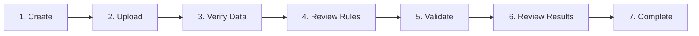

# Approved FinSight Financial-Review Workflow

- **Status:** Human-approved Product Owner source
- **Recorded:** 2026-07-27
- **Scope:** Configurable-rule-engine V2 requirements, UX, UI, architecture, acceptance criteria, tests, and traceability
- **Source reference:** HD-15 and HD-19–HD-26 in `../briefs/PRODUCT-DIRECTION-SOURCE-configurable-rule-engine-v2.md`

## Workflow contract

The configurable-rule-engine evolution preserves FinSight as a guided financial-review assistant. It is not a generic batch-validation utility.

The visible MVP journey uses seven business-facing steps:

The `WF-*` sections below retain their durable requirement identifiers and provide
the detailed behavior behind those seven visible steps. Metadata extraction and
edit confirmation are activities inside Upload and Verify Data, while summary,
Findings, analytics, and bounded Ask Fin are views inside Review Results.

Each review covers one department or business unit and one selected reporting period. Any department using compatible Budget and GED structures may use the same workflow and rules. The supplied Application Engineering identifiers are sample data and are never hard-coded product configuration.

For the V1/MVP, the supplied Budget and GED structures and their agreed sample conventions are the business contract. Organization-wide accounting semantics, broader duplicate normalization, additional source layouts, and department-specific conventions are future governed, configurable extensions; they do not delay this workflow's first release.

The MVP roles are Reviewer, Rule Administrator, and Financial Control Approver. A Rule Administrator may author and test a protected candidate and request its activation, but a different authenticated Financial Control Approver must approve it and any application of the approved baseline to an existing workspace. Multiple active role assignments combine by permission union, except that an explicit separation-of-duties denial takes precedence. The authenticated Windows account supplies the default actor identity. Identity resolution and authorization remain replaceable application boundaries outside the deterministic rule engine.

Review Lifecycle Status, displayed as `Review Status`, follows `Draft → Data Uploaded` on the pre-confirmation Working Candidate and `Data Reviewed → Validation Complete → Reviewed → Closed → Archived` on the resulting Review Version/ReviewGeneration. It describes workflow progress and is distinct from generation analytical/publication state and Overall Review Status (`Healthy`, `Attention Required`, or `Incomplete`), which is a deterministic financial-validation result. The inherited RAG presentation is the same status expressed as `On Track (Green)`, `Needs Attention (Yellow)`, or `At Risk (Red)` respectively; it is not a second calculation.

Review ID is the inherited ReviewCycle identity. Review Version is created only at confirmation and identifies exactly one inherited ReviewGeneration; it has no run before validation and exactly one authoritative Validation Run thereafter. Full normalized/working/verified row stores and source workbook bytes are not persisted; FinSight reconstructs them from fingerprint-matching source bindings, the recorded extractor version, and the correction ledger. The cycle separately identifies its working and published Review Versions so in-progress reruns never silently replace trusted output.

### WF-01 — Welcome and review selection

When FinSight opens, it presents:

- Create New Review
- View Past Reviews

View Past Reviews is enabled only when at least one prior review exists. Otherwise it is disabled and explains that no previous reviews are available. Past reviews display and can be filtered by Review Status.

The inherited `Active`/`Abandoned` ReviewCycle disposition is shown separately from Review Status. Abandon/resume is explicit, audited, and non-destructive; inactivity causes informational reminders only and never changes status or expires a review.

### WF-02 — Reporting-period selection

After Create New Review, the user selects:

- reporting month;
- reporting year.

The selection becomes part of the review identity and is compared with period evidence extracted from the uploaded reports. For V1, a mismatch is shown before validation and prevents validation until the report is replaced or the review selection is corrected; there is no silent or user-confirmed period override.

A newly created review starts with a Working Candidate in `Draft`; no Review Version is fabricated before confirmation.

### WF-03 — Budget and GED upload

The first configurable-rule-engine MVP presents exactly two required upload slots:

- Budget Report
- GED Report

Invoice, purchase-order, statement-of-work, rate-card, resource-sheet, and other upload options are not displayed in this MVP.

For each upload, FinSight displays:

- file name and assigned file type;
- upload and extraction status;
- workbook-compatibility status;
- extracted department name and number when present;
- extracted reporting period when present;
- missing-sheet, missing-column, and other structural issues.

Validation cannot begin until both files are uploaded and successfully processed.

When both required source bindings—path hint, fingerprint, filename/provenance, actor/time, and assigned role—are persisted, Review Status becomes `Data Uploaded`. FinSight does not persist or modify the workbook bytes.

### WF-04 — Metadata extraction and workspace identification

After both uploads, FinSight displays:

- resolved Department Name;
- resolved Department Number;
- selected and extracted reporting month/year;
- Budget filename;
- GED filename;
- number of Budget detail records;
- number of GED transactions;
- department mismatches;
- period mismatches;
- workbook-structure problems.

Metadata is extracted from source evidence rather than manually entered whenever the compatible reports provide it. Under the supplied-layout V1 contract, the GED `TOTAL FOR DEPARTMENT` row supplies report-level Department Number; department values on GED detail rows remain transaction-level rule inputs, so an intentionally unmapped transaction does not redefine or invalidate report metadata.

If the reports identify different departments, FinSight stops the pre-validation workflow and explains the conflict. If reporting-period evidence conflicts, FinSight shows the conflict and applies the V1 no-override behavior defined in the detailed requirements.

### WF-05 — Extracted-data review

Before validation, FinSight reconstructs and presents separate Budget and GED Working Candidate data views. Users can:

- search, filter, and sort;
- inspect normalized and original source values;
- open the original source location;
- edit any extracted field, including BGT, ATD, GED Amount, department, account, date, and description values;
- revert an individual edit;
- compare the original extracted value, user-reviewed value, and current value that validation will use.

Edits affect only FinSight's review-local logical working copy through persisted correction/reversion events. The uploaded workbooks remain unchanged. Row identity, source lineage, source fingerprints, and audit records are system provenance rather than editable extracted fields; the complete reconstructed row store is not persisted.

### WF-06 — Edit confirmation and audit

When edits exist, Save and Continue remains unavailable until the user affirms:

> I confirm that I have reviewed these edits. I understand that all changes will be recorded in the audit history and that validation results will be based on the edited values.

Each edit records:

- Review ID;
- Working Candidate ID and correction-basis version; the later confirmation record links that exact basis to the created Review Version;
- stable Actor ID and identity source;
- timestamp;
- dataset;
- row/source reference;
- field name;
- Original Extracted Value;
- previous User-Reviewed Value;
- resulting User-Reviewed Value and confirmation state;
- optional reason or comment;
- optional linked reversal event.

The user can inspect the audit record before proceeding. When no edits exist, the user confirms the extracted data without artificial edit events. After both sources are compatible, department/period gates pass, and the Reviewer confirms the Working Candidate, FinSight persists its verification/reconstruction basis and verified fingerprint and creates the sealed Review Version/ReviewGeneration at `Data Reviewed`. The complete Current Validation Value projection is the V2 `VerifiedDataset` and is reconstructed rather than stored as a row set. Later source, reviewed-value, or extractor changes create a successor Working Candidate and require fresh confirmation; rule/configuration reanalysis may inherit an unchanged verified basis without claiming a new verification.

### WF-06A — Rules Repository review

After Verify Data and before validation, FinSight opens the Rules Repository for the
exact Rule Set Version proposed for the review. The five protected baseline rules
are visible by business name:

1. Actual spend must not exceed BGT.
2. Every GED transaction must map to a valid Budget department/account combination.
3. Exact duplicate GED transactions must be flagged.
4. Required GED fields must be present and parseable.
5. Budget ATD must equal the summed GED Amount.

Each rule shows its classification, version, lifecycle state, severity, concise
business purpose, deterministic logic summary, and enabled/effective status. The
Reviewer can inspect the proposed set but cannot change protected controls.
Authorized roles may manage optional and advisory rules through the configured
create, edit-as-new-version, test, enable, disable, and retire lifecycle.

Protected baseline changes remain outside ordinary user actions and require the
governed request/different-person approval process. Any data or active-rule-set
change invalidates a stale result and requires a new deterministic run before
Review Results can be treated as current.

### WF-07 — Deterministic validation

After both datasets are compatible, the working data is confirmed, and the Reviewer
has reviewed the exact proposed Rule Set Version, FinSight runs:

- all five protected baseline rules;
- active optional rules;
- active informational/advisory rules.

The engine uses only the fingerprint-verified reconstructed `VerifiedDataset`, including confirmed review-local corrections.

Progress displays rules executing, records evaluated, rules completed, rules not evaluated, and processing status.

Every rule result records:

- source-file fingerprints and verified-data fingerprint;
- extractor version and correction-basis version;
- Rule ID and version;
- execution timestamp;
- deterministic result;
- finding evidence when applicable.

When the generation's one complete Rule Result ledger and Rule Executions are persisted, Review Status becomes `Validation Complete` and its analytical state is at least `ANALYZED`. The first generation auto-publishes at that point when no prior published result exists; a successor remains working/unpublished.

### WF-08 — Review Summary and validation results

After validation completes, FinSight first opens the Review Summary Dashboard. It provides an executive overview before the user drills into detailed findings.

The Review Summary displays:

- Department Name;
- Department Number;
- Reporting Period;
- Validation Run ID;
- Rule Set Version;
- Review Version;
- Review Lifecycle Status;
- Source File Names;
- Validation Timestamp;
- Overall Review Status;
- RAG Status;
- Budget Health;
- Data Quality;
- Number of Rules Executed;
- Number of Rules Passed;
- Number of Rules Failed;
- Number of Rules Not Evaluated;
- Advisory Rules With Observations;
- Advisory Rules With No Observations;
- Budget Overruns;
- Duplicate Transactions;
- Missing Required Data;
- Reconciliation Status;
- Top Findings;
- Recommended Next Actions.

Every financial status, count, top finding, and recommended action shown on the summary consumes recorded deterministic rule-engine results. The summary does not independently recalculate validation logic.

Business meaning and next action remain visually primary. Validation Run ID, Rule
Set Version, Review Version, source fingerprints, and other technical provenance
remain available in a clearly labeled details/evidence region without dominating
the executive summary.

The default trusted Review Summary uses the published Review Version. Immediately after a successor validation, the run-specific summary may show the working result only with a prominent `Working — Unpublished` label and the still-published Review Version alongside it. The Reviewer may inspect that working result without changing any trusted default.

From the Review Summary, users can navigate to:

- Findings;
- Rule Results;
- Analytics;
- Reports;
- Ask Fin.

The detailed results workspace includes every rule outcome, passed, failed, and not-evaluated counts, findings by severity/rule/department/account, and source evidence.

Each finding explains what failed, why, which rule produced it, involved records, original or edited values used, source-file/row evidence, and recommended human follow-up.

The rule-oriented Results view groups every outcome by rule and exposes counts,
status, severity, and evidence. The record-oriented Findings view groups exceptions
by affected business record and supports filters for severity, rule, department,
account, and status. Selecting evidence opens the relevant Budget or GED view and
highlights the implicated row or cell; the same navigation works in both appearance
modes and never relies on color alone.

After the Reviewer explicitly confirms that the summary and detailed results have been reviewed, a first already-published generation becomes `Reviewed`. For an unpublished successor, that same explicit action includes a clearly identified promotion decision; only a successful atomic promotion moves the published pointer and advances the successor to `Reviewed`. A failed or declined promotion leaves the prior published result unchanged and the working successor at `Validation Complete`.

### WF-09 — Analytics and reporting

FinSight provides views including:

- budget versus actual by account;
- over-budget accounts and largest variances;
- findings by severity and rule;
- GED completeness;
- reconciliation results;
- validation-run summary;
- leadership-ready summary.

Any pass/fail, risk, exception, reconciliation, or validation conclusion consumes recorded deterministic rule-engine results. Trusted analytics and reporting default to the published Review Version. No dashboard, report, KPI, export, or summary independently recalculates financial validation logic or silently mixes generations.

Analytics also includes deterministic Data Quality and Coverage metrics such as
required-field completeness, mapped/unmapped transaction coverage, duplicate
coverage, and reconciliation coverage. Charts use restrained financial
visualization, accessible labels and legends, tabular alternatives, and the same
sealed ledger projection as their underlying counts.

### WF-10 — Ask Fin

Ask Fin is available after validation results exist and may answer questions about over-budget accounts, failed rules, urgent findings, review-local edits, Budget/GED reconciliation, duplicates, and suggested next review steps.

Ask Fin:

- explains only recorded deterministic results;
- cites rules, findings, records, and source evidence;
  - distinguishes Original Extracted, User-Reviewed, and Current Validation values;
- does not invent pass/fail results;
- does not modify data or rules;
- does not approve financial actions;
- operates within the approved data-security boundary.

Ask Fin uses the published Review Version by default. A Reviewer may explicitly select one analyzed working version, which is labeled `Working — Unpublished`; one response is grounded in exactly one identified generation and never mixes it with published or historical evidence.

Without completed validation results, Ask Fin may provide product-help guidance but cannot make financial claims.
If no approved on-device or organization-private AI provider is configured, Ask Fin is visibly unavailable while the deterministic review, results, reports, and exports remain complete.

### WF-11 — Completion, retention, and past reviews

After a `Reviewed` review is explicitly completed, Review Status becomes `Closed` and FinSight saves:

- source bindings, uploaded-file metadata, and fingerprints, but not source workbook bytes;
- extractor, correction-basis, confirmation, verification-basis, and verified-fingerprint records, but not complete normalized, Working Dataset, or `VerifiedDataset` row stores;
- confirmed edits and audit history;
- ReviewGeneration metadata, working/published pointers, and promotion/supersession history;
- rule and configuration versions;
- the generation's one Validation Run, results, and findings;
- analytics, reports, spreadsheet-compatible exports, and their Derived Record/Generation Event metadata;
- policy-permitted Ask Fin interaction content and required audit metadata.

Closed reviews appear under View Past Reviews and open read-only. Matching sources permit fingerprint-verified reconstruction of the reviewed rows; missing, mismatched, or extractor-divergent sources show the recovery state while retained runs/results/findings/artifacts remain viewable. A Reviewer may explicitly begin a changed-data Working Candidate, a governed rule/configuration reanalysis generation, or an exact replay comparison. A Reviewer may archive a Closed review; `Archived` hides it from the default recent list but retains the authoritative read-only history.

Reports, exports, and Ask Fin responses generated later are append-only derived artifacts linked to the sealed Review Version and Validation Run. Each records its own actor, generation timestamp, and outcome without changing the authoritative generation or lifecycle history.

Ordinary review actions never erase retained evidence. Governed review disposal is
available only from clearly identified review-management entry points and uses a
strong two-step confirmation that names the selected scope and permanence. The
operation atomically removes only that review's live-store metadata, corrections,
audit content, results, findings, generated artifacts, and FinSight-managed source
copies or caches; it preserves unrelated reviews and external source workbooks and
leaves only the required content-free deletion receipt. The UI must not claim
forensic device erasure or immediate destruction of independently administered
backups unless that capability is separately implemented and verified.

## Binding design principles

- The workflow is guided and shows progress.
- Validation never precedes data review and confirmation.
- Original source files remain unchanged.
- Every review-local edit is visible and auditable.
- Original extracted, user-reviewed, and current validation values are never conflated.
- Validation uses the confirmed working dataset.
- The deterministic rule engine remains the sole source of financial validation truth.
- The Review Summary Dashboard is the first landing page after validation.
- Review Summary, reports, exports, and Ask Fin identify the exact review/run context.
- Review Status follows the seven-state lifecycle and remains distinct from Overall Review Status.
- Working Candidate, Review Version/ReviewGeneration, analytical state, and publication state remain distinct.
- Trusted product outputs default to the published generation; working results require explicit labeling and promotion.
- Overall Review Status and inherited RAG are one mapped engine-derived status, not competing calculations.
- Ask Fin explains but does not create financial conclusions.
- The workflow supports any compatible department or business unit.
- The first configurable-rule-engine MVP contains only Budget and GED uploads.
- The supplied Budget and GED reports are the V1/MVP reference contract; broader enterprise semantics are future configurable extensions.
