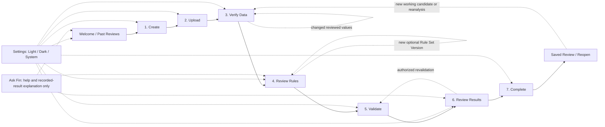
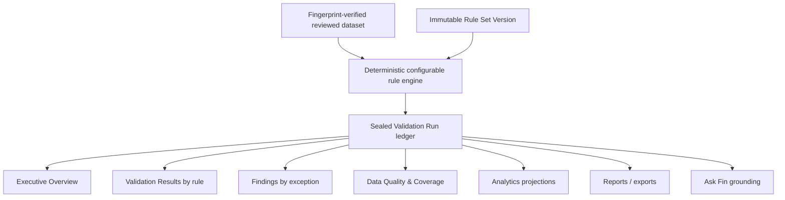

# MVP Remediation Architecture and Workflow — 2026-07-28

- **Status:** Implementation-facing Architecture delta
- **Parent architecture:** `APPLICATION-ARCHITECTURE.md`, `RULE-ENGINE-DESIGN.md`, `PERSISTENCE-MODEL.md`, and `UX-UI-DESIGN.md`
- **Decision:** Extend the existing modular monolith; do not create a second engine, result path, or application
- **Verification:** Pending consolidated execution

## 1. Updated workflow

Gate conditions:

- Upload cannot complete without compatible Budget and GED sources and matching report-level department/period evidence.
- Review Rules cannot begin while working-copy edits are unsaved or the Reviewer attestation is absent.
- Validate accepts only a confirmed verified basis and one immutable Rule Set Version.
- Review Results consumes only the sealed deterministic run projection.
- Complete requires an explicit review action and never silently discards a prior run.

## 2. Single source of financial truth

The engine owns financial aggregation, comparison, status, percentage, severity, and completeness semantics. Delivery code selects, filters, sorts, and renders persisted projections but does not recalculate them.

## 3. Presentation architecture

### 3.1 Shell and page hierarchy

The existing desktop shell remains responsible for:

- deep-navy sidebar;
- top application header and review context;
- seven-step progress component;
- wide responsive content workspace;
- Settings appearance control; and
- visible, bounded Ask Fin entry point.

Welcome is a purpose-built centered state within that shell. Workflow pages retain a compact page header, stage context, and card/table/chart content area.

### 3.2 Appearance service

One replaceable Appearance service owns:

- preference values `LIGHT`, `DARK`, and `SYSTEM`;
- persisted user preference;
- operating-system appearance observation for `SYSTEM`;
- semantic design tokens rather than page-local colors;
- theme-change notification to every live view; and
- chart palette and tooltip refresh.

Required semantic tokens include application background, elevated/card background, navigation background, primary/secondary text, border, focus ring, primary action, selection, edited value, success, warning, error, informational, chart series, and disabled state.

Widgets shall consume semantic tokens through the shared theme layer. Pages shall not hardcode independent light-only colors.

### 3.3 Plain-language failure projection

Application/domain failures retain their typed codes, diagnostic IDs, correlation IDs, retryability, and audit facts. A delivery failure presenter maps them to:

1. one concise plain-language problem;
2. one next action; and
3. an optional, collapsed technical-details projection.

The presenter never changes failure semantics or suppresses mandatory audit retention.

## 4. Working-copy edit boundary

Verify Data reconstructs Budget and GED source rows plus the append-only correction ledger.

The table model retains:

- stable record ID;
- source role and worksheet;
- source row and cell;
- Original Extracted Value;
- prior and Current/User-Reviewed Value;
- edit/revert event identity; and
- edited/status/accessibility roles.

Edit Mode creates a bounded UI change set. Cancel discards only the unsaved set. Save requires affirmation and appends corrections atomically. Source files remain immutable and are never spreadsheet-save targets.

## 5. Rules Repository boundary

Rules Repository is a projection over governed persistence:

- protected and optional Rule Definition Versions;
- lifecycle events;
- immutable workspace Rule Set Versions and bindings;
- required fields, grouping keys, severity, evaluator key, and approved parameters;
- Draft test results; and
- prior versus successor run comparison metadata.

The UI does not embed evaluator logic. Rule testing and validation dispatch through the same deterministic evaluator registry. Unknown evaluator keys fail closed.

Protected actions continue through the existing request/different-person approval boundary. Ordinary optional-rule changes create new immutable versions and never rewrite a completed run.

## 6. Structured evidence and drill-down

The evidence projection shall carry structured references, not only display strings:

| Field | Purpose |
|---|---|
| `record_id` | Stable Budget/GED record selection |
| `source_role` | Budget or GED |
| `workbook_filename` | Business-readable source identity |
| `worksheet` | Exact sheet |
| `source_row` | Exact row |
| `field_name` / `source_cell` | Exact affected value where applicable |
| `original_value` | Extracted source value |
| `current_value` | Value used by validation |
| `value_origin` | Original or User-Reviewed |
| `related_record_ids` | Duplicate pair or contributing reconciliation/overrun rows |
| `expected` / `actual` | Deterministic condition evidence |

The persisted evidence shape remains backward-readable: legacy display references may be normalized into `references`, while new structured details populate `details`.

Delivery maintains an affected-record index:

- record ID to finding/rule IDs and maximum severity;
- record ID + field to affected finding IDs; and
- finding/rule selection to exact Budget/GED navigation target.

Validation Results uses rule-oriented projections. Findings uses exception-oriented projections. Data Quality & Coverage uses dataset-reliability metrics. They share evidence identities but not the same table presentation.

## 7. Analytics projection boundary

The deterministic ledger persists chart-ready decimal strings, categorical outcomes, completeness flags, and labels. Required projection families are:

- executive budget/actual, severity, outcome, utilization, account-budget status, and reconciliation status;
- Budget account values including BGT, ATD, EAC, remaining, and overrun;
- GED spend/transaction counts by account and fiscal period; and
- Department + Account comparison values including BGT, Budget ATD, GED Amount, variance, overrun, and reconciliation difference.

Charts render these values and always retain an exact table alternative. Presentation may choose a deterministic top-N view or ordering but shall not derive new financial truth. Missing/unparseable amounts produce an explicit partial/incomplete label.

## 8. Governed review disposal

The UI performs a two-step operation:

1. `prepare_disposal(review_id)` returns the reporting-period label, current revision/status, one-time confirmation token, opaque scope token, and inventory preview.
2. `confirm_disposal(review_id, confirmation_token)` re-resolves identity/authorization and disposes the exact review scope or rejects stale/reused/cross-review confirmation.

The infrastructure disposal boundary:

- computes the exact table closure;
- removes only pre-authorized review rows in one live-store transaction;
- retains shared/global rule/source records still referenced elsewhere;
- writes an opaque content-free tombstone and exact inventory receipt;
- appends a global content-free disposal audit event;
- removes the review-scoped audit stream;
- retires its external audit anchor; and
- reconciles a committed database operation whose external publication was interrupted.

No disposal path calls filesystem deletion for selected workbook paths.

The approved retained-graph/key-erasure and managed-backup-revocation architecture remains the stronger end-of-life model. Until that mechanism is executed and qualified, UI and release evidence shall distinguish live-store scope removal from forensic media/backup erasure.

## 9. Accessibility architecture

- Every chart has an accessible title, summary, legend/label semantics, and table alternative.
- Status, severity, edited values, and selected cells use text/icon/pattern as well as color.
- Table models expose record/evidence identity without placing technical IDs in visible business columns.
- Evidence navigation scrolls, selects, focuses, and announces the target, then restores focus on return.
- Dialogs expose names/descriptions, initial focus, keyboard order, destructive-action warning, disabled-state reason, and focus restoration.
- Theme changes preserve focus and do not reconstruct financial state.
- Qualified scaling and resizing tests cover the same content in Light, Dark, and System modes.

## 10. Architectural invariants

- One FinSight application and repository.
- One deterministic engine and sealed-result path.
- Original Budget/GED files remain unchanged.
- Core controls remain protected and versioned.
- Optional rules use the same engine and persistence lifecycle.
- UI never silently replaces or mixes historical runs.
- AI explains recorded results but does not determine them.
- Disposal cannot remove unrelated reviews or external workbooks.
- Technical identifiers remain available without dominating business workflows.
- Windows packaging remains outside this remediation increment.
