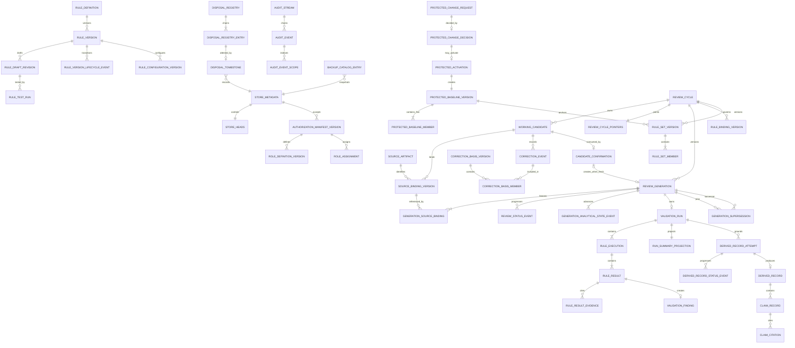

# FinSight V2 — Persistence Model

- **Status:** Draft — AI-PROPOSED for named human review
- **Initiative:** Configurable Rule Engine V2
- **Product relationship:** Evolution of the existing FinSight product and ordered SQLite migration chain
- **Decision state:** Proposed architecture design; this document does not accept or amend an ADR
- **Implementation authorization:** None. No code, migration, test, package, or production-data use is authorized by this Draft.
- **Primary requirements:** FR-137–FR-173, FR-184, FR-189–FR-203; NFR-082, NFR-085, NFR-088–NFR-091, NFR-100–NFR-110
- **Governing requirements:** [V2 Functional Requirements](../specs/01-functional-requirements.md), [V2 Non-Functional Requirements](../specs/02-non-functional-requirements.md), [V2 Constitution](../specs/constitution.md), and [approved review workflow](FINANCIAL-REVIEW-WORKFLOW.md)
- **Inherited decisions:** [ADR-003](../../../specs/adr/ADR-003-exact-decimal-and-determinism.md), [ADR-004](../../../specs/adr/ADR-004-persistence-sqlite.md), [ADR-005](../../../specs/adr/ADR-005-audit-event-architecture.md), [ADR-009](../../../specs/adr/ADR-009-ai-persistence-and-retention.md), [ADR-011](../../../specs/adr/ADR-011-review-lifecycle-and-generation-model.md), [ADR-012](../../../specs/adr/ADR-012-source-binding-and-working-set-reconstruction.md), [ADR-013](../../../specs/adr/ADR-013-single-user-single-instance-desktop-scope.md), [ADR-014](../../../specs/adr/ADR-014-review-abandonment-and-retention.md), and [ADR-015](../../../specs/adr/ADR-015-immutable-export-and-report-identity.md)
- **Design standards:** [secure defaults](../../../spec-driven/plugins/engineering-standards/skills/secure-defaults/SKILL.md) and [data-architecture standards](../../../spec-driven/plugins/engineering-standards/agents/data-architect.md)

## 1. Decision summary

FinSight V2 extends the existing ordered SQLite migration chain and repository/Data Mapper boundary. Production data is held in a **SQLCipher-compatible encrypted SQLite store**. After Architecture approval, the first Review Management workflow must qualify the exact Python binding, native library, cipher settings, and Windows/macOS packaging combination before dependent implementation proceeds.

The production application has no plaintext-database mode and no automatic fallback to the standard-library `sqlite3` driver. Failure to load the approved cipher, obtain the key, verify the cipher profile, verify the role manifest, or acquire the store lock fails closed before protected data is read.

The store is machine-scoped and supports sequential use by deployment-authorized operating-system actors. One application instance may open a store at a time. A store must reside on a verified local volume; network shares, synchronized folders, and concurrent/shared-database use are unsupported. Two-person protected-rule governance therefore occurs sequentially against the same managed installation in the MVP. Cross-machine approval requires a future repository implementation, not SQLite on a file share.

The database key is a cryptographically random 256-bit value:

- on Windows it is wrapped by a key-protection adapter using DPAPI machine scope, with the wrapped blob and database protected by deployment-managed ACLs;
- on macOS the equivalent adapter uses a provisioned System Keychain item constrained to the approved signed application and deployment access policy;
- no key, recovery secret, provider secret, or connection secret is stored in plaintext or inside the database it unlocks.

Role assignments are not editable in FinSight. They come from a canonical, versioned, administrator-protected manifest outside the application UI. The manifest is signed by an approved deployment authority, verified on every startup and before privileged commits, and imported as an immutable encrypted authorization snapshot for historical reproducibility.

Persistence is authoritative-only. FinSight persists provenance, bindings, fingerprints, correction and confirmation facts, immutable rule/version manifests, review generations, complete validation results, findings, derived records, authorization evidence, and audit evidence. It never persists:

- source workbook bytes;
- a complete normalized Budget or GED row store;
- a complete Working Dataset;
- a complete `VerifiedDataset`;
- UI state, filters, selections, worker objects, or in-process caches.

The complete row projections are reconstructed from fingerprint-matching source files, the recorded extractor profile, and the persisted correction/confirmation basis. A missing or divergent source makes reconstructed rows unavailable without changing retained results.

## 2. Scope and non-goals

This document defines:

- the production encryption, key, machine-scope, and single-instance model;
- the authoritative logical entities, cardinalities, and integrity constraints;
- the separation of global Protected Baseline Version from workspace Rule Set Version;
- candidate-specific and generation-specific source-binding history;
- append-only correction, lifecycle, rule-governance, result, artifact, and audit history;
- the one-authoritative-run and complete-ledger transaction;
- backup, replacement-machine restore, recovery-key-provider, disposal, and temporary-data behavior;
- additive migration from the current schema;
- indexes, growth controls, corruption checks, and verification gates.

It does not:

- authorize implementation;
- persist source or reconstructed datasets for convenience;
- make SQLite a network, multi-writer, or organization-wide service;
- choose a public AI provider or permit public-model transmission;
- define new financial semantics;
- reclassify or activate any of the 57 preserved legacy rules;
- claim that a machine-scope key protects data from a malicious local administrator;
- claim that a user-created external export or independently copied backup remains under FinSight control.

## 3. Governing persistence principles

1. **Repositories own storage access.** Domain and delivery code do not import SQLCipher, SQLite, filesystem-store, DPAPI, or Keychain types.
2. **Facts accrete; pointers advance.** Historical facts are inserted once. Only explicitly identified heads, hints, and working projections may update.
3. **No `INSERT OR REPLACE`.** V2 authoritative repositories use insert-only writes, explicit compare-and-swap for mutable heads, and conflicts that fail visibly.
4. **Exact money.** Monetary values use canonical fixed-scale decimal `TEXT` or integer minor units. SQLite `REAL`, JSON numbers, and binary floats are forbidden on financial paths.
5. **Stable identity; complete-or-absent results.** A Validation Run envelope is authoritative from its atomic start transaction. Its financial result is authoritative only when the entire Rule Execution, Rule Result, Finding, projection, lifecycle, audit, and completion-seal unit commits.
6. **Used versions never drift.** A run references immutable content hashes and version identities, never a mutable “current rule.”
7. **Reconstruction proves identity.** A path is a hint; a SHA-256 fingerprint is source identity.
8. **Results are retained without source files.** Full row inspection may be unavailable, but the stored ledger, minimal cited evidence, findings, reports, exports, and audit history remain readable.
9. **Fail closed.** Encryption, authorization, signature, integrity, migration, and recovery errors block the guarded operation.
10. **Disposal is a separate governed rebuild with an external revocation authority.** Ordinary repositories cannot delete immutable evidence. Confirmed whole-scope disposal rebuilds a clean encrypted store, destroys superseded encryption keys, and records its revocation in the non-restorable Disposal Registry before any managed restore can proceed.

## 4. Store, encryption, identity, and access

### 4.1 Production store profile

The production profile uses a pinned SQLCipher-compatible build behind the existing DAL/repository boundary. Connection setup occurs in this order:

1. resolve the canonical machine-local FinSight root and reject a network, remote, or synchronized location;
2. acquire the installation recovery/disposal lock and the selected per-store single-instance lock;
3. open and verify the separate Disposal Registry journal, platform-protected head, and absence of an unresolved prepared operation;
4. resolve a stable Actor ID;
5. read and verify the signed role-assignment manifest;
6. obtain and unwrap the database key through the platform key-protection adapter;
7. open the approved SQLCipher driver and apply the key before reading schema content;
8. prove cipher availability and the exact approved cipher profile;
9. enable foreign keys and the approved durability profile;
10. run schema, foreign-key, cipher-integrity, audit-chain, and store-to-registry lineage checks;
11. permit repository access only after every preceding check succeeds.

The approved profile is persisted by ID and hash in `store_security_profiles`; it pins the SQLCipher major/minor version, compatibility mode, KDF and HMAC algorithms, page size, KDF work factor, journal mode, and durability settings. Defaults supplied by whichever native library happens to load are not accepted implicitly.

The proposed durability baseline is:

- `foreign_keys=ON`;
- WAL journal mode, provided the dependency spike proves encrypted WAL behavior;
- `synchronous=FULL` for authoritative commits;
- a bounded `busy_timeout`;
- `trusted_schema=OFF` where the selected SQLite/SQLCipher version supports it;
- no loadable extensions;
- no application-controlled `writable_schema`;
- explicit transactions, with `BEGIN IMMEDIATE` for authoritative write units.

The dependency spike must prove all of the following on the exact Windows and macOS package candidates:

- the Python API is compatible with required repository and migration operations;
- `PRAGMA cipher_version` identifies the intended native library;
- a wrong or missing key cannot read schema or data;
- a known financial sentinel is absent from database, WAL, SHM, backup, and temporary raw bytes;
- online backup, restore, rekey/export, foreign keys, triggers, and ordered migrations work;
- crash recovery does not expose plaintext or corrupt an authoritative transaction;
- the packaged binary loads only the approved native cipher dependency.

If the spike fails, Architecture must select and review another SQLCipher-compatible binding. The application must not silently open a plaintext database.

### 4.2 Key-protection adapters

The application depends on `StoreKeyProviderPort`; deterministic rule code never does.

For Windows:

- generate the database key through the operating-system CSPRNG;
- wrap it with DPAPI `CRYPTPROTECT_LOCAL_MACHINE`;
- store only the wrapped blob and a non-secret envelope identifier;
- protect the key blob, database, WAL/SHM, lock, and protected temp directory with installer/deployment ACLs;
- permit write/read only to the deployment-authorized local group, Administrators, and `SYSTEM`;
- deny inheritance that would broaden access;
- rotate the database key by SQLCipher export/rekey into a separately verified encrypted file, never by writing a plaintext intermediate.

For macOS:

- store the random database key in the System Keychain;
- provision the item and access control through the approved installer/management profile;
- bind access to the approved signed FinSight application and deployment policy;
- apply equivalent local-directory permissions and single-store locking.

The audit HMAC key, Disposal Registry HMAC/scope-token key, and, when the optional organization-certificate profile requires one, any recovery client credential are distinct random secrets held by the same adapter family. The registry key envelope is stored with the non-restorable registry authority, not inside a replaceable store. The default passphrase profile has no stored recovery credential. A compromise or rotation of one secret does not silently redefine another purpose.

### 4.3 Required qualification of DPAPI machine scope

DPAPI machine scope is suitable for the approved NFR-009 “casual access outside the application” boundary only when the wrapped blob is protected by a restrictive deployment ACL. Machine scope alone is **not** a role-level confidentiality boundary: any account able to read the blob on that machine may be able to ask DPAPI to unwrap it.

Therefore this model makes two explicit claims:

- deployment ACLs plus signed role manifests are mandatory, not optional hardening;
- Reviewer, Rule Administrator, and Financial Control Approver separation is enforced by the application authorization layer, not by separate cryptographic database compartments.

If the approved threat model later requires protection from a malicious deployment-authorized local user bypassing the application, the concrete correction is a separately reviewed service-mediated key broker or DPAPI-NG/group-protected design. A world-readable machine-scope blob is prohibited.

The macOS spike must likewise prove that a System Keychain item can support the approved sequential multi-actor installation without weakening code-signing or access controls. If it cannot, a privileged key broker is required; a plaintext key file is not an alternative.

### 4.4 Machine-scoped sequential actor model

The MVP default store locations are `%ProgramData%\FinSight\Stores\<store-id>` on Windows and `/Library/Application Support/FinSight/Stores/<store-id>` on macOS. The separate Disposal Registry authority resides at `%ProgramData%\FinSight\Security\DisposalRegistry\` or `/Library/Application Support/FinSight/Security/DisposalRegistry/`. It is outside every replaceable store directory and ordinary database backup. An administrator may configure another canonical machine-local, non-synchronized root only when the same installer/deployment ACL and path-safety policy validates it; network, user-profile sync, and broadly writable paths remain prohibited.

Each store has one opaque `store_id`. “Global Protected Baseline Version” means global to that one FinSight store/installation for the MVP. It does not imply automatic synchronization across laptops. A later organization-global catalog requires a signed distribution mechanism or a server-backed repository implementation.

The store lock combines an OS-level exclusive file lock with a store-specific process identity check. A second process is refused before database open. Stale-lock recovery verifies that no owning process remains and is itself audited. SQLite files are never placed on SMB, NFS, OneDrive, SharePoint synchronization, or another shared/synchronized location.

### 4.5 Signed role-assignment manifest

The role-assignment source is a canonical UTF-8 JSON manifest with a detached signature. Its schema contains:

- manifest schema and monotonically increasing version;
- issuer and signer certificate identity;
- issue and effective timestamps;
- versioned roles and allowlisted permission IDs;
- Actor ID, identity source, role-version ID, effective-from, optional effective-through, assigning Actor ID, and assignment version;
- explicit revocations or successor assignments;
- canonical content hash.

The manifest and signature are stored outside the application UI in an administrator-write-protected deployment directory. FinSight users cannot edit, approve, or replace it through normal application actions. The installer pins the approved signing trust. The application rejects:

- missing, invalid, expired, unsupported, or noncanonical manifests;
- a signature from an untrusted signer;
- version rollback unless a separately signed emergency-rollback authorization is present;
- unknown permission identifiers;
- self-approved role assignment;
- ambiguous duplicate active assignments.

After verification, FinSight stores the exact canonical manifest, signature, signer identity, hash, and normalized assignments in encrypted immutable authorization records. Every protected commit records the manifest version used. Authorization is reevaluated at the commit boundary, not only when a screen opens.

Adding a future role requires a new signed role definition and mappings to existing allowlisted permissions. It does not change rule definitions, evaluators, results, or historical authorization facts.

## 5. Logical entity-relationship model

The diagram omits some associative and policy tables for readability. `DISPOSAL_REGISTRY` and its entries are authoritative records in a separate protected journal rather than SQL tables. The exhaustive entity catalog below is authoritative for this Draft.

## 6. Entity catalog and constraints

All authoritative IDs are opaque UUIDs or another approved collision-resistant identifier generated at the application edge. Timestamps are UTC RFC 3339 values with an explicit precision. Hashes are SHA-256 unless a successor security profile is approved. Canonical JSON uses the rule-engine design’s closed schema and canonicalization profile. JSON monetary values are strings, never numbers.

### 6.1 Store, migration, actor, and authorization entities

| Entity | Required content | Keys, cardinality, and constraints |
|---|---|---|
| `store_metadata` | Store ID, creation time, application lineage, audit-stream genesis metadata | Exactly one row per physical store; Store ID is immutable |
| `store_heads` | Active security-profile ID, highest accepted authorization-manifest ID/version, currently effective Protected Baseline ID, compare-and-swap revision | Exactly one row per store; controlled mutable pointers only; every target is sealed/verified |
| `store_security_profiles` | Cipher binding/profile ID, exact SQLCipher settings, key-envelope IDs, ACL-policy hash, platform profile, activation time | Append-only; one active profile head; no secret values |
| `schema_migrations` | Existing ordered migration version, name, application time | Existing table retained; versions strictly increasing and applied once |
| `migration_attestations` | Migration version, migration source checksum, application version/commit, pre/post schema hash, outcome, correlation ID | Exactly one successful attestation per applied migration; append-only |
| `actor_identity_observations` | Stable Actor ID, identity source, domain-qualified account snapshot, observed time | Append-only; display-name changes do not change Actor ID |
| `authorization_manifest_versions` | Manifest version, canonical content, hash, detached signature, signer, effective range, import actor/time | Version and hash unique; immutable; only verified manifests are usable |
| `role_definition_versions` | Manifest ID, role ID/version, display label, permission-set hash | Many roles per manifest; role IDs stable; permissions must be allowlisted |
| `role_permission_members` | Role-version ID, permission ID | Unique pair; no executable policy expression |
| `role_assignments` | Manifest ID, Actor ID, role-version ID, effective range, assigning Actor ID, assignment version | Unique assignment version; subject cannot approve own assignment; time range valid |
| `authorization_decision_events` | Actor, manifest version, action, resource scope, allow/deny, rule/reason, time, correlation ID | Append-only; every protected commit and denied protected attempt has one decision event |

`actor_identity_observations` is not an identity directory. It preserves the identity snapshot used by an action. The operating-system identity provider remains authoritative for the current session.

### 6.2 Rule, configuration, and governance entities

| Entity | Required content | Keys, cardinality, and constraints |
|---|---|---|
| `rule_definitions` | Stable Rule ID, protected control key when applicable, creation provenance | Rule ID unique; protected keys limited to CORE-01…CORE-05 and unique |
| `rule_versions` | Rule-version ID/label, Rule ID, predecessor version, author, creation time | Unique `(rule_id, version_label)`; predecessor belongs to same Rule ID |
| `rule_draft_revisions` | Rule-version ID, revision number, canonical definition bytes, definition hash, author/time | Append-only; unique revision number and hash; no revision may be added after Tested |
| `rule_version_lifecycle_events` | Rule-version ID, prior/new state, locked revision ID where applicable, actor/time/reason | Append-only; only Draft → Tested → Active → Retired; Tested locks one exact revision |
| `rule_test_runs` | Rule-version/revision, test-suite version/hash, runner version, actor/time, overall outcome | Append-only; exact revision tested |
| `rule_test_results` | Test-run ID, positive/negative/boundary case ID, outcome, expected/actual projection hashes, evidence | Required case classes must all pass before Tested |
| `rule_configuration_versions` | Rule-version ID, configuration version, canonical operands, severity/status references, content hash, predecessor, author/time | Immutable; operands valid for the pinned evaluator schema |
| `severity_policy_versions` | Policy ID/version, canonical fixed or criteria policy, hash | Immutable; monetary thresholds use exact decimal text |
| `status_policy_versions` | Policy ID/version, roll-up and Overall Review Status policy, canonical hash | Immutable and replayable |
| `evidence_template_versions` | Template ID/version, controlled fields, follow-up text, canonical hash | Immutable; no executable templating |
| `evaluator_registry_versions` | Registry release ID, evaluator/schema implementation IDs and hashes, application build identity | Immutable release manifest; a run pins one |
| `protected_change_requests` | Request ID, exact Tested rule/revision/configuration, requested action, before/after evidence, reason, proposed effective time, requester/time, prior request when revised | Immutable; starts Pending Approval; requester is Rule Administrator |
| `protected_change_decisions` | Request ID, Approved/Rejected, approver/time/reason, role-manifest version | At most one per request; approver Actor ID differs from requester; terminal |
| `protected_activation_schedules` | Approved Request ID, approved effective time, schedule ID/version, registration state, creation time | Exactly one for a future-dated approval; immutable due basis; authoritative source for dispatcher reconciliation |
| `protected_activation_schedule_events` | Schedule ID, Register/Attempt/Deferred/Failed/Completed, actor/system, actual time, stable reason/correlation ID | Append-only; OS scheduler registration is an idempotent projection, not authority |
| `protected_activations` | Approved request ID, actual activation time/outcome, prior/resulting baseline IDs, system/actor provenance | At most one successful activation per approved request; none for rejected requests |
| `protected_baseline_versions` | Baseline ID/sequence, predecessor, effective time, status-policy version, manifest hash, activation ID | Immutable; activation establishes effectivity |
| `protected_baseline_members` | Baseline ID, protected Rule ID, locked rule revision, configuration, severity policy, ordinal | Exactly five unique protected IDs per sealed baseline; all enabled |
| `protected_baseline_seals` | Baseline ID, member count/hash, seal time/event | Inserted last; database trigger rejects anything other than the exact five protected IDs |
| `rule_binding_versions` | Workspace/Review ID, Rule ID/version/configuration, Enabled/Disabled, predecessor binding, actor/time, hash | Immutable; changes append a successor; retired rules cannot receive new bindings |
| `rule_set_versions` | Rule Set ID/sequence, workspace/Review ID, predecessor, Protected Baseline ID, status policy, registry version, creator/time, manifest hash | Immutable; unique sequence per workspace |
| `rule_set_members` | Rule Set ID, ordinal, Rule ID, locked rule revision, configuration, binding, classification, enabled state, hashes | Unique Rule ID and ordinal within a Rule Set |
| `rule_set_seals` | Rule Set ID, member count/hash, protected-baseline consistency proof, seal time | Inserted last; executable only after seal; trigger requires all five matching protected members enabled |
| `workspace_baseline_upgrade_requests` | Workspace, target baseline, requester/time, reason | Immutable; initiated by Rule Administrator |
| `workspace_baseline_upgrade_decisions` | Request ID, distinct Financial Control Approver, decision/time/reason | At most one terminal decision |

A Protected Baseline Version is installation-global. A Rule Set Version is workspace-local. Global activation changes no existing `rule_set_versions`. An approved workspace upgrade appends one new Rule Set Version for that workspace only.

### 6.3 Review, source, correction, and generation entities

| Entity | Required content | Keys, cardinality, and constraints |
|---|---|---|
| `review_cycles` | Review ID, selected month/year, creation actor/time | Stable identity; month/year valid; department is evidence, not a hard-coded key |
| `review_cycle_pointers` | Review ID, active candidate ID, working generation ID, published generation ID, current Rule Set ID, compare-and-swap revision | One row per review; each non-null pointer must reference the same review |
| `review_disposition_events` | Review ID, Active/Abandoned action, actor/time/reason | Append-only; no automatic age transition |
| `working_candidates` | Candidate ID, Review ID, predecessor generation, creation trigger, extractor-profile ID, creator/time | Many over review lifetime; at most one active candidate pointer |
| `source_artifacts` | Artifact ID, source role, filename, byte size, SHA-256, first-seen actor/time | No bytes; unique fingerprint may be reused across bindings |
| `source_binding_versions` | Binding ID, Candidate ID, source role, Artifact ID, path hint, predecessor binding, bind/rebind reason, actor/time | Append-only; path is a hint; a changed fingerprint creates a new version |
| `candidate_source_heads` | Candidate ID, source role, current binding ID, compare-and-swap revision | At most one Budget and one GED head; mutable pointer only |
| `metadata_evidence_records` | Candidate/source role, field, raw scalar, normalized scalar/status, source cell, parser/profile version | Minimal report-level evidence only; not a row store |
| `extraction_profile_versions` | Extractor version, source-layout contract, parser/canonicalization settings, implementation hash | Immutable; Review Generation pins one |
| `correction_events` | Candidate, dataset, stable source record/cell, field, original normalized/raw lineage, prior/resulting reviewed value, Set/Revert, actor/time/reason | Append-only; one field event; no row insert/delete or source mutation |
| `correction_basis_versions` | Candidate, basis sequence, predecessor basis, canonical ordered event-set hash, creator/time | Immutable; unique sequence per candidate |
| `correction_basis_members` | Basis ID, correction event ID, ordinal | Unique event and ordinal per basis |
| `candidate_correction_heads` | Candidate ID, current basis ID, compare-and-swap revision | One mutable pointer; a save/revert appends a new basis first |
| `candidate_confirmations` | Candidate, exact source binding IDs, correction basis, extraction profile, confirmation-text version, verified-data fingerprint, verifier Actor/time | At most one successful confirmation; consumes candidate |
| `review_generations` | Existing ADR-011 identity plus Review ID/sequence, creation reason, lineage/basis generation IDs, verified fingerprint, extractor profile, original verification Actor/time, creator/time, analytical metadata | Unique sequence per review; immutable verification basis; reanalysis inherits exact basis |
| `generation_source_bindings` | Generation ID, source role, exact binding-version ID | Exactly one Budget and one GED binding per sealed generation |
| `generation_metadata_snapshots` | Generation ID, resolved department evidence, selected/resolved period, source filenames, Budget/GED counts, metadata-contract version/hash | One immutable snapshot per generation; no complete rows |
| `review_status_events` | Owner kind/ID, from/to lifecycle status, actor/time/reason | Append-only; Candidate owns Draft/Data Uploaded; Generation owns Data Reviewed onward |
| `generation_analytical_state_events` | Generation ID, ordinal, origin `NATIVE`/`LEGACY_SNAPSHOT`, prior/new state, trigger type, triggering confirmation/basis-generation/run/Derived Record ID, initiating Actor/system identity, time, canonical event hash | Append-only; native first event is `VERIFIED` and only `VERIFIED` → `ANALYZED` → `SUMMARIZED` → `EXPORTED`; a legacy snapshot may start only at the explicitly recorded state with null prior/unknown transition actor-time; unique ordinal/state per generation |
| `generation_supersessions` | Prior/successor generation, actor/time/reason | Existing append-only relation; same review; increasing sequence; prior superseded once |
| `generation_promotions` | Review, prior published generation when present, promoted generation, actor/time/reason | Append-only; promotion and pointer move occur atomically |
| `replay_verification_events` | Generation/run/rule set, replay actor/time, comparison-profile version, expected/actual hashes, outcome | Append-only; creates no generation and no authoritative run |

For a fresh verification, `candidate_confirmations` and its exact source/correction basis create the generation in one transaction. For a rule-set or configuration reanalysis, a new generation references the predecessor and verification-basis generation, repeats the same verified fingerprint, extractor profile, source-binding IDs, correction basis, original verifier, and verification time, while recording a distinct reanalysis creator/time.

The existing `review_generations.analytical_state` column may remain as a denormalized per-generation compatibility mirror of the latest valid analytical-state event. It is updated only in the same transaction as that append-only event, never used to erase transition history, and is repairable downward from the event stream if a mirror divergence is detected. Any cycle-level compatibility mirror follows only the working generation and is not changed by exporting a non-working generation. Verification basis, lineage, source links, fingerprints, and identity remain immutable.

Fresh confirmation creates the generation and its native `VERIFIED` event with trigger `HUMAN_CONFIRMATION` atomically. A rule-set/configuration reanalysis creates the generation and native `VERIFIED` event with trigger `INHERITED_VERIFICATION_BASIS`, references the basis generation, and preserves the original verifier/time. Successful validation completion appends ordered `ANALYZED` and `SUMMARIZED` events in the same transaction as the complete ledger and Review Summary projection.

The first successfully completed PDF report or XLSX export appends `EXPORTED` whether the generation is working, published, historical, or superseded. Supersession freezes its financial/verification/run/result/publication facts but, as the narrow FR-171/FR-172 refinement of ADR-011 §7, does not prohibit this one remaining additive artifact-state event. Derived Record request creation serializes with promotion and snapshots the exact creation-time publication/supersession label: promotion first yields a permitted `Historical — Superseded` artifact, while request creation first preserves its earlier label even if promotion follows. Concurrent first completions serialize on the generation state head: both outputs may complete, but exactly one event is inserted. Failed/blocked generation, Ask Fin output, screen rendering, and external delivery do not advance analytical state. Regeneration after `EXPORTED`, including for a superseded generation, creates a new Derived Record and no duplicate transition.

### 6.4 Validation, result, Finding, and summary entities

| Entity | Required content | Keys, cardinality, and constraints |
|---|---|---|
| `validation_runs` | Run ID, Generation ID, Rule Set ID, initiating Actor, verified/input fingerprint, registry/engine version, start time, comparison-profile version/hash | Inserted once at validation start; Generation ID unique; Run ID is random and never derived from the input fingerprint; immutable basis |
| `validation_run_attempts` | Attempt ID, Run ID, ordinal, initiating Actor, start/end time, outcome `SUCCEEDED`/`CANCELLED`/`FAILED`/`INTERRUPTED`, stable error/correlation ID | Append-only; unique `(run_id, ordinal)`; one open attempt at most; no financial payload |
| `run_completion_seals` | Run ID, terminal persistence status `COMPLETED`, expected/persisted execution/result/finding counts, ordered-ledger hash, summary-projection hash, completion time | Zero while open/retryable; exactly one after successful completion; inserted last in the completion transaction |
| `rule_executions` | Execution ID, Run ID, rule-set-member ID, Rule ID/revision/configuration/classification, ordinal, grain, expected scope count, status counts, roll-up status, provenance hash | Exactly one per selected enabled rule; unique `(run_id, rule_id)` and ordinal |
| `rule_results` | Result ID, Execution ID, scope key, result ordinal, permitted status, calculation/dependency evidence, severity policy/result severity, source-reference projection, result hash | Exactly one per expected scope; unique `(execution_id, scope_key)` and ordinal |
| `rule_result_evidence` | Result ID, evidence ordinal, source binding/artifact, sheet/row/cell/field, minimal original/reviewed/current value evidence or evidence hash | Minimal cited evidence only; never an undiscriminated full-row copy |
| `validation_findings` | Finding ID, failed Result ID, resolved severity/policy, finding type, affected entities, evidence/follow-up, creation state/hash | Exactly one for each failed control Result; zero for every other status; Result ID unique |
| `finding_lifecycle_events` | Finding ID, prior/new operational state, actor/time/reason | Append-only; does not change the originating result or finding payload |
| `run_summary_projections` | Run ID, projection/status-policy version, Overall Review Status, RAG mapping, health/count/status fields, canonical payload/hash | Exactly one per completed run; produced by the engine evaluation and committed with it |
| `summary_projection_lineage` | Run/projection field, Rule Execution/Result/Finding source ID | Every validation conclusion maps to persisted engine records |

Engine evaluation occurs outside the database against immutable in-memory inputs. The application validates the returned cardinalities and builds the entire write set before beginning the authoritative completion transaction. Within the transaction, `run_completion_seals` is inserted last. Consumers query only sealed runs.

If scope enumeration fails after validation starts, the run envelope remains unsealed and the attempt records `FAILED`; no financial result is represented. If one scope has unavailable evidence, its required `NOT_EVALUATED` Result is part of the complete ledger. An evaluator defect or persistence failure rolls back the complete-ledger transaction, appends the attempt outcome when recovery permits, and leaves the same run retryable.

### 6.5 Derived records, AI content, audit, diagnostics, backup, and disposal entities

| Entity | Required content | Keys, cardinality, and constraints |
|---|---|---|
| `derived_record_attempts` | Derived Record ID, type, Review/Generation/Run/Rule Set IDs, creation-time publication label, initiator, request time, request/corpus/profile versions | Append-only; one selected generation/run only |
| `derived_record_status_events` | Derived Record ID, Requested/Completed/Failed/Blocked, time, actor/system, correlation/error code | Append-only; exactly one terminal event |
| `derived_records` | Derived Record ID, media type/schema, canonical encrypted content BLOB when retained, content SHA-256, retention-policy snapshot, explicit no-content reason when absent | At most one content row per attempt; stored only inside SQLCipher; immutable |
| `derived_record_manifests` | Derived Record ID, full ADR-015 identity manifest, canonical bytes/hash | Exactly one for Completed content; immutable |
| `external_delivery_events` | Derived Record ID, destination hint, delivered fingerprint, actor/time/outcome | Append-only; user-chosen external copies are outside managed retention after delivery |
| `claim_records` | Ask Fin Derived Record ID, Claim ID, structured subject/predicate/value, rendered text, support status | Immutable; one response uses one run |
| `claim_citations` | Claim ID, cited corpus record/field ID, citation ordinal | Every supported claim has one or more exact citations |
| `blocked_claim_records` | Ask Fin Derived Record ID, proposed Claim ID, stable block reason, no hidden reasoning | Immutable; no unsupported claim presented as fact |
| `ai_preferences` | Actor ID, preference key/version, value, actor/time | Versioned successor records; current head is a projection |
| `ai_consent_events` | Consent ID, Actor ID, Grant/Revocation, provider/profile, scope, consent-text/context/payload-category/masking-policy versions, exact payload-projection hash, actor/time | Append-only; active consent is the latest valid non-revoked matching grant; no default grant |
| `ai_conversations` | Conversation identity, Actor/Review scope, title, creation metadata, retention policy | Policy-managed; never validation truth |
| `ai_messages` | Conversation, sequence, role, encrypted content, creation time | Content retained only when policy permits; sequence unique |
| `ai_review_memory` | Actor/Review scope, human-authored or deterministic-source provenance, encrypted content | Model output cannot author durable memory |
| `ai_interaction_events` | Provider/model/version, selected run/corpus, masking/consent references, transmitted-payload fingerprint, status, non-sensitive metadata | Append-only; an external interaction requires one matching active Consent ID; no prompts, raw source rows, or hidden reasoning |
| `ai_content_retention_events` | Scope, retained/cleared/deleted action, actor/time/policy/outcome | Append-only; preserves non-content provenance after permitted content deletion |
| `audit_streams` | Stream ID/type, Review ID when scoped, genesis hash, current verified tail metadata | Separate GLOBAL, RULE_GOVERNANCE, REVIEW, SECURITY, and DISPOSAL streams |
| `audit_events` | Stream sequence, Event ID/schema, actor snapshot, time, event type, canonical payload, prior HMAC, event HMAC | Append-only; unique sequence/Event ID; no update/delete path |
| `audit_event_scopes` | Event ID, resource type/opaque ID | Query index; review access events stay in the review stream |
| `diagnostic_events` | Correlation ID, cataloged code/cause/remedy, component, time, non-sensitive technical metadata | No workbook content, financial values, names, credentials, prompts, or responses |
| `backup_catalog_entries` | Backup ID, store/registry lineage, required registry sequence, schema/security versions, snapshot/manifest hashes, creation actor/time, key-provider profile/envelope ID, managed path, state | Encrypted evidence/projection of external managed-backup lifecycle; never restore authority; no passphrase or recovery private key |
| `backup_scope_memberships` | Backup ID, mandatory `STORE_LINEAGE` token plus registry-lineage-qualified review/period tokens, token epoch, coverage version | Evidence/projection supporting disposal impact and cross-machine admission without exposing scope values |
| `disposal_tombstones` | Tombstone ID, registry operation ID and prepared-entry ID/hash, actor, time, scope category/token, bounded reason code, confirmation ID, outcome, prior/resulting store hash | Content-free evidentiary mirror; committed registry entry later references resulting store/tombstone hash; no circular dependency and no restore authority |

Reports, exports, and policy-permitted Ask Fin responses are stored as encrypted `derived_records`, not as mutable generation columns or unprotected app-managed files. A regenerated artifact receives a new Derived Record ID.

Conversation content remains subject to ADR-009’s explicit clear/delete policy. The associated non-content audit and Derived Record Generation evidence remains append-only. When policy excludes response content, the attempt, terminal event, corpus/provider/version identity, and explicit no-content reason remain, but no prompt or response body is retained.

Audit streams are separated so a confirmed review/period disposal can remove complete review streams without rewriting unrelated global or rule-governance history. HMAC-SHA-256 chains use a distinct protected audit key. This advances the deferred ADR-005 tamper-evidence mechanism in response to root NFR-020 and V2 NFR-090; it must receive explicit Architecture approval.

### 6.6 Non-restorable recovery-control authority

`DisposalRegistryPort` owns both disposal revocation and FinSight-managed backup lifecycle. Its infrastructure adapter is a canonical append-only journal plus a small platform-protected head outside every SQLCipher store and ordinary database backup.

| Record | Required content | Integrity and cardinality |
|---|---|---|
| Registry metadata | Registry lineage ID, format/security profile, creation time, immutable scope-token epoch/profile, capsule-signing public-key fingerprint, wrapped registry secret-bundle envelope, local-segment anchor type/sequence/tail/capsule hash | One authority per installation/recovery lineage; a segment begins at local genesis/cutover or a verified signed-capsule checkpoint; no financial content |
| Registry journal entry | Sequence/prior-entry hash, event kind, operation ID, store lineage, scope category/tokens, Backup IDs/ciphertext hashes, prior/resulting store heads, Actor/time/bounded reason/outcome, record HMAC | Append-only and strictly ordered; event kinds include genesis/cutover/migration/recovery adoption, `BACKUP_PREPARED`/`ACTIVE`/`RETIRED`/`REVOKED`, and `DISPOSAL_PREPARED`/`COMMITTED`/`ABORTED` |
| Protected head | Registry lineage/security profile; committed sequence/tail; optional pending sequence/tail/operation; last durable-update time | Atomically replaced and platform protected; committed/pending tuples drive crash recovery |
| Managed-recovery continuity capsule | Registry lineage/format/token epoch, signed committed/pending head, committed and unresolved-prepared scope tokens, authoritative managed-backup lifecycle projection, capsule-signing public key/profile | Exactly one current signed capsule per custody-controlled managed recovery root; no database rows, financial values, or plaintext secret |

Every managed backup contains a registry-lineage-qualified `STORE_LINEAGE` token plus all included review and reporting-period tokens. Scope tokens are HMACs over canonical scope identity using one scope-token key epoch that is immutable for the registry lineage in the MVP; rotation within a lineage is prohibited because it would break old-backup comparison. Tokens reveal no review ID, period, department, filename, or financial value. The registry journal HMAC key, scope-token key, and capsule-signing private key are distinct from database/audit keys and platform wrapped as one purpose-separated secret bundle.

Each admitted backup recovery-wraps that registry secret bundle inside its encrypted control section under the same `PASSPHRASE-v1` or `ORG-CERT-v1` profile used for replacement-machine recovery. The separate continuity capsule contains only signed public/control state. Therefore the source installation can sign later capsule updates with its platform-protected key without retaining or requesting the backup passphrase; an admitted replacement-machine restore unwraps the secret bundle from the package and reseals it locally.

Registry append/head update uses a two-phase protocol under the exclusive recovery lock:

1. append and fsync journal entry N;
2. atomically replace the protected head with committed N−1 plus pending N;
3. reread and verify entry N, its prior hash, operation, and HMAC;
4. atomically replace the head with committed N and no pending tuple.

On startup, a valid authenticated journal suffix beyond the committed head is adopted through the pending step; a valid pending entry is promoted. A pending head whose journal entry is absent/truncated, an invalid suffix/MAC, conflicting operation, or lineage/sequence ambiguity fails closed. This distinguishes recoverable interruption from rollback without pretending filesystem and platform-key writes are one transaction.

The external journal/head/capsule state is authoritative for backup admission, lifecycle, and disposal. In-database `backup_catalog_entries`, memberships, and tombstones are immutable evidence/projections only and can never lower or replace it after restore. Restore rechecks the registry head immediately before store activation.

On an empty replacement machine, the current signed capsule is a checkpoint rather than fabricated journal history. After package/capsule admission and secret-bundle unwrap, FinSight creates a protected local registry segment anchored to the capsule hash, committed sequence, and committed tail; reseals the same secret bundle locally; and appends `RECOVERY_ADOPTION` at the next sequence with the capsule tail as its prior hash. The checkpoint capsule plus the authenticated suffix are thereafter the verifiable local authority. Adoption and protected-head installation complete before database activation, are idempotent by operation/package/capsule hash, and enter recovery mode after interruption. FinSight never synthesizes the unavailable earlier entries or resets the lineage/sequence to genesis.

Within the local-administrator threat boundary, rollback protection is the combination of the protected committed/pending head, chained journal, exclusive lock, store-lineage cross-check, and custody-controlled current capsule. An empty offline replacement machine cannot cryptographically know whether a valid out-of-band cloned package/capsule pair was later superseded without an independent organization currentness witness. The MVP guarantee therefore applies only to the current artifacts in a FinSight-managed recovery root; stale clones outside that custody are explicitly external copies.

## 7. Cardinality and integrity invariants

The schema and repositories must enforce these invariants together:

1. One Review Cycle has zero or one active Working Candidate, zero or one working generation, and zero or one published generation.
2. Every candidate and generation belongs to exactly one Review Cycle.
3. `Data Uploaded` requires exactly one current Budget binding and one current GED binding.
4. A sealed generation references exactly one Budget and one GED binding version, one extraction profile, one correction basis, and one verification basis.
5. A reanalysis generation has a non-null verification-basis generation in the same review and byte-identical verified/extractor/source/correction basis references.
6. A fresh-verification generation has no inherited verification-basis generation and carries a fresh verifier/time.
7. A generation owns zero authoritative runs before validation starts and exactly one immutable run envelope thereafter; it has zero completion seals while open/retryable and exactly one after successful completion.
8. A Rule Set Version references exactly one sealed Protected Baseline Version.
9. A sealed Protected Baseline Version contains exactly `R-VAL-01` through `R-VAL-05`, each once and enabled.
10. A sealed executable Rule Set contains those same five baseline members with matching hashes and enabled states.
11. One selected Rule Set member creates exactly one Rule Execution.
12. One enumerated rule/scope pair creates exactly one Rule Result.
13. Rule Execution status counts sum exactly to expected scope count.
14. One failed Core Mandatory or Optional Configurable Result creates exactly one Finding; every other result creates none.
15. A Run Summary Projection references one completed run and derives every validation conclusion from its Executions, Results, and Findings.
16. Every native V2 generation has exactly one `VERIFIED` event; a completed run adds exactly one `ANALYZED` and one `SUMMARIZED` event in order; the first eligible completed PDF/XLSX report adds at most one `EXPORTED` event. A `LEGACY_SNAPSHOT` generation has exactly one migration event at only its recorded state and is exempt from native adjacency.
17. Supersession leaves a generation's financial, verification, run/result, publication/supersession facts, and every prior Review Status event immutable. It does not prohibit otherwise legal append-only Review Status events. Its only permitted later analytical transition is the one additive `SUMMARIZED` → `EXPORTED` event caused by an authorized first retained PDF/XLSX report, including for a Closed/Archived historical generation; request creation serializes with promotion for an exact label, and concurrent first completions serialize to one event.
18. Promotion uses a same-review analyzed-or-later working generation and moves the published pointer only in the transaction that appends supersession and audit evidence.
19. A protected request has at most one terminal decision. A rejected request has no activation. An approved request may activate only the exact Tested revision it named.
20. Protected requester and approver stable Actor IDs differ. The role manifest used by each action was effective at its persisted evaluation timestamp.
21. A completed Derived Record attempt has exactly one terminal event and either one immutable content record or an explicit policy-based no-content state. Failed/Blocked attempts have no content.
22. Monetary storage never uses `REAL`; canonical JSON financial values are fixed-scale strings.
23. Foreign keys default to `ON DELETE RESTRICT`. Ordinary cascade deletion is not used for authoritative review, governance, run, result, Finding, audit, or derived-record history.
24. Immutable-table update/delete triggers are defense in depth. Governed disposal does not disable them; it builds a new retained-scope store.
25. A committed Disposal Registry token is permanent, external to store replacement, and takes precedence over every database/catalog/tombstone snapshot during restore.

Count assertions such as “exactly five baseline members” cannot be represented by an ordinary row `CHECK` in SQLite. The design uses insert-last seal records whose `BEFORE INSERT` triggers validate member count, exact IDs, hashes, and lifecycle state. An unsealed manifest or run is never executable or visible as complete.

## 8. State and immutability matrix

| Record class | Allowed normal change | Immutable point | Ordinary delete | Disposal behavior |
|---|---|---|---|---|
| Store/security profile | Append successor; move active head atomically | Each profile row at insert | Denied | Retain only what surviving store needs; all-data creates a fresh profile |
| Signed authorization manifest and assignments | Import newer signed version | At verified import | Denied | App copy removed for all-data; external administrator-owned source follows deployment policy |
| Rule Draft | Append a Draft revision; advance lifecycle by event | Exact revision locks at Tested | Logical retirement only | Shared used versions retained unless complete all-data disposal permits removal |
| Tested/Active/Retired rule and configuration | Append successor version only | Tested | Denied | Same as above |
| Protected Baseline Version | Append successor after governed activation | Seal/activation | Denied | Review/period disposal retains shared baseline; all-data may remove |
| Workspace Rule Set Version | Append successor and move current head | Seal | Denied | Removed only with its complete disposed workspace when no retained run needs it |
| Working Candidate | Append bindings, corrections, and bases; move heads by CAS | Consumed by confirmation | Empty unprogressed candidate may be discarded under inherited policy | Complete selected review/period/all-data disposal |
| Source binding | Append successor; same-fingerprint path rebind | When referenced by generation | Denied | Removed with complete selected review scope |
| Correction/reversion | Append new event and basis | At insert | Denied | Removed with complete selected review scope |
| Confirmation | None | At insert | Denied | Removed with complete selected review scope |
| Review Generation identity/basis | No in-place content change; status events append | At creation | Denied | Removed with complete selected review scope |
| Review lifecycle state | Append valid seven-state Review Status event | Each event at insert | Denied | Removed with complete selected review scope |
| Generation analytical state | Append exact forward `VERIFIED`/`ANALYZED`/`SUMMARIZED`/`EXPORTED` event | Each event at insert | Denied | Removed with complete selected review scope; external disposal token remains |
| Working/published/current heads | Compare-and-swap pointer update in governed transaction | Prior values remain evidenced by events | Not applicable | Recreated for retained graph |
| Validation Run envelope/attempts | Append attempt outcomes under the same immutable run basis until completion | Run basis at start; each attempt at insert | Denied | Removed with complete selected review scope |
| Execution/Result/Summary/completion seal | None after completion seal | Complete-ledger transaction commit | Denied | Removed with complete selected review scope |
| Finding payload | None; operational lifecycle events append | At run commit | Denied | Removed with complete selected review scope |
| Supersession/promotion/replay event | None | At insert | Denied | Removed with complete selected review scope |
| Derived Record content/manifest | New regeneration only | At completed insert | Denied except policy-permitted AI content clearing | Removed with complete selected review scope |
| Conversation/message/memory content | Only policy-permitted append, clear, or scoped delete with audit | Derived validation provenance remains immutable | Explicit policy action only | Included in complete scope disposal |
| Audit event | None | At insert/HMAC seal | Denied | Complete review stream may be removed only by confirmed whole-scope disposal |
| Diagnostic event | No payload mutation | At insert | Governed retention may apply; no financial content exists | Cleared with all-data or diagnostics policy |
| Backup catalog/key envelope | State transition by append-only catalog/provider event | Snapshot at commit | Only governed backup retirement/disposal | Managed object removed and provider envelope revoked/destroyed when applicable |
| Disposal tombstone | None | At insert | Denied | The only record retained after all-data disposal |
| External recovery-control entry/head | Append disposal, managed-backup lifecycle, or format/cutover event; two-phase protected-head advance | Each journal entry at durable commit | Never through database/store operations | Survives store replacement, all-data reset, upgrade, default/all-data uninstall, and reinstall |
| Normalized/Working/Verified rows | In-memory reconstruction only | Not persisted | Not applicable | Cache/temp destroyed |

## 9. Authoritative-only persistence boundary

### 9.1 Persisted

The persisted authoritative set is:

- review identity, selected period, pointers, disposition, Review Status events, and generation analytical-state events;
- source filenames/provenance, fingerprints, size, path hints, source roles, and binding history;
- extractor/layout profile versions;
- minimal report metadata evidence;
- correction, reversion, correction-basis, and confirmation facts;
- generation identity, verification basis, source-binding snapshot, and verified-data fingerprint;
- rule definitions, configurations, tests, lifecycle, protected requests/decisions/activations, baselines, bindings, and Rule Set manifests;
- one complete Validation Run, Rule Executions, Rule Results, minimal cited evidence, Findings, and engine-produced summary projection;
- promotion, supersession, replay, report/export/Ask Fin generation, authorization, and audit evidence;
- encrypted policy-permitted Derived Record and AI content;
- backup catalog and content-free disposal tombstones; and
- the separately stored content-free Disposal Registry authority and managed-recovery continuity state.

### 9.2 Reconstructed

The following are rebuilt on demand and fingerprint checked:

- normalized Budget/GED rows;
- Original Extracted Values for unedited fields;
- the Working Dataset;
- the complete Current Validation Value projection;
- the V2 `VerifiedDataset`;
- source previews and readiness details.

Correction records necessarily retain the original/reviewed scalar for the field that changed. Rule Results necessarily retain the minimum evidence needed to explain that result. Neither exception permits a convenience table whose columns and cardinality reproduce every source row.

PASS results should store stable scope identity, calculation/evidence hashes, and the minimum values required by the result contract. They must not copy all 15 GED fields merely because those fields were available in memory. Failed duplicate groups may retain the material values required to explain the duplicate, because that is result evidence expressly required by the rule contract.

### 9.3 Transient

UI state, sorting, filters, search text, active-review selection, progress counters, engine input indexes, background workers, uncommitted `EngineEvaluation`, reconstructed datasets, and caches remain in memory. They never enter the database, audit payload, diagnostic log, or crash report.

## 10. Transaction and concurrency boundaries

### 10.1 General unit of work

There is one writer because the store lock admits one application instance. Repository methods do not commit. Application services compose one `BEGIN IMMEDIATE` unit of work and commit only after authorization is rechecked. Mutable heads use a monotonically increasing row revision in the `WHERE` clause; a stale head produces a conflict rather than a lost update.

No transaction spans rule evaluation, workbook parsing, PDF rendering, AI provider calls, or user decision time.

### 10.2 New-review intake commit

For a new review, reporting-period selection, source selection, workbook-safety preflight, SHA-256 calculation, structural compatibility, and extraction remain volatile until **both** required sources pass. FinSight then rechecks both file identities immediately before one transaction inserts:

- Review Cycle;
- initial Working Candidate;
- Draft candidate status event;
- initial Rule Set Version derived from the effective local Protected Baseline Version;
- review pointers;
- both source artifacts when new, both binding versions, and both candidate source heads;
- metadata evidence and the adjacent Data Uploaded event;
- authorization and audit events.

No workbook bytes are copied. A rejected, over-limit, canceled, changed, or failed intake leaves zero authoritative Review Cycle, Working Candidate, source-binding, or status records.

### 10.3 Existing-review source rebind

For an existing review, file size, format limits, SHA-256, structural compatibility, and extraction are completed before the write transaction. The transaction rechecks file identity and then inserts the source artifact when new, binding version, candidate source-head update, metadata evidence, applicable Data Uploaded event, and audit event. Failure leaves the prior consistent binding/head unchanged. No workbook bytes are copied.

A different source after `Data Reviewed` first creates a successor Working Candidate; it never changes generation bindings.

### 10.4 Correction or reversion

One transaction inserts:

- correction/reversion event;
- successor correction-basis version and ordered members;
- candidate correction-head compare-and-swap;
- authorization and audit events.

The original event remains. A revert is a new fact, not deletion.

### 10.5 Confirmation and generation creation

Reconstruction and verified-fingerprint calculation occur outside the transaction. Immediately before commit, FinSight re-probes both source fingerprints and verifies that candidate source/correction heads are unchanged.

One transaction then:

- inserts confirmation;
- inserts the Review Generation and exact generation-source bindings;
- inserts generation metadata and `Data Reviewed` status;
- inserts native `VERIFIED` with trigger `HUMAN_CONFIRMATION` and advances the per-generation compatibility mirror;
- consumes the candidate and moves the working-generation pointer;
- retains the published pointer;
- appends audit events.

If any assertion fails, no generation exists.

A rule-set/configuration reanalysis uses a separate atomic generation-creation command. It copies the exact inherited verification basis and original verifier/time, inserts native `VERIFIED` with trigger `INHERITED_VERIFICATION_BASIS` and basis-generation reference, and never emits a new human-confirmation claim.

### 10.6 Rule lifecycle and protected governance

Draft save appends a revision and audit event. Tested transition inserts the test evidence and lifecycle event only when every required positive, negative, and boundary case passes.

Protected request submission, terminal decision, and activation are distinct transactions. Approval of a future-dated request inserts its immutable decision and `protected_activation_schedules` due job atomically. Registering the corresponding signed OS-scheduler wake is an idempotent outbox action evidenced by schedule events; the database job remains authoritative.

At due time, the in-process coordinator or signed local helper acquires the store lock and invokes the same activation transaction. Activation revalidates the different-actor decision, exact Tested hash, approved effective time, no-prior-activation condition, and five-control invariant. The scheduled transition relies on the immutable authorization evidence captured at decision time rather than requiring the human roles to remain active. It atomically inserts:

- activation;
- new Protected Baseline Version and five members;
- seal;
- prior-version lifecycle events where required;
- global effective-baseline head update;
- complete NFR-090 audit event.

It changes zero existing workspace Rule Set Versions.

If an effective time passes without a completed activation, startup reconciliation appends the attempt/defer/failure event and blocks workspace creation, baseline selection, workspace upgrade, and protected-governance writes until the due job commits or receives an authorized recovery outcome. It never silently selects the prior baseline for new work after the due time.

An existing-workspace upgrade transaction inserts the approved decision, successor Rule Set Version/members/seal, workspace Rule Set head, and audit evidence. It does not create or rewrite a Validation Run.

### 10.7 Validation start, attempts, and completion

After every authorization, reconstruction, Rule Set, and pre-execution gate passes, one validation-start transaction inserts the immutable `validation_runs` envelope, the first open `validation_run_attempts` row, and matching authorization/audit events. Generation ID uniqueness prevents a second Run ID. On retry, a smaller transaction verifies the unchanged immutable basis and appends a new attempt under the existing unsealed run.

Progress is transient. Safe cancellation or a caught evaluator/serialization failure appends the attempt terminal outcome and leaves the generation at `Data Reviewed`. After a process interruption, startup appends `INTERRUPTED` for the previously open attempt before new sensitive work is allowed. In every case, the run envelope remains, no partial financial result exists, and a retry uses the same Run ID.

After the engine returns, the application verifies:

- selected-rule count;
- one Execution per selected rule;
- one Result per expected scope;
- unique rule/scope pairs and ordinals;
- status/count reconciliation;
- one Finding per failed control Result only;
- complete lineage and exact version hashes;
- one engine-produced summary projection.

One completion transaction closes the active attempt as `SUCCEEDED`; inserts Executions, Results, evidence, Findings, summary projection/lineage, ordered `ANALYZED` and `SUMMARIZED` analytical-state events, `Validation Complete` status, completion audit, and completion seal for the existing Run ID; and records the run completion timestamp/terminal status through the seal. `SUMMARIZED` is justified by the persisted Review Summary projection in that same transaction, not by a later screen visit. For the first generation only, the same transaction also auto-publishes and audits the pointer change.

The completion seal is physically inserted last. Rows that depend on completion may reference the immutable Run ID earlier in the same transaction only under deferred commit assertions that require the seal and exact counts by transaction end. No other connection can observe them before commit; seal insertion/validation failure rolls the entire unit back.

Any error rolls back the entire completion transaction; the recovery path then records the attempt failure without adding results. Repository APIs expose `start_validation_run`, `append_run_attempt`, and `complete_run_ledger`, not piecemeal public result-save methods.

### 10.8 Promotion

Promotion rechecks Reviewer authorization and that the target is the current working, analyzed-or-later, sealed generation. One transaction inserts promotion and supersession, moves the published pointer, appends `Reviewed` status and audit evidence, and leaves every generation/result immutable. A failure leaves the prior published pointer unchanged.

### 10.9 Derived records

The request event is persisted first. Its creation transaction serializes with promotion/current-pointer mutation and pins the selected generation's exact creation-time working/published/historical/superseded label. Rendering or approved private AI processing occurs outside a database transaction. A terminal transaction inserts:

- terminal status event;
- encrypted content or explicit no-content record;
- complete manifest;
- Claim/Citation/Blocked Claim records when applicable;
- for the first successfully completed PDF report or XLSX export on a `SUMMARIZED` generation, including an authorized Closed/Archived historical or superseded generation, the single `EXPORTED` analytical-state event and per-generation compatibility-mirror advance;
- audit event.

The terminal transaction serializes against the generation analytical-state head. If another first export won, this attempt may still complete its artifact but appends no duplicate event. Supersession alone is never a block reason: a first historical artifact completes under its request-time `Historical — Superseded` label and advances only the per-generation analytical event/mirror. Failed/blocked Derived Records and Ask Fin records never change analytical state. An external delivery is a later append-only event. Regeneration of an already `EXPORTED` generation, including after supersession, receives no duplicate state event.

### 10.10 External key-provider and managed-copy operations

The default passphrase profile has no external key service, but filesystem operations, the non-restorable Disposal Registry, managed-recovery continuity capsules, and SQLite cannot share one ACID transaction. An optional organization-certificate/vault profile adds another non-transactional boundary. Backup, restore, and disposal therefore use an idempotent prepare/commit/reconcile protocol with opaque operation IDs. The safe failure bias is:

- no active-store deletion before all affected managed backup packages are removable and provider envelopes are revocable when applicable;
- no restore activation before the current external registry admits the package and full integrity checks pass;
- a durable registry `PREPARED` entry blocks every affected package before managed-copy deletion or store replacement begins;
- orphan prepared backup objects are revoked and removed during reconciliation;
- an unresolved disposal prepare blocks protected use and restore until reconciled to `COMMITTED` or a provably safe `ABORTED`; and
- uncertainty blocks completion and produces an actionable correlation ID.

## 11. Backup, restore, recovery key providers, and disposal

### 11.1 Backup format

A backup is not a copy of the live file. FinSight:

1. acquires the recovery lock, verifies the external registry, allocates an opaque Backup ID, and appends `BACKUP_PREPARED`;
2. opens a target SQLCipher database with a fresh random backup content key;
3. uses the SQLCipher/SQLite online backup API from one consistent committed snapshot;
4. checkpoints and closes the target;
5. verifies cipher integrity, foreign keys, schema/migration attestations, audit chains, and the backup manifest;
6. includes the mandatory `STORE_LINEAGE` token plus all covered review/period tokens;
7. wraps the backup content key and registry secret bundle using the selected approved recovery-key-provider profile;
8. stores the encrypted snapshot in the configured managed recovery location;
9. records the in-database catalog projection and provider-envelope evidence;
10. appends authoritative external `BACKUP_ACTIVE` with the final package hash/memberships; and
11. publishes the signed current continuity capsule for that managed recovery root before presenting the backup as usable.

The encrypted backup includes every NFR-101 authoritative class and excludes source bytes and complete normalized/Working/Verified row stores. The outer bundle contains only non-sensitive routing metadata, Backup ID, store/registry lineage and required registry sequence, scope-token epoch, capsule-signing public-key fingerprint, membership-token digest, ciphertext hash, format/provider version, KDF salt or certificate-envelope identity, wrapped content/registry-secret keys, and authenticated-envelope metadata. The detailed manifest and full opaque membership-token set are inside the encrypted snapshot.

The current continuity capsule is a separate signed control artifact, not part of the immutable database snapshot. It can advance after backup creation when later disposal or backup retirement changes admission. The installation signs updates with its platform-protected registry signing key; no backup passphrase is stored or re-entered. A `BACKUP_ACTIVE` entry whose capsule publication fails remains unavailable until reconciliation publishes the exact current head or retires/revokes and removes the object.

The required MVP profile is `PASSPHRASE-v1`: the user enters an explicit recovery passphrase that FinSight never stores; an approved memory-hard KDF with a unique salt derives a key-encryption key that wraps the random backup content key. Exact algorithm and parameters are fixed by the post-Architecture dependency/security qualification in Workflow 1 and recorded in the bundle metadata. Loss of the passphrase makes that backup unrecoverable.

An optional `ORG-CERT-v1` profile may instead wrap the content key to an organization recovery public certificate or approved vault-held key. Its private unwrap capability remains outside the FinSight data store and is needed only for restore. Neither profile sends plaintext review data to a provider.

A backup is not qualified as replacement-machine-capable until a restore drill proves that the selected profile can unwrap its key on another approved machine. A DPAPI-only copy of the live database is not a valid replacement-machine backup.

### 11.2 Restore

Restore never overwrites the active store in place:

1. acquire the installation recovery/disposal lock and enter recovery mode;
2. authenticate/authorize the restoring actor;
3. on the current machine, verify the existing external registry; on a replacement machine, require and authenticate the current signed continuity capsule from the same FinSight-managed recovery root and preserve its lineage;
4. refuse any capsule or package that would lower an already accepted registry sequence/head, and fail closed when the required capsule is absent, stale, tampered, or lineage-inconsistent;
5. compare outer Backup ID/hash/lineage metadata with the registry and reject a specifically revoked or unresolved-prepared package before decrypting financial content;
6. unwrap the backup content key and registry secret bundle through the recorded provider profile, using the user-entered passphrase or authorized organization private-key service;
7. verify the outer ciphertext hash, authenticated key envelope, capsule-signing key fingerprint, immutable token epoch, encrypted detailed manifest, and registry-qualified scope-membership tokens;
8. reject when any package membership token intersects a committed or unresolved-prepared registry token;
9. open and fully validate the backup in a protected staging directory;
10. run supported forward migrations in staging;
11. compare manifested counts, IDs, relationships, fingerprints, audit ordering, analytical-state events, and result projections;
12. create a fresh local database key and platform envelope and, on a replacement machine, create or verify the protected local registry segment anchored to the admitted capsule, reseal the admitted registry secret bundle locally, and append the idempotent `RECOVERY_ADOPTION` successor before store activation;
13. re-read the external registry/capsule-derived checkpoint and authenticated suffix, then compare-and-swap its exact admitted head immediately before activation;
14. atomically switch the store directory only after every check passes;
15. retain or retire the prior encrypted store according to the confirmed recovery choice.

Missing source workbooks after restore do not invalidate stored results. Reconstruction is shown as unavailable until matching files are rebound.

A standalone package or obsolete capsule that was copied outside a FinSight-managed recovery location is an external copy under FR-201. It cannot be represented or tested as a managed recovery set. The MVP managed replacement-machine restore path requires the package plus that recovery set's current continuity capsule; absence of that authority fails closed rather than guessing whether a later disposal occurred.

### 11.3 Recovery-key-provider port and managed catalog

`BackupKeyProviderPort` supports versioned, allowlisted profiles:

- `PASSPHRASE-v1`, required for MVP and fully offline;
- `ORG-CERT-v1`, optional deployment configuration using a provisioned public certificate and an organization-controlled private-key/vault service.

Every profile must provide deterministic envelope metadata, authenticated key wrapping, restore-time integrity verification, explicit failure states, and replacement-machine recovery evidence. The in-database managed recovery catalog records an evidentiary projection of backup identity, registry lineage/required sequence, ciphertext hash, opaque coverage membership, provider profile/envelope ID, managed location, state, and disposal events. The external journal and signed current continuity capsule are authoritative for backup lifecycle/admission. Neither projection nor capsule stores a plaintext passphrase, derived key-encryption key, backup content key, registry private key, organization private key, or financial value.

The deterministic review remains offline-capable. The default passphrase profile has no external-service dependency. The organization-certificate profile can create backups offline with a provisioned public key; restore may require an authorized administrator/vault connection, and that limitation is explicit.

### 11.4 Whole-scope disposal

Ordinary SQL `DELETE`, cascades, `VACUUM`, and page overwrite cannot prove secure removal from an encrypted database, WAL, SSD, and old backups. Confirmed disposal therefore uses cryptographic erasure and a retained-graph rebuild.

For one review or reporting period:

1. build and show the exact closure of reviews, candidates, generations, runs, results, artifacts, AI content, review audit streams, and backup snapshots affected;
2. require separate confirmation with an opaque confirmation token;
3. acquire exclusive store/recovery/disposal coordination and recheck Actor, scope, store head, registry head, and managed-copy inventory;
4. derive the registry-lineage-qualified scope tokens and affected Backup IDs, then durably append `DISPOSAL_PREPARED` before deleting or replacing anything;
5. publish that prepared head to every registered managed-recovery continuity capsule; failure stops before destructive work;
6. build a new encrypted database under a new random store key containing only the out-of-scope authoritative graph;
7. preserve shared rule/baseline/authorization records still referenced outside the disposed scope and insert a content-free tombstone that references the prepared registry operation;
8. validate the rebuilt store, retained graph, tombstone, and planned prior/resulting store heads;
9. append `BACKUP_REVOKED`, remove every externally registered managed package whose snapshot contains the disposed scope, and revoke/destroy its provider envelope when the selected profile supports independent revocation;
10. atomically activate the rebuilt store and destroy the old store key;
11. durably append `DISPOSAL_COMMITTED` referencing the resulting store head and tombstone hash, then publish the advanced continuity capsule;
12. remove the old encrypted database, WAL/SHM, temp files, and managed backup objects; and
13. optionally create a new post-disposal backup of the retained store.

For all-data disposal, the same prepare/commit order applies and the revoked token set includes the mandatory prior `STORE_LINEAGE` token, catching any package even if an individual review/period membership were incomplete. FinSight creates a fresh empty encrypted store with a new key/new active store token and only the content-free disposal tombstone and minimum schema/security metadata needed to read it. All prior store keys are destroyed; all externally registered managed backup packages are revoked/removed, and provider envelopes are revoked/destroyed when applicable. The external registry and its wrapped secret bundle/head remain outside that new store.

The rebuilt-store tombstone carries the registry operation ID and `DISPOSAL_PREPARED` entry ID/hash plus the required actor, time, scope category, bounded non-financial reason code, separate confirmation, and outcome. It contains no department, account, filename, period value, rule outcome, financial content, source fingerprint, or free-text comment. The later `DISPOSAL_COMMITTED` entry references the resulting store/tombstone hash. The tombstone is evidence inside the surviving store; the external registry remains the restore-revocation authority.

If any affected registered managed copy cannot be removed, any prepared capsule cannot be published, or a provider envelope that supports revocation cannot be proven revoked, disposal fails before the active data is made unavailable. A prepared entry still blocks affected restore until startup reconciliation proves that the original active store remains unchanged and appends `DISPOSAL_ABORTED`, or completes the disposal and appends `DISPOSAL_COMMITTED`.

After a crash, the installation opens in recovery mode. It compares the prepared operation's prior/resulting store heads, active key envelope, external backup lifecycle, managed-object existence, and continuity-capsule heads. If the resulting store was activated, it finishes key/object cleanup and appends `DISPOSAL_COMMITTED`. If no destructive activation occurred and the original store remains intact, it may append `DISPOSAL_ABORTED` after reconciling any removed backup objects. Any ambiguous state remains blocked for authorized recovery; it is never treated as an allowed restore.

User-created exports and separately copied backup bundles or continuity capsules outside the managed recovery catalog are listed in the confirmation impact but cannot be erased by FinSight. Copying an old package and capsule outside the controlled location moves them outside the managed guarantee; they cannot later be presented as a current FinSight-managed recovery set.

The external signed role-assignment manifest is administrator-owned deployment configuration, not review content. The application removes its encrypted imported snapshot during all-data disposal, but does not silently modify the administrator’s signed source file. Removing that external manifest is an administrator/uninstall action and must be disclosed in the confirmation. This qualification requires Security and Product Owner approval because a Reviewer cannot safely rewrite an admin-protected authorization source.

## 12. Protected temporary-data lifecycle

FinSight avoids disk temporary data where possible:

- source workbooks are opened read-only at their original path and never copied into app storage;
- extraction, normalized rows, engine indexes, and uncommitted results remain in memory;
- completed Derived Record content is written directly into the encrypted database before optional external delivery.

When a library requires a disk spool:

- create it atomically in the per-store protected temporary directory with restrictive ACLs;
- encrypt the payload with a fresh per-operation AEAD key held only in process memory;
- use unpredictable names and prohibit executable permissions;
- record only an opaque artifact-set ID;
- delete it before the operation reports completion;
- on startup, sweep orphan ciphertext before allowing review work;
- append one NFR-109 disposal event containing category, trigger, outcome, Actor/system ID, and time, but no content.

Database WAL/SHM files stay beside the encrypted database under the same ACL; the SQLCipher spike must prove that they expose no sentinel plaintext. Crash dumps and support bundles exclude process memory and sensitive payloads by default.

An external export is assembled in protected memory/spool and written only after the user chooses a destination. FinSight records the delivered fingerprint and warns when the destination is outside a protected managed location. The external copy is thereafter governed by organizational policy.

## 13. Migration from the current schema

### 13.1 Migration policy

The existing migration files `m0001_baseline.py`, `m0002_ai_platform.py`, and `m0003_review_lifecycle.py` remain immutable. V2 appends strictly increasing migrations to `src/finsight/infrastructure/migrations/runner.py` only after the Architecture package and implementation plan are approved.

The current schema is retained and evolved; no second repository or second application database is created. New V2 tables and guarded columns are additive. Semantically inadequate legacy tables remain readable as legacy history until a separately governed retirement.

The recovery-control registry has a separate append-only format version because it is not a database table:

- Fresh install creates registry metadata, purpose-separated secret bundle, protected head, `GENESIS`, and the first `STORE_LINEAGE` token before creating the SQLCipher store.
- A pre-registry legacy cutover inventories trustworthy database catalog/tombstone evidence and reachable managed objects, then appends `GENESIS` plus a `LEGACY_CUTOVER` attestation. A pre-registry package has no comparable membership tokens and is labeled `Legacy — unmanaged`; after V2 activation it cannot be restored directly into production. It may be opened only in migration quarantine, validated, and immediately re-backed up as a registry-governed V2 recovery point before activation.
- Registry format upgrade appends a signed/HMAC-verified migration attestation and advances the protected head only after old/new journal verification; it never rewrites history or initializes a fresh empty registry merely because a store is missing.
- Replacement-machine recovery starts a local journal segment only from a verified current managed-root capsule checkpoint and appends `RECOVERY_ADOPTION`; it preserves the original lineage, sequence, tail anchor, token epoch, and lifecycle projection rather than creating a new genesis.
- SQL schema/binary rollback never lowers the registry head. A prior binary must declare compatibility with the current registry format or enter recovery-only mode.
- Default uninstall and `Remove all FinSight data` retain the content-free registry, secret-bundle envelope, and current managed-recovery capsules. Reinstall verifies and reuses them before store open. Only a separately documented administrator device-decommissioning procedure may remove the final registry authority; it discloses that externally copied recovery material is then governed solely by organizational policy.

Every new migration:

- runs in one transaction;
- has an immutable source checksum and migration attestation;
- performs explicit existence/conflict checks;
- never uses `INSERT OR REPLACE`;
- never silently ignores a conflicting row;
- never rewrites a prior migration;
- never fabricates missing verifier, source, result, rule, or export evidence;
- leaves the prior database untouched if the migration fails.

### 13.2 Plaintext-to-encrypted store conversion

Current stores were created through the standard `sqlite3` driver and must be treated as plaintext/synthetic-only under ADR-004/ADR-009. Production upgrade uses a one-time, explicit conversion utility:

1. acquire the exclusive store lock;
2. verify the legacy database with standard SQLite in migration-only mode;
3. create a new SQLCipher database at a separate path with a new protected key;
4. copy through approved SQLCipher export or a typed repository migration;
5. run the ordered schema migrations on the encrypted target;
6. reconcile counts, foreign keys, hashes, and legacy diagnostics;
7. prove sentinel absence and wrong-key rejection;
8. atomically switch to the encrypted store;
9. remove the old plaintext database and its journal files.

Normal production startup never tries plaintext after an encrypted open fails. The one-time converter is not a fallback.

Deleting a plaintext legacy file cannot guarantee erasure from SSD wear-leveling or prior backups. Because the inherited product explicitly limited those databases to synthetic/demo data, the conversion must not claim retroactive protection of real data. If real confidential data is discovered in a legacy plaintext store, production migration stops and requires an administrator-approved secure media/remediation procedure.

### 13.3 Legacy table disposition

| Current object | V2 disposition |
|---|---|
| `cycles` | Retain identity and existing pointers; add V2 child facts/heads rather than rewriting historical rows |
| `ingested_files` | Legacy provenance only; import trustworthy identity into `source_artifacts`/binding history with a bridge record |
| `config` | Retain as legacy configuration evidence; do not treat as a V2 Rule Configuration Version |
| `rule_runs` | Retain existing IDs; extend/bridge for legacy history. Only runs with a V2 completion seal qualify as complete V2 ledgers |
| `findings` | Retain legacy findings; V2 Findings require a unique failed Rule Result link |
| `audit` | Retain as a hashed legacy-import segment; do not claim retroactive HMAC tamper evidence |
| `ai_*` tables | Import policy-permitted content into actor/review-scoped encrypted records; preserve explicit legacy identity limitations |
| `source_bindings` | Treat as legacy current hints; append candidate/generation-specific version history for V2 |
| `review_generations` | Retain existing generation identity; add child basis/source/status records. Seed exactly one `LEGACY_SNAPSHOT` analytical-state event only for a state explicitly recorded by the legacy row, with null prior and unknown historical transition actor/time; native adjacency does not apply and `SUMMARIZED`/`EXPORTED` is never inferred from artifact presence. Legacy incomplete metadata remains explicitly incomplete |
| `generation_supersessions` | Retain as append-only history |
| `export_artifacts` | Retain and label legacy manifest gaps; new output uses Derived Record entities |
| `migration_diagnostics` | Retain unchanged as honest migration evidence |

Legacy runs do not acquire fabricated PASS results. They remain viewable as legacy findings/run history but cannot be represented as a complete V2 Rule Result ledger or V2 Review Summary. New V2 validation requires a new eligible Review Generation.

The physical migration must enforce the one-run-per-generation invariant across old and new storage. It may extend `rule_runs` to realize the logical `validation_runs` entity or import trustworthy legacy identities into a new table, but it cannot leave a path that lets one generation own both a legacy run and a V2 run. A generation already linked to a legacy `rule_runs` row is ineligible for another authoritative run.

### 13.4 Repository cutover

The implementation plan must replace current overwrite-oriented paths, including `INSERT OR REPLACE` in run, finding, ingested-file, and configuration repositories, with:

- immutable insert methods;
- explicit successor creation;
- compare-and-swap heads;
- dedicated aggregate commands for confirmation, run completion, activation, promotion, backup, and disposal;
- read models that distinguish legacy, working, published, historical, and reconstruction-unavailable states.

No compatibility dual-write is permitted. After cutover, a V2 command writes only the V2 authoritative path; legacy tables are read-only unless an approved migration owns the write.

## 14. Indexes, growth, and maintenance

### 14.1 Required index families

At minimum, the physical design includes:

- Review Cycle by `(year, month)`, creation time, disposition, and current status projection;
- candidate and generation by Review ID/sequence/status;
- generation analytical-state events by generation/ordinal/state and triggering Run/Derived Record;
- source artifact by SHA-256 and binding by candidate/source role/version;
- correction events and bases by candidate/sequence/source reference;
- Rule Definition by stable Rule ID; rule versions/revisions by version and lifecycle;
- pending protected requests by status/effective time and actor;
- Protected Baseline by effective time/sequence;
- Rule Set by workspace/sequence and members by Rule ID/ordinal;
- Validation Run unique by Generation ID;
- Rule Execution unique by `(run_id, rule_id)` and ordered by ordinal;
- Rule Result unique by `(execution_id, scope_key)` and indexed by run/status/ordinal;
- Findings by run, severity, Rule ID, department/account scope, and operational state;
- Derived Records by review/generation/run/type/request time/status;
- claims/citations by Derived Record and Claim ID;
- audit events by stream/sequence, Event ID, actor, type, time, and resource-scope lookup;
- role assignments by Actor ID, role, and effective range;
- backup membership by registry lineage/opaque keyed scope token and backup state.

Every query that presents financial result order includes its explicit deterministic `ORDER BY`; index order is never treated as business order.

### 14.2 Growth profile

FinSight does not persist 10,000 GED source rows, but transaction-grain rules may legitimately create tens of thousands of Rule Results per run. Capacity tests must cover:

- 10,000 GED transaction scopes;
- up to 10,000 duplicate-fingerprint scopes;
- account-grain results;
- five protected rules plus the approved optional-rule stress profile;
- repeated monthly generations, derived artifacts, access audit events, and superseded versions.

Append-only retention means growth is expected. The application monitors encrypted database size, page count, WAL size, audit/result counts, and backup age without logging financial values. It shows a non-destructive capacity warning before storage exhaustion.

There is no automatic age-based deletion, compaction of audit facts, or history truncation. WAL checkpoints are bounded and performed at safe commit/backup boundaries. Ordinary `VACUUM` is not a disposal mechanism. A maintenance rebuild requires a verified backup, full integrity checks, an audit event, and no semantic record loss.

### 14.3 Corruption and integrity checks

Startup performs bounded checks before write access:

- Disposal Registry journal/HMAC/head/lineage verification and prepared-operation reconciliation;
- database header/key/cipher-profile verification;
- `PRAGMA quick_check`;
- `PRAGMA foreign_key_check`;
- migration sequence and checksum verification;
- seal/member/count checks for active baselines, Rule Sets, and completed runs;
- generation analytical-state sequence/mirror checks;
- audit-chain tail verification;
- pointer-to-same-review and published-not-superseded checks.

A full `integrity_check`, cipher-integrity check, complete audit-chain verification, analytical-state reconciliation, external-registry verification, and managed-recovery capsule/catalog reconciliation run before backup, after restore, after schema upgrade, and when a storage-health operation is requested.

Corruption places the store in read-only recovery mode. FinSight never “repairs” a financial value, recomputes a missing Finding, skips a failed migration, or exposes partial results as complete. The user receives a stable correlation ID, detected cause, affected capability, and approved restore/support remedy.

## 15. Security and failure behavior

| Failure | Required behavior |
|---|---|
| Cipher library missing or wrong build | Refuse protected store open; no plaintext fallback |
| Key blob missing, ACL-invalid, or unwrap fails | Permit non-sensitive shell/help only; no protected data read |
| Signed role manifest missing, invalid, or rolled back | Deny all protected reads/writes and privileged actions |
| Actor identity unresolved | Apply FR-189 shell/help-only behavior |
| Store path is network/shared/synchronized | Refuse store use and explain local managed-location requirement |
| Second instance targets same store | Refuse before database open; make no modification |
| Migration fails | Roll back that migration; retain prior encrypted store; correlation ID |
| Source missing/mismatched | Withhold reconstructed rows; retain authoritative results unchanged |
| Run cardinality or seal check fails | Roll back run completion; generation remains Data Reviewed |
| Analytical-state sequence or compatibility mirror diverges | Reject guarded transition; repair mirror only from verified append-only events or enter recovery mode |
| Audit HMAC mismatch | Enter read-only recovery mode; do not append over an unexplained break |
| Disposal Registry key/head/journal/capsule is missing, rolled back, or inconsistent | Enter recovery mode; block restore, disposal, backup, and protected store use until authoritative continuity is reconciled |
| Disposal operation remains `DISPOSAL_PREPARED` after restart | Block affected restores and protected use; reconcile to proven `DISPOSAL_COMMITTED` or safe `DISPOSAL_ABORTED`, never assume success |
| Selected backup key provider or managed copy unavailable | Deterministic review remains usable; the affected backup/restore/disposal operation fails closed |
| Restore contains disposed scope | Reject activation even when database integrity passes |
| Temp cleanup fails | Do not report operation/recovery complete; block new sensitive work |
| Disk full or I/O error | Roll back current transaction; preserve last committed state |

## 16. Traceability

| Persistence design area | Requirements and inherited decisions |
|---|---|
| SQLCipher, OS key protection, ACLs, no plaintext fallback | Root NFR-009–NFR-010; NFR-085–NFR-086, NFR-088; ADR-004, ADR-009, secure-defaults items 1, 2, 7, 11 |
| Machine-scoped store, sequential actors, single instance | FR-189–FR-190; NFR-107–NFR-108; ADR-013 as explicitly refined by V2 |
| Signed role manifest and historical authorization | Functional §2.8, FR-144, FR-190, FR-198–FR-199; NFR-085, NFR-090, NFR-107–NFR-108 |
| Exact decimal/canonical serialization | FR-152–FR-165; root NFR-021, NFR-058–NFR-059; ADR-003 |
| Candidate/source/correction/confirmation model | FR-137–FR-140, FR-191–FR-192, FR-196, FR-203; NFR-082, NFR-110; ADR-011–ADR-012 |
| Working/published generations, Review Status, and analytical-state events | FR-171–FR-173, FR-195–FR-197, FR-202; NFR-082, NFR-102; ADR-011, ADR-014–ADR-015 |
| Rule versions, baselines, bindings, Rule Sets | FR-141–FR-151, FR-174, FR-198–FR-199; NFR-082, NFR-084–NFR-085, NFR-089–NFR-090, NFR-097–NFR-099 |
| Complete one-run result ledger | FR-152–FR-165, FR-184–FR-187; NFR-082–NFR-083, NFR-091, NFR-093, NFR-098 |
| Derived records and immutable manifests | FR-165–FR-171, FR-185–FR-194, FR-200; NFR-091, NFR-101, NFR-103–NFR-104; ADR-009, ADR-015 |
| Append-only attributable audit and tamper evidence | Root FR-084–FR-090, root NFR-019–NFR-020; NFR-090–NFR-091, NFR-100, NFR-109; ADR-005 |
| Authoritative-only persistence and reconstruction | FR-171–FR-173, FR-191–FR-203; NFR-101–NFR-102, NFR-110; ADR-011–ADR-012 |
| Backup/replacement restore | Root NFR-060–NFR-061; NFR-101, NFR-110 |
| Whole-scope disposal and non-restorable revocation authority | Root NFR-017, FR-201, NFR-089, NFR-101–NFR-102, NFR-109–NFR-110 |
| Temporary-data protection/disposal | NFR-088, NFR-100, NFR-105, NFR-109; secure-defaults items 5, 8, 10 |
| Additive migration and repository substitutability | NFR-082, NFR-099; root NFR-057, NFR-070–NFR-073; ADR-002, ADR-004 |

## 17. Verification strategy

### 17.1 Encryption and key tests

- Prove approved SQLCipher binding/version on every packaged platform.
- Write seeded sentinels and scan database, WAL, SHM, temp, backup, and crash artifacts for plaintext.
- Verify wrong key, missing key, invalid ACL, invalid Keychain access, and cipher-profile mismatch all fail closed.
- Verify key rotation and encrypted export/rekey leave no plaintext intermediate.
- Verify a user outside the deployment ACL cannot read the database/key blob or acquire the store lock.
- Verify role-level actions still require application authorization; do not claim DPAPI provides RBAC.

### 17.2 Schema and invariant tests

- Fresh database/registry genesis, pre-registry legacy cutover, upgrade from migrations 0001/0002/0003, registry-format migration, older-binary recovery-only behavior, repeated startup, and migration failure rollback.
- Foreign-key, unique, `CHECK`, trigger, seal, and compare-and-swap conflict tests.
- Exact five-member baseline and protected Rule Set tests.
- Candidate-to-generation, native exact `VERIFIED` → `ANALYZED` → `SUMMARIZED` → `EXPORTED` sequence, inherited-basis trigger honesty, `LEGACY_SNAPSHOT` exception, completion-seal-last assertions, request-label/promotion races, a Closed superseded `SUMMARIZED` generation's first historical artifact, concurrent first exports, one-run, complete-ledger, one-Finding-per-failed-control, and promotion atomicity tests.
- Attempts to update/delete every immutable entity are rejected.
- Static schema scan reports zero money-bearing `REAL` columns.

### 17.3 Crash/fault injection

Inject failure before and after every write in:

- review/candidate creation;
- source binding;
- correction/reversion;
- confirmation/generation creation;
- rule test/lifecycle;
- protected request/decision/activation;
- workspace Rule Set upgrade;
- run completion and first auto-publication;
- successor promotion;
- Derived Record generation;
- external `BACKUP_PREPARED`/`ACTIVE`/`RETIRED`/`REVOKED`, package creation, database projection, and capsule publication;
- restore activation;
- journal append, pending-head publication, pending promotion, capsule publication, disposal prepare, managed-copy purge, store activation, registry commit, and key revocation.

Each restart exposes either the prior consistent state or one complete successor. It exposes no unsealed baseline, Rule Set, run, half-moved publication pointer, orphan Finding, invalid analytical-state sequence, content-bearing Derived Record without a terminal event, or disposal whose affected restore is admitted while registry outcome is unresolved.

### 17.4 Reconstruction and data-minimization tests

- Storage inventory after every workflow path finds zero source bytes and zero complete normalized/Working/Verified row stores.
- Fingerprint-matching reconstruction reproduces values, lineage, counts, and verified-data hash.
- Missing/mismatched/extractor-divergent sources withhold rows while retained results remain readable.
- Result evidence tests prove sufficient explanation without copying unrelated full rows.
- Diagnostic, support-bundle, and audit-content scans find no prohibited sentinels.

### 17.5 Backup, restore, and disposal tests

- Backup manifest includes every NFR-101 authoritative class and no prohibited row/source store.
- Every backup includes one immutable-epoch `STORE_LINEAGE` token plus exact review/period tokens, and restored database catalog rows cannot reactivate an externally retired/revoked package.
- Restore on a replacement machine with each supported recovery-key-provider profile and the current managed-recovery continuity capsule reproduces counts, IDs, hashes, relationships, analytical-state events, audit ordering, publication pointers, Derived Records, and deterministic projections.
- Replacement adoption anchors the local segment to the exact signed capsule checkpoint, appends one idempotent `RECOVERY_ADOPTION`, survives interruption before/after protected-head installation and store activation, and never creates a fresh lineage/genesis.
- Missing-source restore preserves authoritative result access and shows reconstruction unavailable.
- Restore rejects a specifically revoked backup, a membership intersection with a committed or unresolved-prepared scope token, an absent/stale/rolled-back capsule, and any attempt by a database backup to lower the external registry head.
- Review-, period-, and all-data disposal remove the exact graph from active storage and every managed backup/recovery copy, preserve out-of-scope data, leave the content-free database tombstone, and retain the content-free external revocation entry.
- Fault injection at every registry prepare/commit/capsule/store-switch boundary proves restart either safely aborts before active-store replacement or completes disposal while affected restore remains blocked.
- Head-protocol tests cover journal-only suffix, committed-plus-valid-pending, missing/truncated pending entry, invalid HMAC, conflicting operation, and sequence/lineage rollback.
- Pre-registry backup tests prove migration-quarantine-only handling and immediate creation of a governed V2 recovery point before production activation.
- Default uninstall, all-data disposal, and reinstall preserve the content-free registry/secret envelope/current capsule; only the administrator device-decommission path removes that final authority.
- Filesystem/keychain scans after all-data disposal find no old database key, backup key, temp content, or managed ciphertext object.

### 17.6 Growth and corruption tests

- Benchmark at the inherited 10,000-GED-line profile and the Architecture-approved optional-rule stress profile.
- Verify query plans use the required result, finding, audit, and review-history indexes.
- Force WAL growth, disk-full, truncated/corrupted copy, bad foreign key, broken audit chain, and incomplete migration states.
- Verify corruption never produces an apparently complete financial result and recovery guidance carries a stable correlation ID.

## 18. Risks, limitations, and required approvals

| Risk or limitation | Proposed control or concrete correction |
|---|---|
| A Python SQLCipher package may not support the required OS/package matrix | Complete the dependency spike before implementation; pin the proven native library and fail release if packaging or cipher verification fails |
| DPAPI machine scope does not provide role-level cryptographic isolation | Restrictive ACL plus application authorization for MVP; use a service-mediated broker or DPAPI-NG design if malicious authorized-local-user isolation is required |
| System Keychain cross-user behavior may not match the Windows machine-scope profile | Prove signed-app multi-actor access in the spike; otherwise use a reviewed privileged broker, never a plaintext key file |
| A local store cannot support approvals from different machines | Constrain MVP approval to sequential actors on the same managed installation; future cross-machine use replaces the repository implementation rather than sharing SQLite |
| “Global” baseline may be mistaken for organization-global | Define it as store-global for MVP; organization-wide distribution needs a later signed catalog/server design |
| Passphrase loss or organization-provider unavailability can make a backup unrecoverable | Warn at creation, require confirmation, and qualify replacement-machine restore for every supported profile; DPAPI-only copies do not satisfy backup requirements |
| Managed filesystem/provider operations and SQLite cannot commit atomically | Use prepare/commit/reconcile operations and fail before destructive activation when state is uncertain |
| Disposal Registry or continuity capsule is lost, stale, or rolled back | Keep it outside replaceable stores, authenticate a monotonic head, replicate the current capsule to every managed recovery location, retain it across uninstall/reinstall, and fail closed rather than admit an unverifiable restore |
| An empty offline replacement machine cannot prove a signed out-of-band capsule is globally latest | Scope the MVP guarantee to custody-controlled FinSight-managed recovery roots; classify stale clones as external, disclose the limit, and allow a future organization currentness witness without changing the engine |
| Secure scoped deletion cannot be proved with SQL `DELETE` on SSDs | Rebuild retained data under a new store key and destroy old store/backup keys |
| Existing plaintext data may remain recoverable from media history | Current legacy stores remain synthetic-only; stop and require administrator media remediation if confidential data is discovered |
| Append-only result/audit/artifact growth may exhaust a laptop | Monitor capacity, checkpoint WAL, index required queries, and provide explicit backup/archive guidance without automatic evidence deletion |
| Audit HMAC key loss could make intact data unverifiable | Protect and recovery-wrap the audit key separately; verify it in every backup/restore drill |
| External exports and independently copied backups can outlive disposal | Show the limitation before export/disposal and record delivery; organization policy governs copies outside the managed catalog |
| External role manifest survives Reviewer-initiated all-data disposal | Disclose it as admin-owned deployment configuration; require Product/Security approval and a separate administrator/uninstall removal path |

## 19. Approval gate

This Draft must not be treated as accepted architecture. The single independent package-level Architecture review must cover:

- repository boundaries, aggregate transactions, analytical-state progression, and consistency with the application/rule-engine designs;
- entity normalization/cardinality, lineage, exact-money storage, growth, migrations, and retained-graph rebuild;
- SQLCipher qualification plan, DPAPI/Keychain ports, ACLs, signed manifest, HMAC audit, temporary protection, recovery profiles, fail-closed behavior, and the DPAPI limitation;
- standard-user machine-scope access, single-instance behavior, installer ACLs, upgrade/uninstall, and macOS parity;
- fault injection, reconstruction, corruption, backup/restore, non-restorable registry continuity, disposal, and sentinel scans; and
- the store-global baseline, same-installation sequential two-person workflow, external role-manifest disposal qualification, and default passphrase/optional organization-certificate recovery model.

All material package-review findings must be resolved and rechecked before the Project Owner approves the Architecture stage.

Any requested change that weakens authoritative-only persistence, permits plaintext fallback, changes protected-role authority, changes whole-scope disposal, or alters the one-run/complete-ledger contract requires governed Requirements impact analysis.

Until this persistence model and the other four required Architecture artifacts pass their named reviews, no application implementation is authorized.
