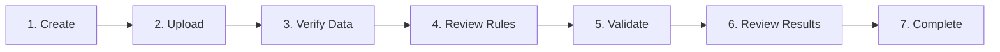

# MVP Final Remediation Stage Package — 2026-07-28

- **Initiative:** FinSight Configurable Rule Engine V2
- **Stage:** Workflow Phase Implementation remediation
- **Package state:** **IMPLEMENTED — INTERNAL AND INDEPENDENT VERIFICATION PASS**
- **Independent review:** **PASS — INITIAL FAIL AND INTERMEDIATE PARTIAL RECHECK PRESERVED; BOTH MAJOR DEFECTS CLOSED**
- **Gate disposition:** **PENDING PROJECT OWNER HANDS-ON ACCEPTANCE**
- **Windows packaging:** Not authorized by this package

## Purpose

This package consolidates the Project Owner's final MVP remediation direction
without rewriting the approved Requirements or Architecture baselines. It defines
the implementation and verification delta needed to bring the integrated MVP into
alignment with the approved financial-review journey and polished desktop visual
direction.

The 2026-07-27 integrated MVP verification and PASS review remain historical
evidence for their frozen snapshot. They do not establish completion of this later
remediation scope.

## Package index

| Artifact | Purpose | State |
|---|---|---|
| [Remediation requirements delta](../requirements/MVP-REMEDIATION-DELTA-2026-07-28.md) | Binding functional and non-functional remediation requirements | Approved scope; implemented and internally verified |
| [Approved financial-review workflow](../docs/FINANCIAL-REVIEW-WORKFLOW.md) | Visible seven-step journey and durable workflow contract | Updated |
| [Remediation architecture delta](../docs/MVP-REMEDIATION-ARCHITECTURE-2026-07-28.md) | Presentation, evidence, rules, analytics, theme, and disposal boundaries | Implemented and internally verified |
| [Remediation implementation plan](../tasks/MVP-FINAL-REMEDIATION-IMPLEMENTATION-PLAN-2026-07-28.md) | Batched work packages, invariants, and exit criteria | Implemented; independent review passed |
| [Synthetic expected-versus-actual matrix](../fixtures/MVP-REMEDIATION-SYNTHETIC-TEST-MATRIX-2026-07-28.md) | Four intentional issues crossed with all five core rules | Automated oracle recorded: 986 scopes = 979 PASS / 5 FAIL / 2 NOT_EVALUATED |
| [Verification record](../verification/MVP-FINAL-REMEDIATION-VERIFICATION-2026-07-28.md) | Implementation, test, screenshot, and accessibility evidence | Internal and independent PASS; hands-on acceptance pending |
| [Exact changed-file inventory](../verification/MVP-FINAL-REMEDIATION-CHANGED-FILES-2026-07-28.md) | Remediation-only runtime, migration, test, script, documentation, and design-evidence inventory | Recorded |
| [Independent review record](../reviews/REVIEW-2026-07-28-mvp-final-remediation.md) | One consolidated independent review and material-defect recheck | Final PASS; initial FAIL and intermediate partial recheck preserved; both defects closed |

## Seven-step workflow baseline

The detailed workflow remains in
[FINANCIAL-REVIEW-WORKFLOW.md](../docs/FINANCIAL-REVIEW-WORKFLOW.md).
The inserted Review Rules step is a presentation and governance refinement; all
financial outcomes still originate from the same versioned deterministic rule
engine and sealed result ledger.

## Traceability summary

| Remediation area | Requirement IDs | Architecture/plan seam | Required verification |
|---|---|---|---|
| Welcome, upload, plain errors | REM-FR-001–004 | Presentation shell and failure presenter | Same-viewport captures and negative upload cases |
| Editable Verify Data | REM-FR-005–006 | Reviewed-copy correction boundary | Edit, revert, audit, restart, and source-hash proof |
| Rules Repository | REM-FR-007–010 | Versioned rule-store projection and governance | Five baseline identities, lifecycle, rerun/revalidation |
| Summary, results, Findings | REM-FR-011, REM-FR-013–014, REM-FR-016 | Structured result/evidence projections | Rule and record drilldowns with source navigation |
| Analytics and coverage | REM-FR-012, REM-FR-015 | Deterministic chart-ready ledger projection | Chart values reconciled to sealed results |
| Review disposal | REM-FR-017 | Two-step governed disposal service | Scope isolation, interruption safety, content-free receipt |
| Appearance and design | REM-FR-018–019, REM-NFR-001–003 | Replaceable theme token service | Light/dark/system, keyboard, focus, zoom, resize captures |
| Ask Fin boundary | REM-FR-020 | Bounded ledger-grounded consumer | Identified run context and no independent determination |
| End-to-end evidence | REM-NFR-004–005 | Consolidated verification/review package | Exact commands, actual outputs, limitations, independent verdict |

## Required gate evidence

Before this package may receive a PASS disposition, the verification owner must:

1. identify the exact source snapshot and files changed;
2. run and record the automated suites and focused negative/boundary tests;
3. execute the synthetic matrix and replace every `[PENDING]` actual value;
4. demonstrate the same key screens in Light and Dark modes and verify System
   Default behavior;
5. record keyboard, focus, accessibility-name, non-color cue, zoom, and resize
   checks;
6. demonstrate edit audit/reversal, structured evidence navigation, deterministic
   chart reconciliation, and review-disposal isolation;
7. record exact launch instructions and honest known limitations; and
8. obtain one independent review, resolving only material defects before a
   bounded recheck.

## Verification progress

The following implementation facts establish the internal verification PASS
without pre-empting the independent review:

- the synthetic reference population is 71 Budget detail records and 258 GED
  transactions;
- the executed protected-rule oracle is 986 scope results: 979 PASS, 5 FAIL,
  and 2 NOT_EVALUATED;
- the screenshot demonstration activates one optional threshold rule and
  therefore shows 1,244 ledger rows (986 protected + 258 optional) while
  retaining the same five protected findings;
- CORE-04 evaluates 329 Budget/GED record scopes (328 PASS / 1 FAIL), while
  CORE-03 evaluates 257 distinct material-field fingerprints (256 PASS /
  1 FAIL);
- the terminal full regression completed with 1,019 passing tests in 68.36
  seconds;
- the final focused accessibility, appearance, and governance UI suite completed
  with 41 passing tests in 15.49 seconds;
- the focused workspace-upgrade seam completed with 50 passing tests in 5.84
  seconds, including context-aware composed-role self-denial, transition-specific
  NFR-090 event schemas, append-only migration guards, request-time Rule Set/run
  binding, stale-approval denial, optional/advisory preservation, and required
  revalidation;
- the independent focused governance re-audit passed 66 tests in 23.21 seconds
  and reconciled exact request/rejection/application schemas, one DENY and zero
  ALLOW records for self-decision, five protected bindings, unchanged history
  and other workspaces, Reviewer revalidation, pure-role UI, and accessibility;
- import-linter kept all 3 contracts and every remediation-touched or newly
  authored Python file passed Ruff;
- `pip check`, compilation of `src`, `tests`, and `scripts`, and
  `git diff --check` passed;
- 48 matching Light and Dark states (96 primary captures) are available at
  1280 × 900, with another 48 + 48 responsive captures at 1180 × 860 and five
  comparison images;
- final focused visual QA passed in Light and Dark; System Default resolved to
  Light headlessly, and live OS-following behavior is covered by automated
  tests; and
- the launcher/restart smoke passed twice against the same persistent temporary
  store.

The following checks are intentionally still open:

- native screen-reader smoke in a hands-on desktop session;
- Project Owner hands-on acceptance; and
- Windows packaging/release, which remains outside this gate.

## Current disposition

The remediation is implemented, internal verification passed, and the bounded
independent recheck passed with both initial Major findings closed. The historical
FAIL and intermediate partial recheck remain in the review record. The Workflow
Phase Implementation gate remains open only for Project Owner hands-on acceptance.
Final Product approval and Windows Packaging and Release remain blocked.
